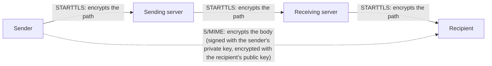

## Introduction

- **What You'll Learn From This Article**: [How STARTTLS works in SMTP](/en/articles/mail-tls-encryption-guide) was a mechanism that encrypts the **communication path** between mail servers. In this article, you'll systematically understand **S/MIME (Secure/Multipurpose Internet Mail Extensions)** — an entirely different layer of mechanism that encrypts **the email body itself**. You'll learn to precisely tell apart which of two entirely different things the phrase "this email is encrypted" is actually referring to.
- **Intended Audience**: Readers who understand STARTTLS's server-to-server encryption, but have never heard the term S/MIME, or can't explain the difference from STARTTLS.
- **Estimated Reading Time**: About 18 minutes

This article is part of the [Top 1% Series Complete Article Guide](/en/sitemap), and article 6.1 in the [Mail Infrastructure Series](/en/sitemap#series-list).

## Prerequisite Knowledge

- [How STARTTLS Works in SMTP](/en/articles/mail-tls-encryption-guide): Understanding this other layer of mechanism — encrypting the communication path — will make the difference between the two clearer.

## Getting the Big Picture

**STARTTLS encrypts the communication path between mail servers. But that's encrypting the "path," not the "body."** **Even when STARTTLS works perfectly, a relaying mail server can read the body, already decrypted by the time it arrives there, in plain sight.** This isn't a defect — it's because STARTTLS was only ever designed as a **server-to-server (hop-by-hop)** mechanism, meant solely to protect server-to-server communication from eavesdropping. **S/MIME is an end-to-end mechanism that uses the sender's private key and the recipient's public key to encrypt the email body itself.** The body stays protected, readable only by the intended recipient, no matter which servers it passes through.

## Deep Dive Into the Fundamentals

### STARTTLS Uses a "Server Certificate," S/MIME Uses an "Email Certificate"

**STARTTLS uses a server certificate, proving the identity of the server you're communicating with.** It's the same kind of certificate used for HTTPS. **S/MIME uses an email certificate (a personal digital certificate) tied to a specific email address.** This certificate is issued by a certificate authority (CA); the sender uses the private key matching this certificate to digitally sign the email, and the recipient becomes able to receive encrypted email by handing a certificate containing their own public key to the sender ahead of time.

### S/MIME Protects What STARTTLS Can't

**Even when STARTTLS works perfectly, the operator of a relaying mail server — your own organization's mail admin, or a cloud email provider — can read the decrypted body in plain sight.** That's because STARTTLS's encryption was only ever meant to protect against an eavesdropper on the communication path itself. **An email encrypted with S/MIME can't be read by anyone but the intended recipient, because the relaying server never holds the key needed to decrypt the body.**

There's Something Neither STARTTLS Nor S/MIME Can Protect

**Even in an email encrypted with S/MIME, some header information — such as the Subject line — stays outside the scope of encryption and gets sent as plaintext.** Protecting that part is the role of STARTTLS's whole-path encryption. **In other words, S/MIME, protecting the body's content, and STARTTLS, protecting the entire communication path including the subject, aren't mutually exclusive choices — combining them covers the range each one can't cover on its own.** Also keep in mind a separate real-world weakness: most STARTTLS implementations don't correctly validate the server certificate, leaving a downgrade-attack risk.

## What a Pro Sees Here (Top 1% Understanding)

### Always Check Which Layer "This Email Is Encrypted" Actually Refers To

**When you hear "this email is encrypted, so it's safe" in real-world practice, whether that refers to STARTTLS's path encryption or S/MIME's body encryption means something entirely different.** **The former never protects the body at all from a relaying mail server's operator. The latter protects the body even from a relaying mail server's operator, but doesn't protect some headers, like the subject.** Rather than feeling reassured by the word "encrypted" alone, making it a habit to always ask concretely **"protected from whom, and protecting what"** is a real-world defense for accurately following a conversation in this field.

## Common Misconceptions and Pitfalls

- **Misconception 1: "If STARTTLS is enabled, no one can ever read the email body."**
  Even when STARTTLS works perfectly, the operator of a relaying mail server can read the decrypted body in plain sight.
- **Misconception 2: "You only need to pick either S/MIME or STARTTLS, not both."**
  The two protect different things (the body, or the entire communication path) — combining them covers the range each one can't cover on its own.
- **Misconception 3: "Encrypting with S/MIME protects everything, including the subject line."**
  Some header information, such as the subject line, stays outside S/MIME's scope of encryption and gets sent as plaintext.

## Troubleshooting Perspective

1. **The recipient can't decrypt an S/MIME-encrypted email**: Check whether the sender received a certificate containing the recipient's public key ahead of time.
2. **You're encrypting with S/MIME, but the content is still guessable from the subject line**: Since the subject is outside S/MIME's scope of encryption, make sure your practice never puts sensitive information in the subject.
3. **STARTTLS is enabled, but a risk of eavesdropping on the content still remains**: Check whether server certificate validation is being performed correctly, and whether countermeasures against downgrade attacks are in place.

## Summary

- STARTTLS is a server-to-server mechanism that encrypts the communication path between mail servers.
- S/MIME is an end-to-end mechanism that uses the sender's private key and the recipient's public key to encrypt the email body itself.
- Even when STARTTLS works perfectly, a relaying mail server's operator can read the decrypted body, but can't read an S/MIME-encrypted body.
- Some headers, like the subject line, stay outside S/MIME's scope of encryption — the two mechanisms complement each other when combined.

**Takeaways to Apply Today**
1. When you hear "this email is encrypted," make it a habit to check which layer it's actually referring to.
2. When sending a genuinely sensitive email, avoid putting anything in the subject line that lets the content be guessed.

## References

- [Technical deep dive: STARTTLS Everywhere | EFF](https://www.eff.org/deeplinks/2018/06/technical-deep-dive-starttls-everywhere)
- [Email encryption | Wikipedia](https://en.wikipedia.org/wiki/Email_encryption)
