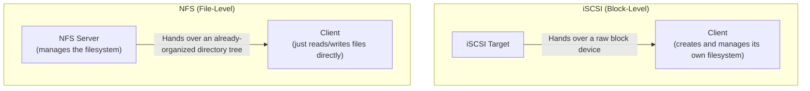

## Introduction

- **What You'll Learn From This Article**: [How iSCSI works](/en/articles/iscsi-guide) was **block-level** storage, implementing SCSI commands over an IP network. In this article, you'll systematically understand **NFS (Network File System)**, which operates at an entirely different layer: **file-level** storage.
- **Intended Audience**: Readers who understand block-level storage via iSCSI or FC, but can't explain the difference from NFS, a file-level storage system.
- **Estimated Reading Time**: About 19 minutes

This article is part of the [Top 1% Series Complete Article Guide](/en/sitemap), and article 7.2 in the [Storage Fundamentals Series](/en/sitemap#series-list).

## Prerequisite Knowledge

- [How iSCSI Works](/en/articles/iscsi-guide): Understanding this other layer — block-level storage.

## Getting the Big Picture

**iSCSI hands "the disk itself" (a block device) over to the client. The client side bears the responsibility of creating and managing its own filesystem on that block device it received.** **NFS (Network File System) operates at an entirely different layer. The NFS server itself already manages the filesystem, and the client just receives an already-organized directory tree (files and folders) as-is** — nothing more needed.

## Deep Dive Into the Fundamentals

### How Safe Concurrent Access Is, for Multiple Clients, Differs Fundamentally

**NFS naturally supports multiple clients mounting and reading/writing the same directory at the same time, through a protocol-level locking mechanism.** **With iSCSI, if multiple clients access the same LUN (block device) concurrently without coordination, data corruption becomes a real risk, unless you're using a cluster-aware filesystem.** This difference directly decides which mechanism you should choose, whenever you have a requirement for "multiple servers accessing the same data at the same time."

### The Evolution From NFSv3 to NFSv4: Stateless to Stateful

**NFSv3's protocol itself was stateless, and file locking was handled by a separate ancillary protocol called NLM.** This setup required multiple ancillary services — mountd, NLM, NSM — each using its own port, making operation across a firewall difficult, and carrying a stale-lock problem during failover, where old lock information lingered. **NFSv4 integrated the locking mechanism into the protocol itself, becoming a stateful design.** This means **communication consolidates onto just one single TCP port, 2049**, making operation across a firewall dramatically easier.

NFSv4 Also Supports Kerberos Encryption Natively

**NFSv4 natively supports Kerberos authentication and encryption** (using it is optional). **Since all communication is consolidated onto that one port, 2049, enabling Kerberos encrypts NFS's entire traffic, including mount operations and lock information.** This was a design that was difficult to achieve under NFSv3's older setup, with its ancillary protocols scattered across multiple ports.

## What a Pro Sees Here (Top 1% Understanding)

### "Block or File" Is a Question of Fit for the Requirement, Not Technical Superiority

**iSCSI and NFS aren't in a simple relationship of one being superior to the other.** **Whether you want "to decide for yourself which filesystem to use on the client side," or "to safely access the same data concurrently from multiple clients" — this difference in the requirement itself decides which one you should pick.** Understanding that behind the single word "storage," entirely different abstraction layers — block-level and file-level — exist, lets you make storage technology choices based on requirements, not mere preference.

## Common Misconceptions and Pitfalls

- **Misconception 1: "NFS and iSCSI are similar technologies, operating at the same layer."**
  iSCSI operates at the block level and NFS at the file level — entirely different layers, and separate technologies.
- **Misconception 2: "Multiple clients can safely access an iSCSI LUN concurrently."**
  Unless you're using a cluster-aware filesystem, concurrent access by multiple clients carries a real risk of data corruption.
- **Misconception 3: "NFSv3 and NFSv4 have no major difference beyond the port number."**
  NFSv4 integrated the locking mechanism into the protocol itself, changing the design itself from stateless to stateful.

## Troubleshooting Perspective

1. **Data got corrupted after multiple clients accessed the same iSCSI LUN**: Check whether you were using a cluster-aware filesystem, or whether a file-level mechanism like NFS should have been used instead.
2. **NFSv3 isn't working well across a firewall**: Check the port-opening configuration for ancillary services like mountd, NLM, and NSM, or consider migrating to NFSv4.
3. **After a failover, an old lock lingers and a file won't open**: Check for NFSv3's stale-lock problem, and consider migrating to NFSv4.

## Summary

- iSCSI is block-level storage, handing over the disk itself (a block device).
- NFS is file-level storage, handing over an already-organized directory tree.
- Concurrent access to the same iSCSI LUN by multiple clients is risky, while NFS naturally supports it.
- NFSv4 integrates locking into the protocol, consolidating onto port 2049 and natively supporting Kerberos.

**Takeaways to Apply Today**
1. When you have a requirement for multiple clients to safely access the same data concurrently, consider a file-level mechanism like NFS.
2. When newly deploying NFS, choose NFSv4 over NFSv3.

## References

- [iSCSI vs NFS: Performance, Security & When to Use Each | MyWorkDrive](https://go.myworkdrive.com/blog/iscsi-vs-nfs)
- [Deciding Between NFSv3 or NFSv4.x | NetApp](https://community.netapp.com/community/discussion/465963/deciding-between-nfsv3-or-nfsv4-x-the-choice-is-getting-clearer)
