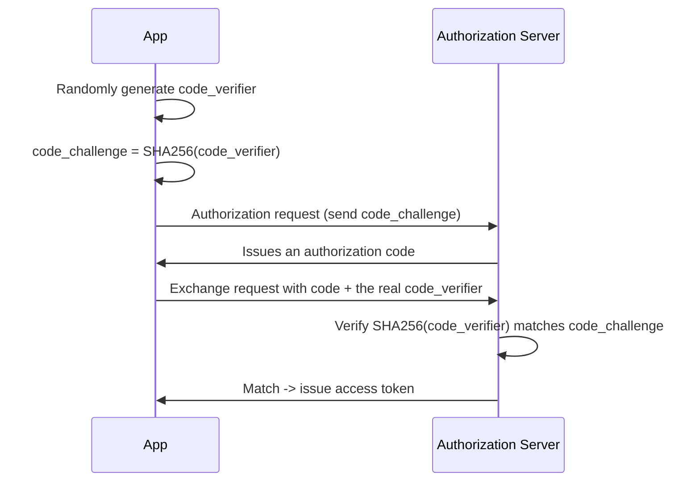

## Introduction

- **What You'll Learn From This Article**: The client secret covered in [How OAuth 2.0 Works](/en/articles/oauth2-guide) was a password-like secret known only to the app's own server side. In this article, you'll systematically understand **PKCE** (Proof Key for Code Exchange) — how a mobile app or SPA, with no server side of its own, prevents authorization code abuse without a client secret at all.
- **Intended Audience**: Readers who understand OAuth 2.0's authorization code flow and the client secret's role, but can't explain what PKCE actually solves.
- **Estimated Reading Time**: About 18 minutes

This article is part of the [Top 1% Series Complete Article Guide](/en/sitemap), and article 4.1 in the [Web/API Series](/en/sitemap#series-list).

## Prerequisite Knowledge

- [How OAuth 2.0 Works](/en/articles/oauth2-guide): Understanding the authorization code flow and the client secret's role.

## Getting the Big Picture

**A client secret was a password-like proof, presented by revealing a secret known only to the app's own server side, that "whoever is trying to use this authorization code really is the legitimate app the user authorized."** **But mobile apps and SPAs have no "server side" at all to begin with — no place where a secret can be safely kept.** Even embedding a secret inside the app's binary or JavaScript code gets it trivially extracted through reverse engineering. **An app that can't safely hold a client secret like this is called a "public client," and PKCE is an OAuth 2.0 extension (RFC 7636) built for exactly this public-client case — preventing authorization code interception attacks without any client secret at all.**

## Deep Dive Into the Fundamentals

### Authorization Code Interception: a Malicious App on the Same Device Steals the Code

**On mobile OSes, multiple apps can sometimes register the exact same custom URL scheme for a redirect.** **If a malicious app has registered the same redirect URL as the legitimate one, it can potentially intercept the authorization code returned by the authorization server before the legitimate app ever sees it.** **For a public client with no client secret at all, having just the intercepted authorization code is enough for the attacker to directly send a token exchange request.**

### How PKCE Works: a Pair of Two Values, code_verifier and code_challenge

**Before sending the authorization request, the app generates a `code_verifier` — a high-entropy random string — as a secret known only to itself.** **It then sends only `code_challenge`, the SHA-256 hash of that `code_verifier`, in the initial authorization request.** **When exchanging the authorization code, it sends the original, unhashed `code_verifier` itself, and the authorization server hashes the received `code_verifier` on its own side and checks whether it matches the `code_challenge` it received earlier.**

Even an Intercepted Authorization Code Makes an Exchange Fail, With PKCE

**Even if an attacker intercepts the authorization code itself, the `code_verifier` exists only inside the legitimate app's own memory and never travels over the network at all.** **If the attacker sends an exchange request with only the intercepted authorization code, lacking the correct `code_verifier`, the hash never matches, and the authorization server rejects it.**

### Under OAuth 2.1, PKCE Becomes Mandatory for Every Client

**PKCE was originally an extension built for public clients, but under OAuth 2.1 — the effort to consolidate and clean up the OAuth 2.0 specification — PKCE is now mandatory for every client, including confidential, server-side apps that do hold a client secret.** **This reflects a shift toward applying PKCE's layered defense to every client, instead of relying on a single defense — the client secret — alone.**

## What a Pro Sees Here (Top 1% Understanding)

### Carry the Premise That What Needs Protecting, and How, Changes by Client Type

**An app with a server side, and an app without one, have fundamentally different kinds of secrets they can safely keep.** **The habit of re-asking, every time you design an authentication/authorization mechanism, "can this particular client genuinely keep a secret safe"** is the perspective a top-1% engineer uses to avoid the failure of unconditionally applying a single defense mechanism like a client secret.

## Common Misconceptions and Pitfalls

- **Misconception 1: "Mobile apps and SPAs can safely use a client secret too."**
  A secret embedded in an app's binary or JavaScript code gets trivially extracted through reverse engineering, so it can never be held safely there.
- **Misconception 2: "PKCE just replaces the client secret with a different, fixed secret."**
  PKCE uses a `code_verifier` randomly generated fresh for every single request, neutralizing the authorization code interception attack itself.
- **Misconception 3: "PKCE is a specialized mechanism only public clients should use."**
  Under OAuth 2.1, PKCE is mandatory for every client, including confidential clients that hold a client secret.

## Troubleshooting Perspective

1. **An error like "invalid_grant" occurs when exchanging the authorization code**: Check whether `code_verifier` exactly matches the value the `code_challenge` sent in the initial authorization request was derived from.
2. **You're concerned about authorization code interception on a mobile app**: Consider using an OS-level protected redirect mechanism (Android App Links or iOS Universal Links) instead of a custom URL scheme.
3. **You're unsure whether to add PKCE to an existing server-side app**: Consider adopting it as layered defense alongside the client secret, given OAuth 2.1's direction.

## Summary

- A mobile app or SPA that can't safely hold a client secret is called a public client.
- PKCE is an OAuth 2.0 extension that uses a `code_verifier`/`code_challenge` hash pair to prevent authorization code interception without any client secret.
- Even if an attacker intercepts the authorization code, an exchange request gets rejected by the authorization server without the `code_verifier` only the legitimate app holds.
- Under OAuth 2.1, PKCE is mandatory for every client, not just public clients.

**Takeaways to Apply Today**
1. When designing a new authentication/authorization mechanism, always re-ask yourself whether this particular client can genuinely keep a secret safe.
2. When implementing OAuth 2.0 in a mobile app or SPA, treat PKCE not as something optional to skip, but as something to implement correctly.

## References

- [OAuth Proof Key for Code Exchange (PKCE) | Gravitee](https://documentation.gravitee.io/am/guides/auth-protocols/oauth-2.0/proof-key-for-code-exchange-pkce)
- [OAuth2 and PKCE: Enhancing Security for Public Clients | DEV Community](https://dev.to/igventurelli/oauth2-and-pkce-enhancing-security-for-public-clients-3bo)
