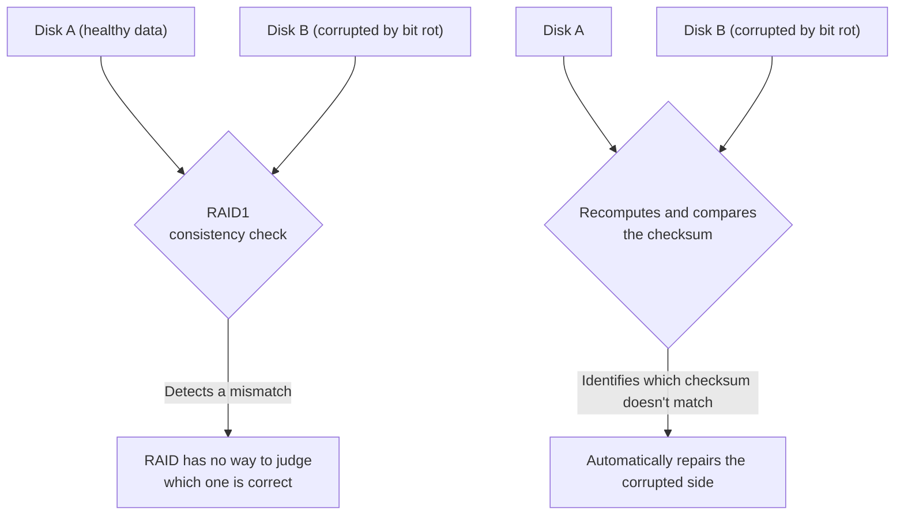

## Introduction

- **What You'll Learn From This Article**: [How RAID5 and RAID6 parity calculation works](/en/articles/raid5-parity-guide) and [the hands-on building RAID1 with mdadm](/en/articles/mdadm-raid-handson-guide) taught you **a mechanism for recovering data once a disk fully fails.** In this article, you'll systematically understand **bit rot (silent data corruption)** — a phenomenon where a disk, without ever reporting a failure, quietly returns data off by just one bit — and how ZFS and Btrfs use a mechanism called a **checksum** to automatically recover from it.
- **Intended Audience**: Readers who understand RAID1 and RAID5's defenses against disk failure, but believe "I have RAID set up, so data corruption absolutely cannot happen."
- **Estimated Reading Time**: About 18 minutes

This article is part of the [Top 1% Series Complete Article Guide](/en/sitemap), and article 6.1 in the [Storage Fundamentals Series](/en/sitemap#series-list).

## Prerequisite Knowledge

- [How RAID5 and RAID6 Parity Calculation Works](/en/articles/raid5-parity-guide): Understanding this other kind of failure defense — recovering data via parity.

## Getting the Big Picture

**What traditional RAID (RAID1's mirroring, or RAID5/6's parity) can handle is a disk that fully fails and reports a read error.** But **a disk can also quietly — silently — return data that's off by just one bit, with no error reported at all.** This is **bit rot.** **A RAID controller can detect that two mirrored copies disagree, but it has no means at all, to begin with, of judging which one holds the correct data.**

## Deep Dive Into the Fundamentals

### A Checksum Is Stored Independently, Separate From the Data Itself

**A filesystem like ZFS stores, for each data block, a checksum calculated from that data's content, in a location separate from the data itself** (in ZFS's case, the parent block pointer). **Every time data is read, it recomputes the checksum from the content and compares it against the stored checksum.** If they don't match, it can confidently conclude "this copy is corrupted," recover the correct data from the other mirror or from parity, and automatically overwrite and repair the corrupted side.

### Scrubbing: an Active, Whole-Pool Inspection

**A "scrub" is a process that periodically reads the entire storage pool's data — including parity blocks, which normally never get read — and verifies every checksum.** This creates a chance to discover and repair bit rot that's been quietly progressing, before the disk actually fails. **As long as enough redundancy (mirrors or parity) remains, a scrub repairs corruption automatically — but if it detects corruption where redundancy is insufficient, ZFS reports it as an error rather than returning the corrupted data as-is.**

A Mismatch in Traditional RAID's Mirror Often Just Gets "Overwritten From One Side"

**In traditional RAID1 with no checksum (mdadm, or most hardware RAID), detecting a mirror mismatch during a consistency check commonly leads to a behavior where, with no means of judging which side is correct, one side simply overwrites the other.** **If that overwrite happens to use the corrupted side's content to overwrite the healthy side, the corruption can actually spread** — a counterintuitive outcome. This is the decisive difference from a filesystem with checksums.

## What a Pro Sees Here (Top 1% Understanding)

### "Having RAID" and "Data Integrity Being Guaranteed" Are Different Layers of the Question Entirely

**The idea "I have RAID set up, so my data is safe" only ever addresses one kind of failure: a disk fully failing.** **Handling the other kind of failure, bit rot, requires a mechanism at an entirely different layer from RAID itself: checksums and scrubbing.** When discussing reliability, **separating "which kind of failure" from "what's actually protecting against it," layer by layer,** is the perspective a top-1% engineer carries.

## Common Misconceptions and Pitfalls

- **Misconception 1: "With RAID set up, data corruption absolutely cannot happen."**
  Traditional RAID handles a disk fully failing, but it can't handle silent data corruption (bit rot) that never reports an error.
- **Misconception 2: "A RAID1 mirror mismatch always gets correctly repaired."**
  Traditional RAID1 with no checksum has no means of judging which side is correct, and can sometimes overwrite the healthy side with the corrupted one.
- **Misconception 3: "Checksums and RAID are competing technologies serving the same purpose."**
  The two handle different kinds of failure — only combining RAID (redundancy) with checksums (corruption detection) lets you automatically recover from bit rot at all.

## Troubleshooting Perspective

1. **Disks are all healthy, but one specific file occasionally comes out corrupted**: Consider the possibility of bit rot, and consider migrating to a filesystem with checksumming (ZFS or Btrfs).
2. **A RAID1 consistency check reports a mirror mismatch warning**: Assume you can't judge which disk holds the correct data without a checksum, and also consider recovering from a backup.
3. **A ZFS scrub reports an error**: Redundancy may be insufficient — prioritize checking the state of the affected disk.

## Summary

- Bit rot is a phenomenon where a disk quietly returns data off by just one bit, with no error ever reported.
- Traditional RAID handles a disk fully failing, but is powerless against bit rot.
- ZFS and Btrfs use a checksum, stored separately from the data, to determine which copy is corrupted and automatically repair it.
- Scrubbing, a periodic inspection, creates a chance to discover quiet corruption before an actual disk failure.

**Takeaways to Apply Today**
1. When you hear "it's safe because we have RAID," check which kind of failure that safety actually covers.
2. If data integrity genuinely matters to you, consider adopting a filesystem with checksumming.

## References

- [ZFS mirror vs traditional HW RAID 1 | TrueNAS Community](https://www.truenas.com/community/threads/zfs-mirror-vs-traditional-hw-raid-1.40966/)
- [ZFS silent data corruption | Netdata](https://www.netdata.cloud/guides/zfs/zfs-silent-data-corruption/)
