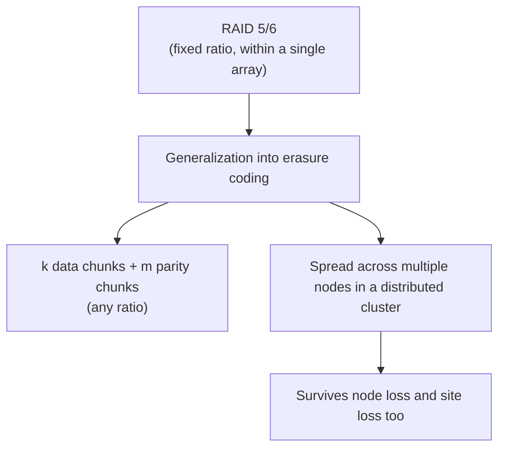

## Introduction

- **What You'll Learn From This Article**: The idea of fault tolerance via parity, covered in [How RAID 5 and RAID 6's Parity Calculation Works](/en/articles/raid5-parity-guide), gets generalized here into **erasure coding** — a mechanism spreading data across multiple nodes at a far freer ratio. You'll systematically understand how that generalization works.
- **Intended Audience**: Readers who understand RAID 5/6's parity mechanics, but can't explain exactly what makes erasure coding different.
- **Estimated Reading Time**: About 18 minutes

This article is part of the [Top 1% Series Complete Article Guide](/en/sitemap), and article 6.2 in the [Storage Series](/en/sitemap#series-list).

## Prerequisite Knowledge

- [How RAID 5 and RAID 6's Parity Calculation Works](/en/articles/raid5-parity-guide): Understanding the basic mechanism of recovering data from a disk failure via parity is a prerequisite.

## Getting the Big Picture

**RAID 5 tolerates one disk failure with one parity, and RAID 6 tolerates two disk failures with two parities — a fixed ratio.** **Erasure coding generalizes this "data-to-parity ratio" into any ratio at all, expressed as k data chunks to m parity chunks.** **In a configuration like RS(10,4), for example, you can lose any 4 out of the 14 total chunks (10 data chunks plus 4 parity chunks) and still recover the original data.** **And where RAID stayed entirely contained within a single disk array, erasure coding typically spreads its chunks across multiple nodes in a distributed cluster.**

## Deep Dive Into the Fundamentals

### Why Erasure Coding Is More Capacity-Efficient Than Replication

**Simple triple replication, copying the same data to three nodes, needs 3x the original data's capacity to survive two failures.** **An erasure-coded configuration with equivalent durability often needs only about 1.4x to 1.6x the original data's capacity** — one reason erasure coding is widely adopted in cloud object storage, like S3-style storage.

### Reed-Solomon Code: the Most Widely Used Erasure Coding Algorithm

**Reed-Solomon code is the most widely used algorithm for implementing erasure coding.** **Ceph's default erasure plugin also uses this Reed-Solomon code.** **Object storage systems like MinIO apply erasure coding per object, which fits well with how an object gets treated as immutable data — written once, then read-only afterward.**

The Trade-off: Slower Recovery (Rebuild) and Higher CPU Load

**While erasure coding excels at capacity efficiency, recovering from a failure (rebuilding) requires far more computation (mathematical decoding) than a simple copy operation under replication, or a simple RAID rebuild, making it slower and more CPU-intensive.** **That's exactly why replication still often gets chosen for latency-sensitive workloads.**

## What a Pro Sees Here (Top 1% Understanding)

### RAID's "Fixed Ratio" Constraint Was Never a Fundamental One

**RAID 5 and RAID 6's fixed parity ratio was designed within the physical constraint of a single disk array, and that fixed-ratio constraint itself turns out not to be fundamental at all under erasure coding, a more generalized framework.** **The habit of digging one layer deeper to ask whether a mechanism's "seemingly obvious constraint" is genuinely fundamental, or merely an accident of the specific context that mechanism was born in** is the perspective a top-1% engineer carries.

## Common Misconceptions and Pitfalls

- **Misconception 1: "Erasure coding is an entirely separate technology from RAID 5/6."**
  Erasure coding is a generalization of RAID 5/6's parity idea, into a freer ratio spread across multiple nodes.
- **Misconception 2: "Erasure coding is always superior to replication."**
  Erasure coding excels at capacity efficiency, but its recovery is slower and more CPU-intensive, so replication still gets chosen for latency-sensitive workloads.
- **Misconception 3: "RAID can also be spread across multiple servers."**
  RAID stays entirely contained within a single disk array — spreading across multiple nodes is a defining characteristic of erasure coding.

## Troubleshooting Perspective

1. **You want to improve an object store's capacity efficiency**: Consider switching from replication to erasure coding.
2. **Recovery feels slow after adopting erasure coding**: This is an expected trade-off — check whether CPU-intensive decoding is genuinely what's happening.
3. **You're unsure which to adopt for a latency-sensitive workload**: Prioritize replication if recovery speed and CPU load matter most, or consider erasure coding if capacity efficiency matters most.

## Summary

- Erasure coding generalizes RAID 5/6's parity idea into any ratio of k data chunks to m parity chunks.
- Where RAID stays entirely contained within a single disk array, erasure coding spreads chunks across multiple nodes in a distributed cluster.
- Reed-Solomon code is the most widely used algorithm for implementing erasure coding.
- Erasure coding excels at capacity efficiency, but carries the trade-off of slower recovery and higher CPU load.

**Takeaways to Apply Today**
1. When considering a storage redundancy scheme, clearly decide whether capacity efficiency or recovery speed matters more for your case.
2. Dig one layer deeper on whether a mechanism's constraint is genuinely fundamental, or just an accident of its specific context.

## References

- [Object Storage Erasure Coding vs. Block Storage RAID | MinIO](https://www.min.io/blog/erasure-coding-vs-raid)
- [A Guide to RAID Pt. 4: RAID vs Erasure Coding, What's the Difference? | Xinnor](https://xinnor.io/blog/a-guide-to-raid-pt-4-raid-vs-erasure-coding-whats-the-difference/)
