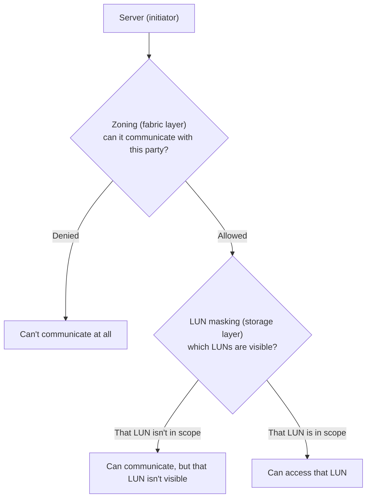

## Introduction

- **What You'll Learn From This Article**: Beyond zoning, covered in [Understanding the Difference Between FC Cabling and LAN Cabling](/en/articles/fc-san-fundamentals-guide), you'll systematically understand **LUN masking** — another, entirely independent access control mechanism.
- **Intended Audience**: Readers who understand zoning, but assume zoning alone fully handles SAN access control.
- **Estimated Reading Time**: About 16 minutes

This article is part of the [Top 1% Series Complete Article Guide](/en/sitemap), and article 2.1 in the [Storage Fundamentals Series](/en/sitemap#series-list).

## Prerequisite Knowledge

- [Understanding the Difference Between FC Cabling and LAN Cabling](/en/articles/fc-san-fundamentals-guide): Understanding the concepts of zoning, WWN, and the fabric is a prerequisite.

## Getting the Big Picture

**Zoning operates at the FC switch (fabric) level, restricting "which initiator (server) can communicate with which target (storage device port)."** **LUN masking operates in an entirely different place — the storage device itself (or the host-side adapter) — restricting "which LUNs get shown, even among the parties already allowed to communicate."** **Thinking of zoning as "permission to enter the hallway" and LUN masking as "the lock on an individual room door further down that hallway" makes it easier to understand these as two entirely separate checkpoints.**

## Deep Dive Into the Fundamentals

### Passing Zoning Doesn't Mean Every LUN Is Visible

**Even once zoning lets a server communicate with a storage device's port, that doesn't mean every LUN that storage device exposes becomes visible to that server.** **LUN masking is used in an environment where multiple servers share the same storage port, showing each server only "the LUNs assigned to it" while hiding the LUNs meant for other servers.** **Neither mechanism alone is sufficient — in real-world practice, combining both zoning and LUN masking is the standard approach.**

### Where It's Implemented Varies by Vendor and Configuration

**LUN masking is generally implemented on the storage controller side (or the host adapter side), but some FC switches support LUN-level zoning, letting the switch perform a control equivalent to LUN masking.** **Because of this, you should know that in real-world practice, the terms "LUN masking" and "zoning" sometimes get used somewhat interchangeably.**

Note: the difference in resistance to WWN spoofing

**WWN-based zoning carries the risk that the WWN identifier itself can be spoofed.** **LUN masking also ultimately judges based on a WWN or initiator ID, so it isn't a fundamental defense against this kind of spoofing either — it needs to be combined with separate measures, like physical security or port-based zoning.**

## What a Pro Sees Here (Top 1% Understanding)

### "Can Communicate" and "Is Visible" Are Different Layers

**Zoning and LUN masking both look like they serve the same purpose — "access control" — but zoning controls reachability at the fabric layer, while LUN masking controls visibility at the storage layer, entirely different layers.** **When you hit "storage isn't visible from this server," never settle for checking zoning alone — always check one layer further: "zoning passes, but is LUN masking restricting it further?"** This is the perspective a top-1% engineer carries.

## Common Misconceptions and Pitfalls

- **Misconception 1: "Setting up zoning correctly handles access control completely on its own."**
  Zoning only controls communication reachability; LUN masking, which individually restricts which LUNs are visible, is a separate mechanism. Both need to be combined.
- **Misconception 2: "LUN masking is always configured on the storage device side."**
  Since some FC switches can perform LUN-level zoning equivalent to LUN masking, where it gets implemented varies by vendor and configuration.
- **Misconception 3: "Setting up WWN-based zoning and LUN masking makes defense against impersonation perfect."**
  Both ultimately judge based on a WWN or initiator ID, so neither is a fundamental defense against WWN spoofing.

## Troubleshooting Perspective

1. **Zoning should be configured correctly, but a specific LUN still isn't visible from the server**: Check whether that server's WWN (or initiator ID) is included in the scope of that storage device's LUN masking configuration for the target LUN.
2. **Multiple servers share the same storage port, and an unintended LUN becomes visible**: Suspect a gap in the LUN masking configuration and re-verify the list of LUNs each server should be assigned.
3. **You can't decide whether to control this with zoning or LUN masking**: Judge based on the division of roles — broad fabric-wide control belongs to zoning, while the specific mapping between an individual server and LUN belongs to LUN masking.

## Summary

- Zoning controls reachability at the fabric layer; LUN masking controls visibility at the storage layer — two separate mechanisms.
- Even after passing zoning, LUN masking further restricts LUN visibility.
- In real-world practice, combining both is the standard approach.
- Where it's implemented varies by vendor and configuration.

**Takeaways to Apply Today**
1. For a "storage isn't visible" issue, check both zoning and LUN masking separately.
2. When designing a SAN environment, keep the division of roles between zoning and LUN masking clear.

## References

- [LUN Masking vs Zoning | theITHollow](https://theithollow.com/2012/03/12/lun-masking-vs-zoning/)
- [What Is LUN Masking? | ITU Online IT Training](https://ituonline.com/tech-definitions/what-is-lun-masking)
