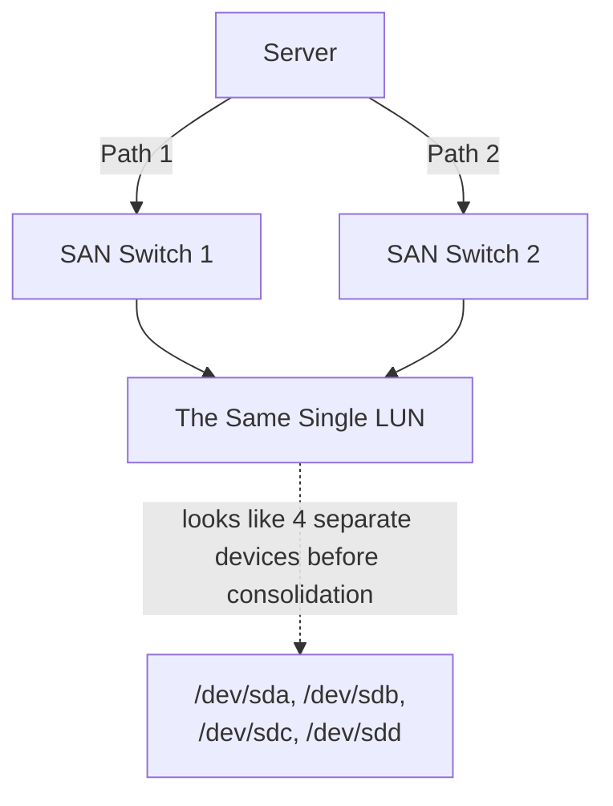

## Introduction

- **What You'll Learn From This Article**: Connecting to a LUN in a SAN environment, as covered in [how iSCSI works](/en/articles/iscsi-guide) and [the difference between FC cabling and LAN cabling](/en/articles/fc-san-fundamentals-guide), in real-world practice goes through multiple physical paths, for redundancy. But **without doing anything about it, a strange phenomenon occurs: the server's OS ends up seeing what should be a single LUN as several entirely separate disks.** This article systematically covers how **Multipath I/O (MPIO)** uses a unique identifier shared across all of them, called a **WWID**, to recognize "these are actually just different paths to the same LUN," and consolidate them into one logical device.
- **Intended Audience**: Readers who understand the basics of iSCSI and FC connectivity, but have hit the phenomenon of several unfamiliar disks of the same capacity showing up in a redundant environment, without being able to explain what's actually happening.
- **Estimated Reading Time**: About 17 minutes

This article is part of the [Top 1% Series Complete Article Guide](/en/sitemap), and article 7.1 in the [Storage Fundamentals Series](/en/sitemap#series-list).

## Prerequisite Knowledge

- [How iSCSI Works](/en/articles/iscsi-guide): The basic premise that a server connects to a LUN on a SAN over a network.
- [The Difference Between FC Cabling and LAN Cabling](/en/articles/fc-san-fundamentals-guide): The premise that redundant connection paths exist in an FC-SAN environment.

## Getting the Big Picture

**To raise availability, a SAN environment commonly prepares multiple physical paths between one server and one storage array.** For example, with two HBAs (Host Bus Adapters) on the server side, routed through two SAN switches, you can reach the same LUN through four entirely independent paths. **But without doing anything about it, the OS recognizes each of these four paths as a completely separate disk.** `/dev/sda`, `/dev/sdb`, `/dev/sdc`, `/dev/sdd` look like four different disks, but they're actually nothing more than four different entry points into just one single LUN.

## Deep Dive Into the Fundamentals

### WWID: a Unique Identifier Proving It's the Same LUN

**The key to resolving this problem is the WWID (World Wide Identifier).** A WWID is a unique, persistent identifier that the storage array itself assigns to each individual LUN — **the exact same WWID gets returned for the same LUN, regardless of which path you access it through.** **Multipath I/O (MPIO) software** (`device-mapper-multipath` on Linux, the standard MPIO feature on Windows) checks the WWID of every block device the OS recognizes, and **re-consolidates multiple devices sharing the same WWID into a single logical multipath device.** On Linux, this shows up as a new device name, something like `/dev/mapper/mpathX`. **The standard real-world practice is for applications and filesystems to use this consolidated multipath device, never the individual `/dev/sdX` names directly** — a name like `/dev/sdX` can stop matching up consistently, since the enumeration order can change across an OS reboot.

RAID and Multipathing Consolidate in Exactly Opposite Directions

RAID, as covered in [the hands-on building RAID1 with mdadm](/en/articles/mdadm-raid-handson-guide), is a mechanism that **consolidates multiple, physically separate disks into one logical disk.** Multipath I/O, by contrast, consolidates **not the disks themselves, but multiple paths for reaching one single, same disk (LUN).** **The surface-level operation ("consolidating many into one") looks similar, but what's actually being consolidated is entirely different** — a distinction worth keeping clearly in mind.

### Two Functions Multipath I/O Provides: Failover and Load Balancing

Multipath I/O broadly serves two roles. **Failover** automatically switches I/O over to a surviving, healthy path, if the path currently in use fails (a cable disconnection, an HBA failure, a switch outage, and so on). **Load balancing** actively uses multiple paths at the same time, distributing I/O across them, achieving higher throughput than using just a single path alone. **There's an active/active mode, using every path simultaneously, and an active/passive mode, normally using just one path while the rest stand by — which one is appropriate depends on what the storage array itself supports.**

## What a Pro Sees Here (Top 1% Understanding)

### "Several Unfamiliar Disks of the Same Capacity Showing Up" Is a Classic Symptom of Unconfigured Multipathing

Here's a scenario you'll often run into in real-world work: **you open `lsblk` or Disk Management on a server newly connected to a SAN, and disks of exactly the same capacity show up two, four times over.** **Seeing this, it's easy to misread it as "something went wrong on the storage side, mapping the same LUN multiple times" — but in most cases, the cause isn't on the storage side at all. It's that Multipath I/O software on the server side is either unconfigured, or not working correctly.** Once you configure the multipath software correctly, **these multiple devices get consolidated into a single multipath device, and the visible count correctly drops back down to one.** When you hit this phenomenon, what you should suspect first is the server-side multipath configuration, not the storage side's settings.

## Common Misconceptions and Pitfalls

- **Misconception 1: "Disks of the same capacity showing up multiple times is a storage-side misconfiguration."**
  In most cases, the cause is unconfigured Multipath I/O software on the server side — the LUN mapping on the storage side itself is usually correct.
- **Misconception 2: "Multipath I/O is a mechanism that consolidates multiple physical disks into one, just like RAID."**
  What Multipath I/O consolidates is multiple paths for reaching one single, same LUN — not multiple, physically separate disks.
- **Misconception 3: "Using individual device names like `/dev/sda` directly makes no difference from using the multipath device."**
  An individual `/dev/sdX` name can stop matching up consistently across an OS reboot, since the enumeration order can change — applications and filesystems should use the consolidated multipath device instead.

## Troubleshooting Perspective

1. **A newly connected SAN LUN shows up as multiple disks of the same capacity**: Check whether Multipath I/O software (`multipathd` on Linux, the MPIO feature on Windows) is installed and enabled.
2. **I/O keeps going even though a failure occurred on one path**: This is proof failover is working correctly — check which path is down using a multipath status command (like `multipath -ll`).
3. **You're not getting the expected throughput**: Check whether the load-balancing mode (active/active or active/passive) matches what the storage array actually supports.

## Summary

- A SAN environment commonly prepares multiple physical paths for redundancy, but without doing anything about it, the OS recognizes each path as a separate disk.
- A WWID is a unique identifier the storage array assigns to each individual LUN, returning the same value for that LUN regardless of the path used.
- Multipath I/O software consolidates multiple devices sharing the same WWID into a single logical multipath device.
- Multipath I/O provides two functions: failover (switching paths on failure) and load balancing (distributing across multiple paths).

**Takeaways to Apply Today**
1. When you hit disks of the same capacity showing up multiple times, check the server-side Multipath I/O configuration first.
2. When using a LUN on a SAN, use the consolidated multipath device, not individual `/dev/sdX` names.

## References

- [Configuring device mapper multipath | Red Hat Documentation](https://docs.redhat.com/en/documentation/red_hat_enterprise_linux/8/html-single/configuring_device_mapper_multipath/index)
- [Managing multipath I/O for devices | SUSE Documentation](https://documentation.suse.com/sles/15-SP7/html/SLES-all/cha-multipath.html)
