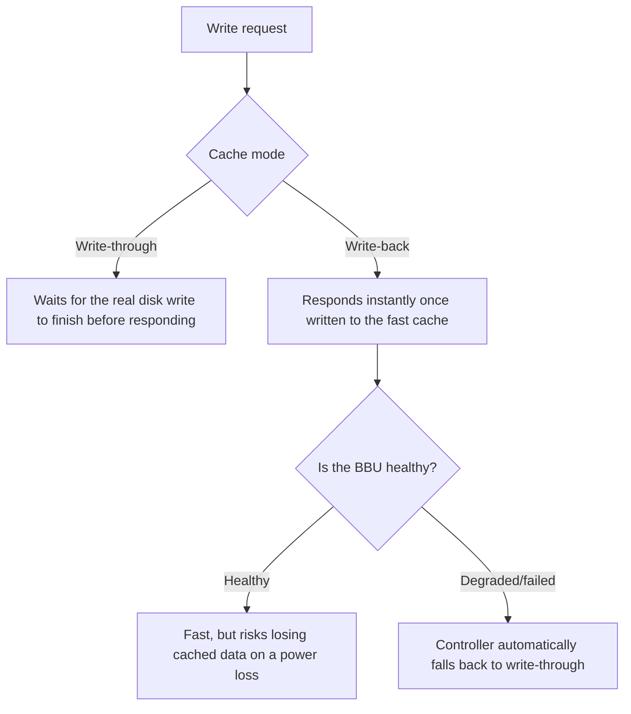

## Introduction

- **What You'll Learn From This Article**: Beyond recovering from a disk failure, covered in [How RAID 5 and RAID 6's Parity Calculation Works](/en/articles/raid5-parity-guide), you'll systematically understand a separate axis — **when a single write actually counts as "complete"** — through write-back and write-through, a RAID controller's caching strategy.
- **Intended Audience**: Readers who've seen "Write-Back" or "Write-Through" in a RAID controller's settings screen, but can't explain the difference, or its relationship to the battery.
- **Estimated Reading Time**: About 18 minutes

This article is part of the [Top 1% Series Complete Article Guide](/en/sitemap), and article 6.3 in the [Storage Series](/en/sitemap#series-list).

## Prerequisite Knowledge

- [How RAID 5 and RAID 6's Parity Calculation Works](/en/articles/raid5-parity-guide): A basic understanding of a RAID controller's role is a prerequisite.

## Getting the Big Picture

**Write-through never returns a "write complete" response to the host until the write actually finishes on disk — safe, but slow.** **Write-back responds "write complete" the instant data lands in the RAID controller's own fast cache (DRAM) — fast, but it carries the risk of losing that data if power drops while it's still sitting in cache, not yet flushed to disk.** **And worse, this data loss happens with the host application never noticing at all** — because the host already received that "complete" response.

## Deep Dive Into the Fundamentals

### The BBU (Battery Backup Unit): Protects the Cache, but Its Charge Has a Limit

**To address write-back's risk, many RAID controllers include a battery called a BBU (Battery Backup Unit), keeping the cache's DRAM powered during an outage, so its contents can get flushed to disk once power returns.** **But a BBU's charge has a limit — typically protecting the cache for only about 24 to 48 hours — and if power isn't restored within that window, the data gets lost anyway.**

### The Controller's Automatic Fallback: Detecting a Weakening Battery Quietly Switches It to Write-Through

**Many RAID controllers, on detecting a degraded or failed BBU, automatically switch from write-back to write-through, with no action from an administrator at all.** **This is a typical cause behind the seemingly unexplainable symptom of "write performance suddenly dropped one day."** **It's the controller itself prioritizing data safety, once it can no longer trust its own battery.**

Something You Must Never Do: Manually Forcing Write-Back Back On With a Degraded Battery

**If an administrator manually forces write-back back on despite the battery showing as degraded or failed, an event that would otherwise have been nothing more than an ordinary power outage turns into a genuine data-loss incident.** **This automatic fallback needs to be understood as the last safety mechanism the controller is giving you.**

## What a Pro Sees Here (Top 1% Understanding)

### Behind "Performance Dropped," a Deliberate, Safety-First Decision Can Be Hiding

**Seeing "performance dropped" tends to make you suspect a hardware failure or a misconfiguration — but in reality, the system itself may have deliberately sacrificed performance to prioritize a more important value: data safety.** **The habit of digging one layer deeper, when hitting a performance-degradation symptom, to check "is this a genuine failure, or the deliberate result of some safety mechanism kicking in"** is the perspective a top-1% engineer carries.

## Common Misconceptions and Pitfalls

- **Misconception 1: "Enabling write-back always guarantees fast writes."**
  If the BBU degrades or fails, the controller automatically switches to write-through, and performance can drop.
- **Misconception 2: "With a BBU in place, cached data stays safe no matter how many days a power outage lasts."**
  A BBU's charge has a limit, typically protecting the cache for only about 24 to 48 hours.
- **Misconception 3: "Even with a degraded battery, manually switching back to write-back is fine as long as it restores performance."**
  Manually forcing write-back back on with a degraded battery turns an ordinary power outage into a genuine data-loss incident.

## Troubleshooting Perspective

1. **Write performance suddenly dropped one day**: Check the BBU's state and the current cache mode (write-back or write-through) using the RAID controller's management tool.
2. **The BBU shows as degraded or failed**: Rather than manually switching back to write-back, consider replacing the BBU itself first.
3. **You want to verify data integrity after recovering from a power outage**: Check whether the BBU's charge actually covered the duration of the outage.

## Summary

- Write-through waits for the real write to disk to finish — safe; write-back responds complete the instant it's in cache — fast.
- A BBU protects write-back's cache, but its charge has a limit of about 24 to 48 hours.
- Many RAID controllers automatically switch to write-through on detecting a degraded BBU, a typical cause behind seemingly unexplainable performance drops.
- Manually forcing write-back back on with a degraded battery should absolutely be avoided.

**Takeaways to Apply Today**
1. When you hit an unexplained performance drop, check the BBU's state and cache mode first.
2. When a degraded BBU gets detected, prioritize replacing the battery itself, rather than manually switching back to write-back.

## References

- [Write-Back Caching | Alteeve](https://alteeve.com/w/Write-back)
- [Battery Backup Unit (BBU/BBM) Maintenance for RAID Controllers | Thomas-Krenn](https://www.thomas-krenn.com/en/wiki/Battery_Backup_Unit_%28BBU/BBM%29_Maintenance_for_RAID_Controllers)
