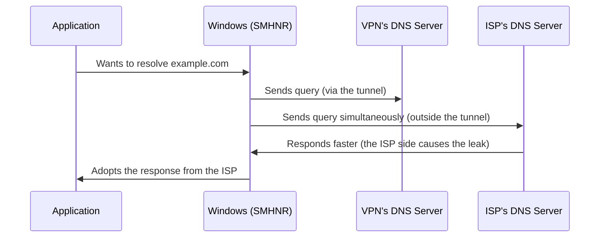

## Introduction

- **What You'll Learn From This Article**: Beyond the connection-drop leak covered in [A VPN's Kill Switch](/en/articles/vpn-kill-switch-guide), you'll systematically understand a **DNS leak** — an entirely different kind of leak that can occur even while a VPN is fully "connected."
- **Intended Audience**: Readers who understand how a kill switch works, but can't explain why a DNS leak, a different kind of leak entirely, happens.
- **Estimated Reading Time**: About 18 minutes

This article is part of the [Top 1% Series Complete Article Guide](/en/sitemap), and article 4.2 in the [VPN Department (Modern VPN Protocols Series)](/en/sitemap#series-list).

## Prerequisite Knowledge

- [A VPN's Kill Switch](/en/articles/vpn-kill-switch-guide): Understanding that "the VPN is connected" and "all traffic is protected" are separate guarantees is a prerequisite.

## Getting the Big Picture

**A DNS leak is a phenomenon where, even while a VPN tunnel is fully "connected," DNS queries alone keep leaking out to a separate DNS server outside the tunnel — often the ISP's own DNS server.** **Unlike the "leak when the connection drops" a kill switch addresses, a DNS leak occurs exactly while the connection is working perfectly normally.** **Windows has a feature called Smart Multi-Homed Name Resolution, designed to send a DNS query out on every available network interface simultaneously and adopt whichever response comes back fastest — and this intentionally causes exactly this leak, by design.**

## Deep Dive Into the Fundamentals

### Why the ISP's DNS Server Tends to Respond "Faster"

**An ISP's DNS server is often physically closer, and never carries the overhead of encryption or tunneling at all, so it tends to respond faster than a DNS server reached through the VPN tunnel.** **Smart Multi-Homed Name Resolution is built on a pure performance-optimization design decision — "use whichever is faster" — giving no special consideration to a VPN's existence at all, so in practice, the ISP's response almost always wins.**

### The Fix: Disable the Feature, or Force the Same DNS Setting on Every Interface

**To disable Smart Multi-Homed Name Resolution, you can either enable "Turn off smart multi-homed name resolution" via Group Policy, or set `DisableSmartNameResolution` to 1 in the registry** (**note that some of these options aren't available on Windows Home editions**). **Another fix is explicitly configuring the exact same DNS server on every network interface, so it no longer matters which one responds first.**

This Problem Isn't a Defect in the VPN Software — It's the OS's Own Design Decision

**A DNS leak's cause is often not a defect in the VPN software itself, but an existing design decision the OS makes for performance optimization.** **When selecting and deploying a VPN product, you need to check not just that product's own security, but also whether this kind of existing behavior exists on the OS it runs on.**

## What a Pro Sees Here (Top 1% Understanding)

### Multiple, Independent Protection Scopes Exist Behind "Being Connected"

**As covered in the article on a VPN's kill switch, "being connected" and "being protected" are separate things — but a DNS leak takes this one step further, teaching that the scope of "protected traffic" itself can be narrower than you'd expect.** **The habit of digging one layer deeper to check exactly what kind of traffic a given VPN actually protects, DNS queries included,** is the perspective a top-1% engineer carries.

## Common Misconceptions and Pitfalls

- **Misconception 1: "If the VPN shows as connected, every kind of traffic, DNS queries included, is protected."**
  A feature like Windows's Smart Multi-Homed Name Resolution can let DNS queries alone keep leaking outside the tunnel.
- **Misconception 2: "A DNS leak is caused by a defect in the VPN software itself."**
  In most cases, the cause isn't a defect in the VPN software, but an existing OS design decision made for performance optimization.
- **Misconception 3: "A DNS leak and the leak a kill switch addresses are the same kind of problem."**
  A kill switch addresses a leak on connection drop, while a DNS leak is an entirely different kind of leak occurring while the connection works perfectly normally.

## Troubleshooting Perspective

1. **The VPN shows as connected, but the ISP might still know which sites you're visiting**: Use a DNS leak test tool to check exactly which DNS server is actually responding.
2. **You want to prevent a DNS leak on Windows**: Disable Smart Multi-Homed Name Resolution, or configure the same DNS server on every network interface.
3. **You're selecting a VPN product**: Check not just that product's own security, but also the DNS resolution behavior of the OS it runs on.

## Summary

- A DNS leak is a phenomenon where DNS queries alone keep leaking outside the tunnel, even while a VPN is fully connected.
- Windows's Smart Multi-Homed Name Resolution causes exactly this leak by design, since it sends a DNS query out on every network interface and adopts the fastest response.
- The fix has two approaches: disabling this feature itself, or forcing the same DNS setting on every interface.
- This problem is often not a defect in the VPN software, but an existing design decision on the OS side.

**Takeaways to Apply Today**
1. When connected to a VPN, periodically use a DNS leak test tool to check whether DNS queries are genuinely going through the tunnel.
2. Don't settle for a "connected" indicator alone — dig one layer deeper to check exactly what kind of traffic is actually protected.

## References

- [DNS Leak | Wikipedia](https://en.wikipedia.org/wiki/DNS_leak)
- [Deactivate Smart Multi-Homed Name Resolution in Windows 8, 8.1, and 10 | OVPN](https://www.ovpn.com/en/blog/deactivate-smart-multi-homed-name-resolution-in-windows-8-8-1-and-10)
