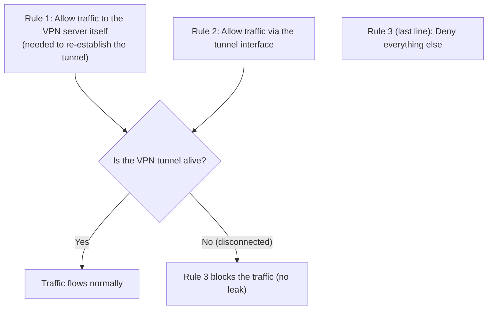

## Introduction

- **What You'll Learn From This Article**: You'll systematically understand the real identity of a **kill switch** — a feature that prevents a leak when a VPN connection unexpectedly drops — as **not a feature of the VPN protocol itself, but simply a firewall policy**.
- **Intended Audience**: Readers who've seen a "kill switch" setting in a VPN client, but can't explain exactly how it's actually implemented.
- **Estimated Reading Time**: About 18 minutes

This article is part of the [Top 1% Series Complete Article Guide](/en/sitemap), and article 4.1 in the [VPN Department (Modern VPN Protocols Series)](/en/sitemap#series-list).

## Getting the Big Picture

**A kill switch is a feature meant to prevent a "leak" — traffic spilling out onto the raw, unencrypted internet connection — when a VPN connection unexpectedly drops.** **But this isn't some special feature built into the VPN protocol itself; it's nothing more than an entirely ordinary firewall policy: "deny all traffic by default, except through the VPN tunnel."**

## Deep Dive Into the Fundamentals

### A Kill Switch's Real Identity: a Combination of Three Firewall Rules

**Building a kill switch yourself typically means combining three rules: (1) allow traffic to the VPN server's own destination (needed to re-establish the tunnel), (2) allow traffic via the tunnel interface, and (3) deny everything else.** **When the tunnel drops, traffic tries the default route (the raw internet connection), but rule 3 blocks that attempt itself.**

### Rule Order Determines What Actually Happens

**A firewall's rules often get evaluated top to bottom, with the first match winning.** **If the final "deny everything else" rule sits below (after) some other, looser allow rule, that looser rule can match first, and the deny rule never takes effect at all.** **Real-world trouble reports have confirmed cases where the deny rule's own position was exactly the cause.**

In Real-World Testing, Many Kill Switches Don't Actually Honor "Fail Closed"

**One test confirmed that, under realistic failure scenarios — crashing the VPN client process, network disconnection and reconnection, a reboot — a built-in kill switch almost always fails to do the job it's supposed to do.** **A particularly common failure pattern is a leak occurring in the gap between the OS's network interface coming up and the VPN tunnel actually establishing, at boot time.** **When testing a kill switch, it's recommended to forcibly kill the process rather than cleanly disconnecting the VPN connection.**

## What a Pro Sees Here (Top 1% Understanding)

### "Something That Looks Like a Special Feature" Can Really Just Be "a Combination of Existing Mechanisms"

**The name "kill switch" conjures up images of a special technology unique to VPNs, but in reality, it's nothing more than a combination of an entirely ordinary mechanism that's existed for far longer: the firewall.** **The habit of not getting pulled in by a product's feature name, and digging one layer deeper to check "what combination of existing mechanisms is this actually built from"** is the perspective a top-1% engineer carries.

## Common Misconceptions and Pitfalls

- **Misconception 1: "A kill switch is a special encryption feature built into the VPN protocol itself."**
  A kill switch is nothing more than an ordinary firewall policy that denies all traffic by default, except through the VPN tunnel.
- **Misconception 2: "Enabling the kill switch feature guarantees a leak gets prevented, no matter what."**
  Real-world testing has confirmed that many implementations fail to prevent a leak during a process crash or reboot.
- **Misconception 3: "Testing by cleanly disconnecting the VPN connection correctly verifies how the kill switch actually behaves."**
  A clean disconnect lets the client run its proper cleanup, so testing by forcibly killing the process — simulating an actual crash — is recommended instead.

## Troubleshooting Perspective

1. **Traffic still leaks on VPN disconnect, despite having a kill switch configured**: Check whether the deny rule sits below (after) some other allow rule.
2. **You want to correctly verify a kill switch's behavior**: Continuously check your own public IP address while forcibly killing the VPN process, rather than cleanly disconnecting it.
3. **Traffic leaks briefly right after a reboot**: This may be caused by the gap in timing between the OS's network interface coming up and the VPN tunnel actually establishing.

## Summary

- A kill switch isn't a feature of the VPN protocol itself — it's a firewall policy that denies all traffic by default, except through the tunnel.
- It's typically implemented as a combination of three rules: allow traffic to the VPN server, allow traffic via the tunnel, and deny everything else.
- Getting the deny rule's position wrong can leave the kill switch not actually working at all.
- Real-world testing has confirmed that many implementations fail to prevent a leak during a process crash or reboot.

**Takeaways to Apply Today**
1. When setting up a kill switch, verify its behavior with a test that actually forcibly kills the process.
2. Don't get pulled in by a product's feature name — dig one layer deeper to check what existing mechanism it's actually built from.

## References

- [VPN Kill Switch: What It Is, How It Works, and Why a Firewall Is Better | Windscribe](https://windscribe.com/blog/vpn-kill-switch/)
- [How to Test Your VPN Kill Switch | ipconfig.io](https://docs.ipconfig.io/guides/how-to-test-your-vpn-kill-switch)
