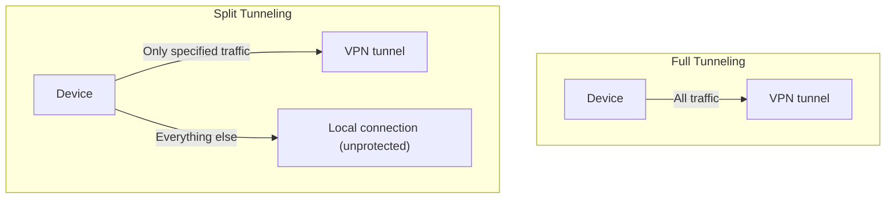

## Introduction

- **What You'll Learn From This Article**: Beyond [Understanding VPN DNS Leaks](/en/articles/vpn-dns-leak-guide), you'll systematically understand **split tunneling** — a setting that deliberately splits traffic — and its trade-offs.
- **Intended Audience**: Readers who assume every bit of traffic normally goes through the tunnel once connected to a VPN, but have heard the term "split tunneling" and can't explain what it actually does.
- **Estimated Reading Time**: About 16 minutes

This article is part of the [Top 1% Series Complete Article Guide](/en/sitemap), and article 4.3 in the [Modern VPN Protocols Deep-Dive Series](/en/sitemap#series-list).

## Prerequisite Knowledge

- [Understanding VPN DNS Leaks](/en/articles/vpn-dns-leak-guide): Understanding that a VPN tunnel showing "connected" and individual traffic actually being protected are two separate things is a prerequisite.

## Getting the Big Picture

**With full tunneling (the default configuration), every bit of traffic during a VPN connection goes through the VPN tunnel, with no exceptions.** **Split tunneling is different — it's a setting that routes only specific destinations' or applications' traffic through the VPN tunnel, while everything else flows directly outside the tunnel over the local network connection.** **This setting creates the convenience of being able to keep accessing devices on the same local network — a local printer, a NAS, a smart home device — even while connected to the VPN.**

## Deep Dive Into the Fundamentals

### Traffic Outside the Tunnel Gets No VPN Protection Whatsoever

**With split tunneling, traffic configured not to go through the VPN tunnel receives no VPN encryption or protection at all.** **This means that traffic's contents become visible to the ISP, the operator of whatever network you're using, or an attacker on an untrusted network.** **And in a corporate environment, split tunneling can also become a path that bypasses the protection mechanisms the organization has put in place, such as DNS filtering or a firewall.**

### A Configuration Gap Causes an Unintended Leak

**If you forget to include an important application's traffic — one that should go through the VPN tunnel — in the split tunneling configuration, that application's traffic flows unprotected over the local connection alone.** **That device now has one foot in two entirely different administrative domains at once: the organization-managed network reached via the VPN, and whatever local network the user is currently connected to — exposing it to unauthorized access from the local network side as well.**

Note: full tunneling carries a different trade-off of its own

**Full tunneling is the safer default configuration, but it carries the side effect of making devices on the same local network — a NAS, a smart home hub, a printer — unreachable.** **A common real-world approach to this problem is a limited use of split tunneling: excluding only your own local subnet from the tunnel.**

## What a Pro Sees Here (Top 1% Understanding)

### "Connected to the VPN" Isn't Synonymous With "All Traffic Is Protected"

**In an environment with split tunneling enabled, some traffic always flows outside the tunnel by configuration, even while connected to the VPN.** **Never settle for "I'm connected to the VPN, so I'm safe" — always check, at the configuration level, exactly which traffic is currently going through the tunnel and which is flowing outside it.** This is the perspective a top-1% engineer carries. Real-world practice favors a minimal-application policy: apply split tunneling only to specific users, roles, or destinations, and leave everything else at full tunneling by default.

## Common Misconceptions and Pitfalls

- **Misconception 1: "As long as I'm connected to the VPN, all my traffic is always protected."**
  With split tunneling enabled, traffic excluded by configuration gets no VPN protection at all.
- **Misconception 2: "Split tunneling only brings convenience, with no risk."**
  Traffic flowing outside the tunnel is unencrypted, and it can also become a path that bypasses an organization's protection mechanisms.
- **Misconception 3: "Full tunneling causes no problems at all."**
  Full tunneling can make devices on the same local network (a NAS, a printer, and similar) unreachable.

## Troubleshooting Perspective

1. **Can't access a local printer or NAS while connected to the VPN**: Check whether full tunneling is enabled, and if needed, exclude the local subnet from the tunnel via split tunneling.
2. **Some traffic's contents are visible externally despite supposedly being connected to the VPN**: Check whether a destination or application that should be protected has been left out of the split tunneling configuration's tunnel scope.
3. **A corporate DNS filter or firewall isn't taking effect on just one device**: Check whether split tunneling is enabled on that device, creating a path that bypasses the protection mechanism.

## Summary

- Full tunneling is the default configuration where all traffic goes through the VPN tunnel.
- Split tunneling routes only specific traffic through the tunnel, with everything else flowing directly over the local connection.
- Traffic flowing outside the tunnel gets no VPN protection at all.
- Real-world practice favors applying split tunneling only to specific use cases, leaving everything else at full tunneling by default.

**Takeaways to Apply Today**
1. When configuring split tunneling, always check whether traffic that should be protected has unintentionally been left out of the tunnel scope.
2. Don't settle for the state "connected to the VPN" alone — build the habit of checking which traffic is actually going through the tunnel.

## References

- [VPN Split Tunneling and When to Use It | NinjaOne](https://www.ninjaone.com/blog/vpn-split-tunneling-and-when-to-use-it/)
- [Split Tunnel vs. Full Tunnel: Which Mode Should You Use? | Private Internet Access](https://www.privateinternetaccess.com/blog/split-tunnel-vs-full-tunnel/)
