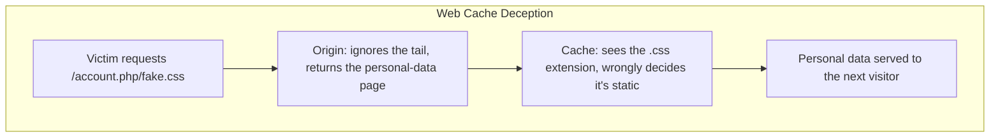
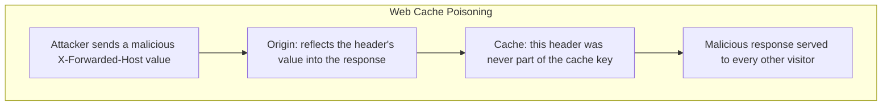

## Introduction

- **What You'll Learn From This Article**: Beyond how the Vary header, covered in [How Cache-Control and Vary Headers Work](/en/articles/cache-control-vary-guide), tells a cache what a response actually varies on, you'll systematically understand two distinct attack techniques: **Web Cache Deception** and **Web Cache Poisoning**.
- **Intended Audience**: Readers who understand the basic mechanics of caching, but can't explain exactly what mismatched assumption each of these attacks abuses.
- **Estimated Reading Time**: About 20 minutes

This article is part of the [Top 1% Series Complete Article Guide](/en/sitemap), and article 6.2 in the [Web Proxy/Caching Series](/en/sitemap#series-list).

## Prerequisite Knowledge

- [How Cache-Control and Vary Headers Work](/en/articles/cache-control-vary-guide): A basic understanding of the Vary header and the cache key concept is a prerequisite.

## Getting the Big Picture

**Web cache deception abuses a mismatch between how the cache layer and the origin server interpret the exact same URL.** **For a URL like `/account.php/nonexistent.css`, the origin server ignores the extra trailing path and returns the normal `/account.php` page, personal data and all — but the cache layer, looking only at the `.css` extension, decides "this is a static asset" and caches that same personal-data-filled response as-is.** **Web cache poisoning, on the other hand, abuses an input (a header or parameter) the response's content actually varies on, that never got included in the cache key** — **letting an attacker send just one malicious request and have that malicious response keep getting served to every other visitor who requests that same URL afterward.**

## Deep Dive Into the Fundamentals

### Web Cache Deception: a Static Extension Becomes the Sole Basis for a Caching Decision

**Many cache layers decide whether to cache a response by looking only at the URL's extension.** **But if the origin server's own routing ignores extra trailing path information on a URL and still processes it as the original endpoint, the cache layer and the origin server stop agreeing on what that URL actually refers to.** **This exact interpretation mismatch is the fundamental root cause that makes web cache deception possible.**

### Web Cache Poisoning: "an Input Left Out of the Key" Becomes the Attack's Entry Point

**A cache key typically includes only the URL path and part of the query parameters — a header like `X-Forwarded-Host`, or certain query parameters like `utm_content`, commonly get left out of the key.** **But if the origin server actually reflects the value of one of these "inputs left out of the key" into the response content (a generated URL, a redirect target, and similar), an attacker can send just one malicious request with a malicious value for that input, bake that response into the cache, and have it served to every subsequent visitor.**

A Broader Technique 2024 Research Revealed, Abusing Parser Interpretation Differences

**Research published in 2024 systematically revealed that various HTTP servers and proxies interpret a cleverly crafted URL differently from each other — an issue rooted in RFC ambiguity — as a technique that achieves arbitrary cache poisoning and cache deception across numerous websites and CDN providers.** **Differences in how delimiter characters like `;`, `?`, and `#` get interpreted were pointed out as a similar class of abuse pattern.**

## What a Pro Sees Here (Top 1% Understanding)

### "The Cache Layer" and "the Origin Server" Don't Necessarily Interpret the Same URL the Same Way

**Surprisingly many designers never even hold the premise that two different pieces of software — a cache and an origin — might interpret the same URL string under different rules at all.** **The habit of re-asking, every time you introduce a cache, "do the cache layer and the origin server genuinely interpret this URL the same way"** is the perspective a top-1% engineer carries.

## Common Misconceptions and Pitfalls

- **Misconception 1: "Web cache deception and web cache poisoning are just two names for the same attack."**
  Web cache deception abuses an interpretation mismatch between the cache and the origin, while web cache poisoning abuses an input left out of the cache key — two attacks with different mechanisms.
- **Misconception 2: "Whether a response gets cached is always decided exactly according to the origin server's own instructions."**
  Many cache layers decide independently whether to cache something, based solely on the URL's extension.
- **Misconception 3: "An element not specified in the Vary header has no effect at all on the response's content."**
  An origin server sometimes reflects the value of an input it never declared via the Vary header into the response anyway, and that's exactly the entry point for cache poisoning.

## Troubleshooting Perspective

1. **A page containing personal data might be getting cached unintentionally**: Send a request with a static-asset extension appended to the URL's tail, and check whether the origin server still returns the same dynamic content.
2. **The value of a specific header is leaking into other visitors' responses**: Check whether that header actually affects the response content, despite never being included in the cache key.
3. **Unexpected caching behavior started after introducing a CDN**: Check whether the cache layer and the origin server genuinely share the same rules for interpreting a URL's path.

## Summary

- Web cache deception abuses a mismatch between how the cache layer and the origin server interpret the same URL, tricking the cache into storing a page containing personal data.
- Web cache poisoning abuses an input the response's content actually varies on that was never included in the cache key.
- 2024 research revealed that differences in how various HTTP servers and proxies interpret URLs enable a broad range of abuse patterns for these attacks.
- When introducing a cache, you need to verify that the cache layer and the origin server genuinely interpret the same URL the same way.

**Takeaways to Apply Today**
1. When introducing a cache, check whether it's making caching decisions based solely on the URL's extension, against the origin server's actual routing.
2. Verify that every input affecting a response's content is correctly reflected in either the cache key or the Vary header.

## References

- [Gotta Cache 'Em All | PortSwigger Research](https://portswigger.net/research/gotta-cache-em-all)
