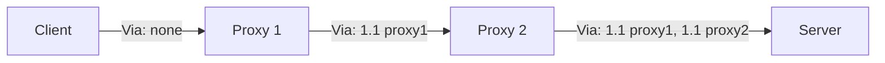

## Introduction

- **What You'll Learn From This Article**: Beyond [Understanding the Difference Between Forward Proxy and Reverse Proxy](/en/articles/forward-reverse-proxy-guide), you'll systematically understand the **Via header** — a mechanism, built into the HTTP spec itself, for recording and detecting loops in proxy hops.
- **Intended Audience**: Readers who know the X-Forwarded-For header, but don't know about the Via header — a separate header the HTTP spec itself defines.
- **Estimated Reading Time**: About 15 minutes

This article is part of the [Top 1% Series Complete Article Guide](/en/sitemap), and article 1.2 in the [Web Proxy/Cache Fundamentals Series](/en/sitemap#series-list).

## Prerequisite Knowledge

- [Understanding the Difference Between Forward Proxy and Reverse Proxy](/en/articles/forward-reverse-proxy-guide): Understanding the concept of a proxy as an intermediary standing between a client and a server is a prerequisite.

## Getting the Big Picture

**The Via header is a standard header the HTTP spec itself defines (RFC 7230, the predecessor to RFC 9110), recording which proxy (or gateway) a request or response actually passed through.** **Each proxy appends its own information to the Via header when forwarding a message, so passing through multiple proxies builds up a comma-separated history of the path.** **This is an entirely different header from the non-standard X-Forwarded-For, which records the client's IP address — different in both purpose and what it records.**

## Deep Dive Into the Fundamentals

### The Via Header's Format, and Applying It to Loop Detection

**The Via header's format is `[protocol-name/]protocol-version host (or a pseudonym for the proxy)`, and when passing through multiple proxies, each entry gets concatenated with a comma.** **For example, `Via: 1.0 fred, 1.1 p.example.net` indicates the message first passed through a proxy called fred using HTTP/1.0, then passed through p.example.net using HTTP/1.1.** **A proxy can detect an unintended forwarding loop and prevent the resource consumption of an infinite loop by checking whether its own identifier already appears in the received request's Via header.**

### How It Differs in Purpose From X-Forwarded-For

**X-Forwarded-For is a non-standard (but widely used) header used to record the real IP address of a client sitting behind a proxy.** **The Via header, on the other hand, doesn't record the client's IP address at all — it records information about the proxy itself and the protocol version each message passed through.** **These are two separate headers that answer entirely different questions: "who made the request" (X-Forwarded-For) versus "what path did it take" (Via).**

Note: a dedicated loop-detection header has also emerged in real-world practice

**Because some implementations use the Via header for purposes other than loop detection (such as deciding whether to disable certain HTTP/1.1 features), relying on the mere presence of a Via header for loop detection alone can produce unintended side effects.** **Because of this, a movement among CDN operators has emerged to define a separate, dedicated header called `CDN-Loop` purely for loop detection.**

## What a Pro Sees Here (Top 1% Understanding)

### "Widely Used" and "Standard" Are Separate Axes

**X-Forwarded-For is widely used as a de facto standard, but it was never defined as a standard header by the HTTP spec itself. The Via header is easily overlooked because it's unglamorous, but it's the mechanism the HTTP spec itself defines as standard for recording proxy hops.** **Never assume "this header is widely used, so it must be standard" — always distinguish "was this header defined by the HTTP spec itself, or did it spread as a real-world convention."** This is the perspective a top-1% engineer carries.

## Common Misconceptions and Pitfalls

- **Misconception 1: "The Via header exists to record the client's IP address."**
  Recording the client's IP address is X-Forwarded-For's role; the Via header records information about the proxies it passed through.
- **Misconception 2: "X-Forwarded-For is a standard header defined by the HTTP spec."**
  X-Forwarded-For is widely used but non-standard. The Via header is what the HTTP spec itself defines.
- **Misconception 3: "Checking the Via header alone fully detects every forwarding loop."**
  Since some implementations use the Via header for other purposes, a movement has emerged to define a dedicated separate header (like CDN-Loop) purely for loop detection.

## Troubleshooting Perspective

1. **An unintended infinite loop occurs in a configuration passing through multiple proxies**: Check whether each proxy can already detect its own identifier in the Via header, and whether loop-detection settings are enabled.
2. **You can't determine the client's real IP address**: Check the X-Forwarded-For header (or the standardized Forwarded header) instead of the Via header.
3. **Via-header-based loop detection misfires in a reverse proxy setup**: Check whether that implementation uses the Via header for some other purpose too, and consider whether to disable the loop-detection feature itself.

## Summary

- The Via header is a standard header the HTTP spec itself defines, recording the history of proxy hops.
- Passing through multiple proxies builds up a comma-separated history of the path.
- The Via header can detect a forwarding loop by checking for a duplicate of its own identifier.
- X-Forwarded-For records the client's identity, while the Via header records the path taken — two separate headers with different purposes.

**Takeaways to Apply Today**
1. When troubleshooting a proxy chain, check both X-Forwarded-For and the Via header, and don't confuse what each one actually records.
2. When designing a configuration that passes through multiple proxies, check that Via-header-based loop detection is working correctly.

## References

- [Via Header | MDN Web Docs](https://developer.mozilla.org/en-US/docs/Web/HTTP/Headers/Via)
- [Via and X-Forwarded-For Headers (Proxy Loop Prevention) | Skyhigh Security](https://success.skyhighsecurity.com/Skyhigh_Secure_Web_Gateway_(On-Prem)/Best_Practices/Proxy_Related/Via_and_X-Forwarded-For_Headers_(Proxy_Loop_Prevention))
