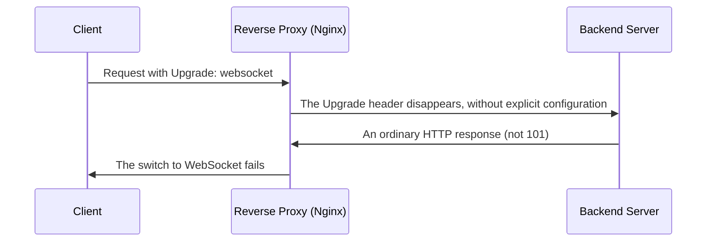

## Introduction

- **What You'll Learn From This Article**: You'll systematically understand **how a reverse proxy handles WebSocket's Upgrade header** — another concrete example of the protocol-switch request covered in [The CONNECT Method's Mechanics](/en/articles/http-connect-method-guide).
- **Intended Audience**: Readers who understand the basic mechanics of WebSocket, but can't explain why a connection suddenly stops working through a reverse proxy.
- **Estimated Reading Time**: About 18 minutes

This article is part of the [Top 1% Series Complete Article Guide](/en/sitemap), and article 3.2 in the [Web Proxy/Caching Series](/en/sitemap#series-list).

## Prerequisite Knowledge

- [The CONNECT Method's Mechanics](/en/articles/http-connect-method-guide): Understanding the idea of a client asking a proxy to stop interpreting the protocol and relay raw bytes instead is a prerequisite.

## Getting the Big Picture

**A WebSocket connection starts as an ordinary HTTP request, using the `Upgrade: websocket` and `Connection: Upgrade` headers to ask the server, "I'd like to switch to the WebSocket protocol from here on."** **But the `Upgrade` header is classified, by the HTTP spec itself, as a "hop-by-hop header" — a proxy carries no obligation at all to automatically forward it to the next hop (the backend server).** **A reverse proxy like Nginx, by default, speaks HTTP/1.0 to its backend, and never forwards this `Upgrade` header at all, unless it's explicitly configured to.**

## Deep Dive Into the Fundamentals

### The Explicit Settings for Correctly Relaying WebSocket on Nginx

**To correctly forward the Upgrade header to the backend on Nginx, you need to explicitly set `proxy_http_version 1.1;`, plus `proxy_set_header Upgrade $http_upgrade;` and `proxy_set_header Connection "upgrade";`.** **When accepting both regular HTTP requests and WebSocket on the same location block, the official documentation recommends a `map` directive that switches the `Connection` header's value depending on `$http_upgrade`.**

### Another Pitfall: a Long-Lived Connection Getting Forcibly Severed by an Idle Timeout

**WebSocket carries the characteristic of staying connected for a long time, but a reverse proxy's default timeout setting (Nginx's `proxy_read_timeout` defaults to 60 seconds) forcibly severs the connection once no data flows across it for that long.** **The fix is either significantly extending the timeout value, or having the application periodically send a WebSocket PING frame, both resetting the timer and confirming the connection is still alive.**

A Diagnostic Clue: 101 on Success, 200 or 400 on Failure

**When a WebSocket handshake succeeds, the server returns status code `101 Switching Protocols`.** **If you get `200` or `400` instead, it's highly likely the Upgrade or Connection header got lost somewhere along the proxy hop — the first thing to suspect is a missing `proxy_set_header` setting.**

## What a Pro Sees Here (Top 1% Understanding)

### A Classification Exists for "a Header Whose Forwarding the HTTP Spec Never Guarantees"

**Most headers get forwarded across a proxy without anyone thinking twice about it, but a "hop-by-hop header" like `Upgrade` has forwarding never guaranteed by the HTTP spec itself.** **The habit of digging one layer deeper, when a new mechanism doesn't work through a proxy, to check "is this header's forwarding even guaranteed by the HTTP spec to begin with"** is the perspective a top-1% engineer carries.

## Common Misconceptions and Pitfalls

- **Misconception 1: "WebSocket's Upgrade header gets forwarded automatically through a proxy."**
  The Upgrade header is a hop-by-hop header, and a proxy like Nginx never forwards it without explicit configuration.
- **Misconception 2: "A WebSocket connection cutting off midway is an application-side implementation problem."**
  A reverse proxy's default idle timeout forcibly severing the connection during a period with no data exchange is a common cause.
- **Misconception 3: "Setting the proxy's timeout to a very large value is enough on its own."**
  Instead of a large timeout, using a WebSocket PING frame to both reset the timer and confirm the connection's liveness is recommended as a more reliable fix.

## Troubleshooting Perspective

1. **A WebSocket connection fails to establish through a reverse proxy**: Check whether the response's status code is 101, and whether `proxy_set_header` correctly sets the Upgrade/Connection headers.
2. **A WebSocket connection suddenly cuts off after a period of time**: Check the reverse proxy's idle timeout setting (such as `proxy_read_timeout`), and either extend it or consider sending PING frames.
3. **You want to accept both regular HTTP requests and WebSocket on the same endpoint**: Consider using a `map` directive that switches the Connection header depending on `$http_upgrade`.

## Summary

- WebSocket uses the Upgrade and Connection headers to request a protocol switch from an ordinary HTTP request.
- The Upgrade header is a hop-by-hop header, and a proxy never forwards it without explicit configuration.
- A reverse proxy's default idle timeout can forcibly sever a long-lived connection.
- 101 on a successful handshake, versus 200 or 400 on failure, is a diagnostic clue.

**Takeaways to Apply Today**
1. When running WebSocket through a reverse proxy, always check the Upgrade/Connection header forwarding settings.
2. When a new mechanism doesn't work through a proxy, check whether its header is classified as a hop-by-hop header.

## References

- [How to Proxy WebSocket Connections With Nginx | OneUptime](https://oneuptime.com/blog/post/2026-01-25-nginx-websocket-proxy/markdown)
- [WebSocket Proxying | NGINX Documentation](https://freenginx.org/hg/nginx-site/file/tip/xml/en/docs/http/websocket.xml)
