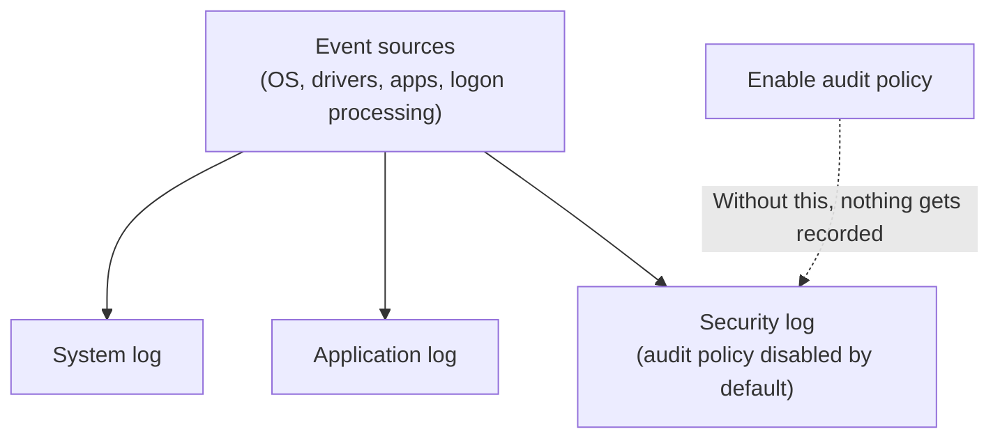

## Introduction

- **What You'll Learn From This Article**: [How to investigate error logs with journalctl](/en/articles/linux-journalctl-guide) on Linux was a gateway for viewing system logs all in one place. In this article, you'll systematically understand **Event Viewer** — Windows's own mechanism serving the same role. You'll understand the difference between the three main logs — System, Application, and Security — and an easily overlooked pitfall around the "Event ID" number.
- **Intended Audience**: Readers who've opened Event Viewer before, but can't explain the difference between the System, Application, and Security logs, or can't explain why the Security log is empty.
- **Estimated Reading Time**: About 17 minutes

This article is part of the [Top 1% Series Complete Article Guide](/en/sitemap), and article 9 in the [Windows Server Operations Series](/en/sitemap#series-list).

## Prerequisite Knowledge

- [How to Investigate Error Logs With journalctl](/en/articles/linux-journalctl-guide): Understanding this mechanism, serving the same role on Linux, will make this article's content clearer.

## Getting the Big Picture

**Event Viewer holds multiple logs, each serving an entirely different purpose.** The three representative ones are **System** (logging the OS itself and drivers), **Application** (logging individual applications), and **Security** (logging the results of logon success/failure and access-control auditing). **Of these, only the Security log starts out mostly empty right after setup, because audit policy isn't enabled by default.** This isn't a malfunction — it's a design premise: the administrator must explicitly choose what to record.

## Deep Dive Into the Fundamentals

### The Security Log Records Nothing Unless You Enable Audit Policy

**The System and Application logs are automatically recorded as the OS's and applications' standard behavior, but most items in the Security log aren't recorded at all unless you explicitly enable a separate setting called "audit policy."** For example, to record logon success/failure, you need to enable the relevant audit subcategory via `gpedit.msc` or `auditpol.exe`. **The assumption that "checking the Security log tells you everything" is wrong — everything hinges on "whether you set up the item you want to see as a recording target beforehand."**

### An Event ID Is Only Unique Within a Given "Provider"

**An Event ID number isn't unique across all of Windows. Its uniqueness is only guaranteed within the scope of a "provider" (the feature or service that raised that log).** There's a real, documented case where **the same number, "Event ID 50," means something entirely different depending on whether it was raised by the NTFS provider or the Win32Time provider.**

Searching or Filtering by Event ID Alone Can Lead You to the Wrong Cause

**The idea "just search by Event ID number" is half right and half dangerous.** You need to **always check the "provider name" (source name) alongside the Event ID, and confirm both actually match.** In PowerShell's `Get-WinEvent` cmdlet, specifying both `ProviderName` and `Id` together in the `-FilterHashtable` parameter prevents this mix-up.

## What a Pro Sees Here (Top 1% Understanding)

### Event Viewer Is the Windows Version of journalctl — But the Design Philosophy of "What Gets Recorded by Default" Differs

**journalctl keeps collecting logs by default from nearly every service systemd manages. Windows's Security log, by contrast, defaults to "record nothing at all" — recording only ever starts once an administrator explicitly enables audit policy.** This difference comes down to **a difference in philosophy: leaving as much information as possible and narrowing down later, versus selecting only the needed information and recording that in advance.** During an incident investigation, when you feel "there's nothing in the log," checking **whether recording that item was even enabled in the first place** is the first move a top-1% engineer makes.

## Common Misconceptions and Pitfalls

- **Misconception 1: "Checking the Security log tells you about every logon failure."**
  An item audit policy doesn't cover never gets recorded in the Security log at all, to begin with.
- **Misconception 2: "The same Event ID always means the same thing."**
  An Event ID's uniqueness is only guaranteed within a given provider — the same number can mean something entirely different under a different provider.
- **Misconception 3: "If Event Viewer shows nothing, nothing happened."**
  An item that isn't set up as a recording target never gets recorded, even if it actually occurred.

## Troubleshooting Perspective

1. **You want to investigate a logon failure, but nothing's recorded in the Security log**: Check, via `auditpol.exe` or `gpedit.msc`, whether the relevant audit subcategory is enabled.
2. **Searching by Event ID returns results that don't match the situation**: Check whether that event's provider name (source name) matches what you expected.
3. **You want to reliably pull out one specific event only**: Specify both `ProviderName` and `Id` in `Get-WinEvent`'s `-FilterHashtable`.

## Summary

- Event Viewer holds multiple logs — System, Application, and Security — each serving an entirely different purpose.
- The Security log starts out mostly empty right after setup, because audit policy isn't enabled by default.
- An Event ID's uniqueness is only guaranteed within a given provider — the same number can mean something different elsewhere.
- Always checking the Event ID together with the provider name is a habit that prevents a misguided investigation.

**Takeaways to Apply Today**
1. When nothing's recorded in the Security log, first check whether audit policy is actually enabled.
2. When investigating by Event ID, make it a habit to always check the provider name alongside it.

## References

- [Windows event ID | NXLog](https://docs.nxlog.co/glossary/windows-event-id.html)
- [Windows Event Log | artifacts-kb](https://artifacts-kb.readthedocs.io/en/latest/sources/windows/EventLog.html)
