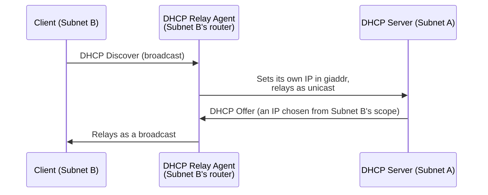

## Introduction

- **What You'll Learn From This Article**: There's a real-world requirement to have a single DHCP server hand out IP addresses to every device across headquarters' multiple VLANs and subnets. But **DHCP's very first query (DHCP Discover) is a broadcast in the first place, and by default never reaches a different subnet across a router.** This article systematically covers the **DHCP relay agent** — the mechanism resolving this contradiction, converting a broadcast into a unicast and relaying it — and the reality that **a single field called `giaddr` is what tells the DHCP server which subnet the request actually came from.**
- **Intended Audience**: Readers who understand the basic behavior of a DHCP server handing out IP addresses to clients, but can't explain how a single DHCP server actually functions across an environment spanning multiple subnets.
- **Estimated Reading Time**: About 17 minutes

This article is part of the [Top 1% Series Complete Article Guide](/en/sitemap), and article 2.1 in the [Windows Server Operations Series](/en/sitemap#series-list).

## Prerequisite Knowledge

- [Configuration Values for Building an NTP Server on Windows Server](/en/articles/windows-ntp-server-guide): The premise that Windows Server can hold multiple network service roles at once.

## Getting the Big Picture

**The first query a DHCP client sends on power-up (DHCP Discover) is a broadcast packet — destination IP address `255.255.255.255`, destination MAC address `ff:ff:ff:ff:ff:ff` — addressed to every single device on that same segment.** **By its very nature, a broadcast, by default, never gets forwarded across a router (an L3 device) into a different subnet.** In other words, **if you install your DHCP server in just one subnet at headquarters, a DHCP Discover from a client sitting in a different VLAN or subnet never reaches that DHCP server at all, as-is.** The **DHCP relay agent** is what resolves this problem.

## Deep Dive Into the Fundamentals

### The DHCP Relay Agent Converts a Broadcast Into a Unicast

**A DHCP relay agent exists on the same subnet as the client, and when it receives a DHCP broadcast packet the client sent, it re-forwards that packet as a unicast packet, addressed to a pre-configured DHCP server's IP address.** At this point, the relay agent **writes its own (the relay agent's) IP address into a field in the packet called `giaddr` (Gateway IP Address).** **By looking at this `giaddr` field, the DHCP server can accurately determine which subnet this request actually came from, and return a response choosing an address from the correct scope (the address-distribution range) corresponding to that subnet.** The server's response also gets sent back as a unicast, addressed to the relay agent's IP address written in `giaddr`, and the relay agent relays that response back onto the client's subnet, this time as a broadcast.

What a DHCP Relay Agent Actually Is on Windows Server

On Windows Server, **the DHCP relay agent function is provided as part of RRAS (Routing and Remote Access).** In most real-world environments, the relay is performed on a dedicated L3 switch or router's side, using a feature like Cisco's `ip helper-address`, but in a smaller environment where dedicated network equipment isn't available, you can also add the RRAS role to Windows Server itself and have it operate as a DHCP relay agent.

### Why Not Just Put a Dedicated DHCP Server in Every Subnet?

**You might think "why not just place a dedicated DHCP server in each subnet," but in real-world practice, a setup consolidating onto one (or a few) DHCP server, using DHCP relay agents, is widely adopted instead.** The reason is that **operational work — configuring scopes, checking IP address utilization, managing reservations — can all be consolidated into one place.** Compared to the overhead of building and maintaining a dedicated DHCP server every time a subnet gets added, **the relay-agent approach, where you just add one line of relay-agent configuration on the router's side to extend an existing DHCP server's management scope, is superior in terms of operational cost.**

## What a Pro Sees Here (Top 1% Understanding)

### Redundancy for the DHCP Server Itself Is a Separate Problem From the Relay Agent

**What a DHCP relay agent resolves is purely the reachability problem — "a broadcast can't cross a subnet boundary" — while the redundancy problem — "there's only one DHCP server, and it's a single point of failure" — needs to be addressed entirely separately.** Historically, an operational trick called the "80/20 rule" was widely used — splitting a single scope's non-overlapping IP address range across two DHCP servers (80% on the primary, 20% on the secondary). **On modern Windows Server, a standard feature called DHCP Failover now synchronizes the lease information itself, in real time, between two DHCP servers — letting the surviving one seamlessly keep responding, even if the other goes down.** **Securing reachability through a relay agent, and securing redundancy through failover, are design decisions on entirely separate axes — only combining both actually achieves the availability real-world work demands.**

## Common Misconceptions and Pitfalls

- **Misconception 1: "Setting up one DHCP server automatically distributes IP addresses from anywhere in the network."**
  A DHCP Discover is a broadcast, and by default never crosses a router. Distributing addresses to a different subnet requires a separately configured DHCP relay agent.
- **Misconception 2: "`giaddr` is a field representing the client's own IP address."**
  `giaddr` isn't the client's IP address — it's a field representing the relay agent's own IP address, the piece of information the DHCP server uses to choose a scope.
- **Misconception 3: "Configuring a DHCP relay agent also automatically achieves redundancy for the DHCP server."**
  A relay agent only resolves the reachability problem — redundancy for the DHCP server itself requires a separate mechanism, like DHCP Failover.

## Troubleshooting Perspective

1. **Devices on one specific subnet alone fail to obtain an IP address via DHCP**: Check whether that subnet's router has its DHCP relay agent (an `ip helper-address`-equivalent setting) configured, pointing at the correct DHCP server's IP address.
2. **The DHCP server's logs show addresses being distributed from an unexpected scope**: Check the correspondence between the IP address written in the relay agent's `giaddr`, and the DHCP server's own scope configuration.
3. **When one DHCP server goes down, every device under it can no longer renew its IP address**: Check whether DHCP Failover is configured, and if it is, check its synchronization state.

## Summary

- A DHCP Discover is a broadcast packet, and by default never reaches a different subnet across a router.
- A DHCP relay agent receives a client's broadcast, converts it into a unicast, and relays it to the DHCP server.
- Writing the relay agent's own IP address into the `giaddr` field lets the DHCP server determine the requesting subnet, and respond from the correct scope.
- A DHCP relay agent resolves the reachability problem — redundancy for the DHCP server itself (via DHCP Failover and the like) is a design decision on an entirely separate axis.

**Takeaways to Apply Today**
1. When configuring DHCP across an environment spanning multiple subnets, confirm early in planning that each subnet's router needs a DHCP relay agent configured.
2. When considering DHCP server availability, design along two separate axes: reachability (the relay agent) and redundancy (failover).

## References

- [RFC 2131: Dynamic Host Configuration Protocol](https://www.rfc-editor.org/rfc/rfc2131)
- [DHCP relay agent | Microsoft Learn](https://learn.microsoft.com/en-us/windows-server/networking/technologies/dhcp/dhcp-relay-agent)
