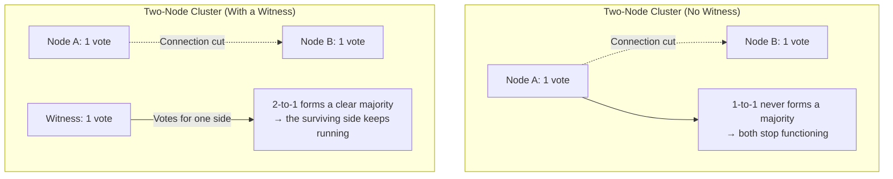

## Introduction

- **What You'll Learn From This Article**: [DFS Namespaces and DFS Replication](/en/articles/windows-server-dfs-guide) was a mechanism for replicating files across multiple file servers. In this article, you'll systematically understand **WSFC (Windows Server Failover Clustering)** — an entirely different mechanism for **making a stateful service like SQL Server or Hyper-V highly available** — and **quorum**, the majority-vote mechanism at its core.
- **Intended Audience**: Readers who've heard the term "clustering" before, but can't explain why a two-node cluster needs a third party called a "Witness."
- **Estimated Reading Time**: About 18 minutes

This article is part of the [Top 1% Series Complete Article Guide](/en/sitemap), and article 10.1 in the [Windows Server Operations Series](/en/sitemap#series-list).

## Prerequisite Knowledge

- [DFS Namespaces and DFS Replication](/en/articles/windows-server-dfs-guide): Understanding this other kind of mechanism for combining multiple servers will make the difference from WSFC clearer.

## Getting the Big Picture

**WSFC (Windows Server Failover Clustering) is a high-availability mechanism that bundles multiple servers (nodes) together, automatically taking over a service on another node if one fails.** **Here's a critical problem: if communication between nodes gets cut due to a network issue, each node risks mistakenly believing "I'm the only one left," and if both start serving at the same time, you end up with a data contradiction — split brain.** **To prevent this contradiction, WSFC uses a voting mechanism called "quorum" (a majority), only permitting the group of nodes that obtained a majority of votes to actually serve the workload.**

## Deep Dive Into the Fundamentals

### Why a Two-Node Cluster Alone Never Forms a Majority

**Quorum is a mechanism that only permits the group of nodes holding "a majority of all voting rights" to keep operating as the cluster.** **With only two nodes, if communication between them gets cut, each node holds just one vote, and in a one-to-one tie, neither can obtain a majority (2 of 2 votes, or more than 50%).** In this state, WSFC fails safe, and **both nodes stop serving the workload entirely.**

### The Witness: Providing a Third Vote

**The fix is a "Witness" — a third voter that holds exactly one vote but never provides any cluster resource itself.** A Witness can be implemented several ways: a File Share Witness, a dedicated Disk Witness, or a Cloud Witness (cloud storage). **The Witness votes for whichever node survives, forming a clear 2-to-1 majority, making it possible to keep the service running.**

Dynamic Quorum Is Convenient, but It's Never a Substitute for a Witness

**Dynamic Quorum, a default feature since Windows Server 2012 R2, automatically adjusts voting rights as nodes are lost one at a time in sequence, making it easier to maintain quorum.** **But it can't handle a simultaneous failure, such as an entire site going down all at once.** Also, when a two-node cluster doesn't use a Witness, Dynamic Quorum can preemptively strip voting rights from one of the two nodes — a real-world pitfall: **if the node you happen to take down for maintenance turns out to be the one still holding the vote, the remaining node can't obtain a majority on its own, and failover never happens.** Microsoft's current recommendation is to always use a Witness for a two-node cluster.

## What a Pro Sees Here (Top 1% Understanding)

### Quorum Mechanically Decides "Who's the Majority," Not "Who's Right"

**The quorum mechanism never judges "which node is technically healthy." It's a purely mechanical rule that simply treats whichever side gathered a majority of votes as the legitimate cluster.** **Understanding this design means that even when you run into the counterintuitive situation of "why can't this node, which should be technically healthy, serve the workload," you can calmly pinpoint the cause along a different axis entirely — the vote count.**

## Common Misconceptions and Pitfalls

- **Misconception 1: "A two-node cluster is safe enough with Dynamic Quorum alone, no Witness needed."**
  Dynamic Quorum handles sequential failures, but carries a pitfall: if the node that happens to hold the vote goes down for maintenance, failover never happens.
- **Misconception 2: "A Witness provides the cluster's resource itself."**
  A Witness never provides a cluster resource — it only provides the one vote used in the quorum decision.
- **Misconception 3: "Quorum judges which node is technically healthy."**
  Quorum never judges technical health — it's a purely mechanical rule based solely on whether a majority of votes was obtained.

## Troubleshooting Perspective

1. **You took one node down for maintenance in a two-node cluster, and failover never happened**: Check whether Dynamic Quorum had stripped that node's vote away from the remaining node.
2. **The entire cluster unexpectedly stopped functioning**: Check for a connectivity cut between nodes, and the connection status to the Witness.
3. **You're unsure whether to add a Witness**: For a two-node cluster, consider always adding one, per the current recommendation.

## Summary

- WSFC is a high-availability mechanism that keeps a service running even if a node fails.
- Quorum is a mechanism permitting only the group of nodes holding a majority of votes to serve the workload, preventing split brain.
- In a two-node cluster, a connection cut results in a 1-to-1 tie that never forms a majority, requiring a Witness as a third voter.
- Dynamic Quorum is convenient, but it's never a substitute for a Witness in a two-node cluster.

**Takeaways to Apply Today**
1. When building a two-node cluster, always add a Witness.
2. When investigating a cluster failure, check the cause along the axis of "vote count," not just "technical health."

## References

- [Define Windows Server Failover Cluster | Microsoft Learn](https://learn.microsoft.com/en-us/training/modules/implement-windows-server-failover-cluster/2-define-windows-server-failover-cluster)
- [Understanding Cluster and Pool Quorum | Microsoft Learn](https://learn.microsoft.com/azure-stack/hci/concepts/quorum)
