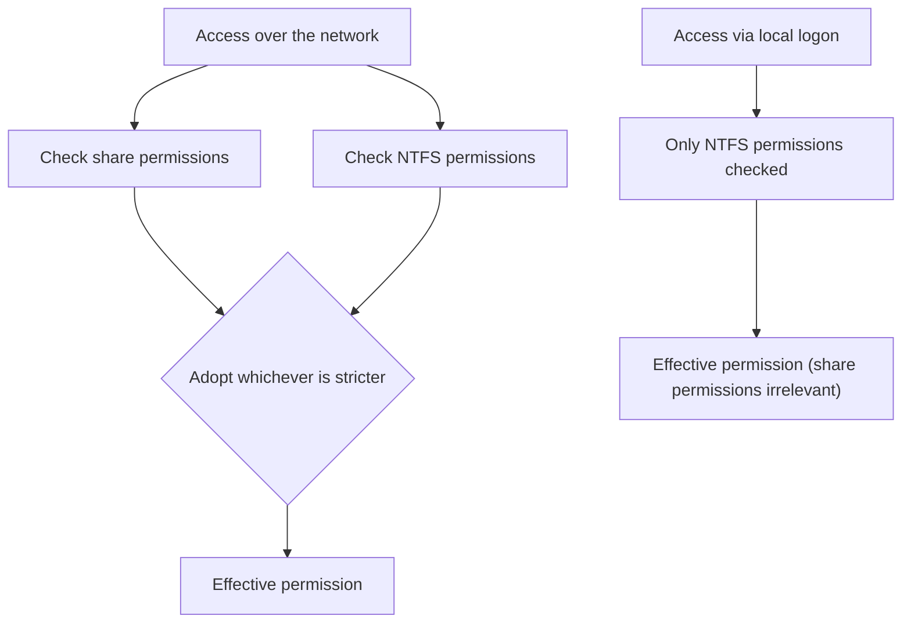

## Introduction

- **What You'll Learn From This Article**: A prerequisite for [Understanding DFS Namespaces and DFS Replication](/en/articles/windows-server-dfs-guide), you'll systematically understand how a single file server's two independent permission systems — **NTFS permissions** and **share permissions** — combine to determine the effective permission.
- **Intended Audience**: Readers who know how to configure NTFS permissions and share permissions separately, but can't explain which one actually takes precedence when both are set.
- **Estimated Reading Time**: About 16 minutes

This article is part of the [Top 1% Series Complete Article Guide](/en/sitemap), and article 9.1 in the [Windows Server Operations Series](/en/sitemap#series-list).

## Getting the Big Picture

**Windows file sharing has two entirely independent permission systems. NTFS permissions are granted on the filesystem itself, applying to both local and network access. Share permissions are granted on the shared folder's "entrance," applying only to access over the network.** **When accessing over a network, both permissions get checked, and whichever one is stricter (more restrictive) is adopted as the effective permission.**

## Deep Dive Into the Fundamentals

### A Concrete Example of "the Stricter One Wins"

**For example, if the share permission is set to "Read" and the NTFS permission is set to "Modify," a user accessing over the network ends up with the stricter one, "Read," as their effective permission.** **But if that same user logs on directly to that server and accesses it locally, share permissions don't come into play at all, and the NTFS permission, "Modify," applies as-is.** **"I can only read over the network, but I can write when I log on directly to the server" isn't a misconfiguration — it's proof this two-layer structure is working correctly.**

### Permissions Add Up Across Group Membership, but an Explicit Deny Always Wins

**Within the same permission system, a permission granted to a user directly and a permission granted to a group that user belongs to combine additively (the more permissive one takes effect).** **For example, even if a user is only granted "Read" directly, if a group they belong to is granted "Modify," that user's effective permission becomes "Modify."** **But this additive rule is always overridden by an explicit deny. No matter how many allows stack up, a single explicit deny on that item takes priority.**

Note: how to precisely check the effective access

**Windows provides an "Effective Access" tab inside NTFS's "Advanced Security Settings" dialog, letting you check exactly what permission a specific user or group ends up with, based on NTFS permissions alone.** **But since this tab doesn't factor in share permissions, fully confirming the effective permission over a network requires separately checking share permissions too.**

## What a Pro Sees Here (Top 1% Understanding)

### An "Insufficient Permission" Problem Means Suspecting Two Separate Places

**NTFS permissions and share permissions are two entirely independent systems, but since both can produce the exact same "can't access it" symptom, they're easily confused during troubleshooting.** **When you hit "this user should be able to access this, but can't," the move isn't checking just NTFS permissions or just share permissions alone — it's first separating "is this network access or local access," then systematically checking both relevant permission systems (or NTFS alone).** This is the perspective a top-1% engineer carries.

## Common Misconceptions and Pitfalls

- **Misconception 1: "As long as the share permission is 'Full Control,' NTFS permissions don't matter."**
  Over a network, the stricter of the two permissions is adopted, so if NTFS permissions are strict, setting the share permission to Full Control accomplishes nothing.
- **Misconception 2: "Share permissions also restrict access when logging on directly to the server."**
  Share permissions only apply to access over the network — a local logon only has NTFS permissions applied.
- **Misconception 3: "A deny granted to a group is weaker than an allow granted to an individual."**
  An explicit deny always takes priority over any allow within the same permission system.

## Troubleshooting Perspective

1. **Access fails over the network but succeeds when logging on directly to the server**: Check whether the share permission is set stricter than the NTFS permission.
2. **A user's own permissions check out, but the actual access result doesn't match**: Check the permissions of every group that user belongs to, especially for an explicit deny.
3. **You want to precisely determine the effective permission**: Check the NTFS "Effective Access" tab, and separately check share permissions, then combine both results.

## Summary

- NTFS permissions and share permissions are two entirely independent permission systems.
- Over a network, whichever of the two is stricter becomes the effective permission.
- On a local logon, share permissions are irrelevant — only NTFS permissions apply.
- Within the same permission system, group permissions add up, but an explicit deny always takes priority.

**Takeaways to Apply Today**
1. For an "can't access it" issue, first separate out whether it's network access or local access.
2. Consider a design policy of leaving share permissions at Full Control by default and doing the actual access control through NTFS permissions.

## References

- [NTFS vs. Share Permissions in Windows | MCSI Library](https://mcsi-library.readthedocs.io/articles/2023/09/ntfs-vs-share-permissions/ntfs-vs-share-permissions.html)
- [Understanding File and Folder Permissions in Windows | Dell](https://www.dell.com/support/kbdoc/en-in/000137238/understanding-file-and-folder-permissions-in-windows)
