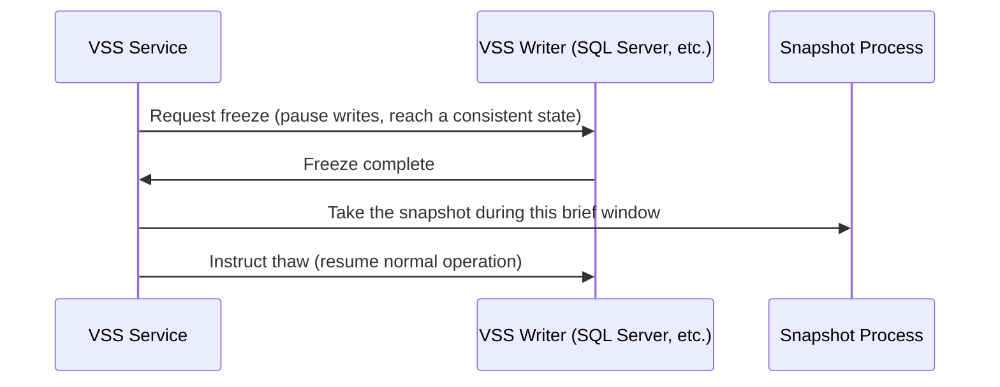

## Introduction

- **What You'll Learn From This Article**: Beyond copy-on-write, the block-level snapshot technology covered in [How Shadow Copy (VSS) Works](/en/articles/windows-server-vss-guide), you'll systematically understand **VSS writers** — the application-side coordination mechanism.
- **Intended Audience**: Readers who understand how a VSS snapshot works, but can't explain what's needed for a backup to be "application-consistent."
- **Estimated Reading Time**: About 18 minutes

This article is part of the [Top 1% Series Complete Article Guide](/en/sitemap), and article 5.2 in the [Windows Server Series](/en/sitemap#series-list).

## Prerequisite Knowledge

- [How Shadow Copy (VSS) Works](/en/articles/windows-server-vss-guide): Understanding copy-on-write, a block-level snapshot technology, is a prerequisite.

## Getting the Big Picture

**Copy-on-write can produce a perfectly accurate snapshot at the block level, but if an application like SQL Server or Exchange happens to be mid-write exactly when that snapshot gets taken, the result can leave the application unable to start normally after a restore, despite the block-level data being flawless.** **A VSS writer is the application-side coordination mechanism: right before a snapshot, VSS asks each registered application to "freeze" (pause writes, reach a consistent state), takes the snapshot during that brief window, then immediately tells it to "thaw" (resume normal operation).**

## Deep Dive Into the Fundamentals

### The Diagnostic Command: vssadmin list writers

**To check each VSS writer's current state, run `vssadmin list writers` with administrator privileges.** **A normal state shows "Stable," but you can also see abnormal states like "Failed," "Retryable error," or "Waiting for completion."**

### When the SQL Server Writer Doesn't Appear, or Shows as Failed

**If the SQL Server writer doesn't even appear in the list at all, check whether a database name contains a space, including a trailing one, and whether the SQL Server VSS Writer service account holds sysadmin rights on the SQL Server side.** **If a writer shows as "Failed," check the Windows Application Event Log for an error from the `SQLWRITER` source.**

The Basic Remediation Pattern: Restart the Service, and a Full Reboot if That Still Doesn't Resolve It

**The typical fix is stopping the relevant writer's service, waiting about 30 seconds, restarting it, and restarting the Volume Shadow Copy service and the Microsoft Software Shadow Copy Provider service if needed.** **But if this still doesn't resolve it, a full server reboot may be required, and if the same failure keeps recurring, its root cause needs independent investigation.**

## What a Pro Sees Here (Top 1% Understanding)

### "The Snapshot Succeeded" and "You Can Restore Normally From That Snapshot" Are Separate Guarantees

**Even when block-level copy-on-write is technically working perfectly, if the application wasn't in a consistent state at that exact moment, the data becomes unusable after restore.** **The habit of re-asking, every time you design a backup mechanism, "is this backup crash-consistent (just a snapshot of the disk's state at that instant), or application-consistent (a consistent state reached through application-side coordination)"** is the perspective a top-1% engineer carries.

## Common Misconceptions and Pitfalls

- **Misconception 1: "If a VSS snapshot succeeds, the backup is guaranteed to restore normally."**
  Even if the block-level snapshot succeeds, the data can become corrupted after restore if the application-side VSS writer didn't coordinate correctly.
- **Misconception 2: "Checking VSS writer state is something you can just leave to the backup software."**
  Running `vssadmin list writers` yourself and checking each writer's state is a basic, direct way to verify backup reliability yourself.
- **Misconception 3: "Restarting the writer's service always resolves the problem."**
  If a service restart doesn't resolve it, a full server reboot may be needed, and if the same failure keeps recurring, its root cause needs investigation.

## Troubleshooting Perspective

1. **A backup reportedly succeeded, but the restored database won't start**: Check whether `vssadmin list writers` showed the relevant writer as "Stable" at the time of the backup.
2. **The SQL Server writer doesn't appear in the list**: Check whether a database name contains a trailing space, and whether the service account holds sysadmin rights.
3. **A writer stays "Failed" even after a service restart**: Check the Windows Application Event Log for details from that writer's error source, to identify the root cause.

## Summary

- A VSS writer is the application-side coordination mechanism that asks an application to freeze right before a snapshot, so the snapshot gets taken in a consistent state.
- Running `vssadmin list writers` and checking whether each writer shows "Stable" is the basic diagnostic method.
- A successful block-level snapshot and an application-consistent backup are two separate guarantees.
- Typical causes of SQL Server writer failures include a trailing space in a database name, or insufficient service account permissions.

**Takeaways to Apply Today**
1. When designing a backup, always check whether it's crash-consistent or application-consistent.
2. Build the habit of checking each writer's state with `vssadmin list writers` around important backups.

## References

- [Troubleshooting SQL VSS Writer Issues | Zmanda](https://www.zmanda.com/kb/troubleshooting-sql-vss-writer-issues/)
- [Windows VSS Writers and Corresponding Service Names | Veeam](https://www.veeam.com/kb2041)
