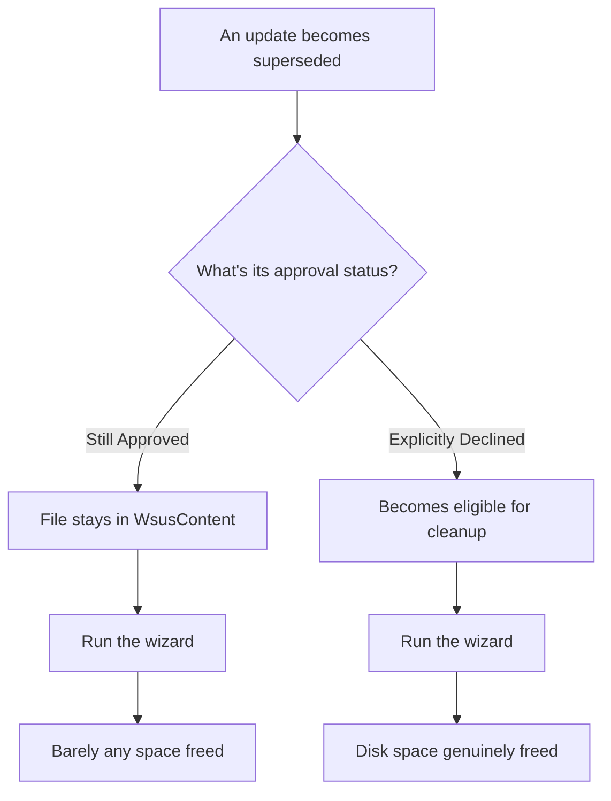

## Introduction

- **What You'll Learn From This Article**: When WSUS (Windows Server Update Services)'s `WsusContent` folder bloats up, you'll systematically understand **why running the Server Cleanup Wizard barely frees any disk space at all** — a real-world symptom many admins actually run into, and how to fix it.
- **Intended Audience**: Readers who operate WSUS, but don't know the Server Cleanup Wizard's own limits against disk-space bloat.
- **Estimated Reading Time**: About 18 minutes

This article is part of the [Top 1% Series Complete Article Guide](/en/sitemap), and article 12.1 in the [Windows Server Series](/en/sitemap#series-list).

## Getting the Big Picture

**WSUS keeps saving every synchronized update's actual file into a folder called `WsusContent`, and the longer it runs, this folder can bloat to hundreds of gigabytes, sometimes over a terabyte.** **Most admins expect running the Server Cleanup Wizard to free up files that are no longer needed, but in practice they run into a symptom where it frees only a few megabytes.** **The reason is a specification: the wizard never touches the files of a superseded update still sitting in "Approved" status.**

## Deep Dive Into the Fundamentals

### The Correct Procedure for Genuinely Reclaiming Disk Space

**To genuinely reclaim disk space, filter the Approved view by "Superseded," select the relevant updates, and explicitly change their status to "Declined."** **Only after that decline operation, running the Server Cleanup Wizard finally deletes those files for real and frees the disk space.** **Don't forget: simply reverting to "Not Approved" never deletes the associated files at all.**

### The "Superseded" Determination Isn't Fully Reliable

**Even when an update is determined to be "superseded," that determination sometimes holds only under a specific combination of system configurations, and isn't necessarily fully reliable.** **For this reason, the safer, real-world practice is to decline the superseded updates, run the cleanup wizard, and then revert them back to "Not Approved" afterward.**

Another Source of Bloat: the Express Installation Files Setting

**Enabling Express installation files makes binary-delta patching available for clients connecting over a slow link, but this setting increases the disk space required by 3 to 4 times the normal amount.** **Many admins enable it without realizing this disk-space impact, and it's recommended to disable it in environments with no clients on slow links.**

## What a Pro Sees Here (Top 1% Understanding)

### "Having a Cleanup Feature" and "the Cleanup Actually Working Fully" Are Two Separate Things

**Most management tools ship with a cleanup or optimization wizard, but surprisingly few admins actually understand, as a precise specification, under exactly what conditions that wizard produces an effect.** **The habit of digging one layer deeper, before using it, to check "exactly what data, meeting what condition, does this cleanup feature actually target"** is the perspective a top-1% engineer uses to avoid being stuck with an unexplained symptom like "I ran the wizard, but the space never dropped."

## Common Misconceptions and Pitfalls

- **Misconception 1: "Running the Server Cleanup Wizard automatically deletes every unneeded update's files."**
  The wizard never touches the files of a superseded update still sitting in Approved status.
- **Misconception 2: "Reverting an update to 'Not Approved' frees up disk space."**
  Reverting to "Not Approved" alone never deletes the associated files — you need to explicitly decline it.
- **Misconception 3: "Express installation files is a setting you should always leave enabled."**
  This setting is meant for clients connecting over a slow link, and increases the required disk space by 3 to 4 times, so it should be disabled in environments without that need.

## Troubleshooting Perspective

1. **The `WsusContent` folder is using far more disk space than expected**: Explicitly decline superseded updates still sitting in Approved status, then run the Server Cleanup Wizard.
2. **Event ID 10041 or 10042 is showing up in the logs**: This signals that the content storage volume is running low on free space, and synchronization itself may start failing.
3. **You want to move the content storage volume to a larger one**: Use the `wsusutil movecontent` command, which relocates it without breaking the existing updates' references.

## Summary

- WSUS's `WsusContent` folder can bloat to hundreds of gigabytes, sometimes over a terabyte, the longer it runs.
- The Server Cleanup Wizard never touches the files of a superseded update still sitting in Approved status.
- Genuinely reclaiming disk space requires explicitly declining superseded updates before running the wizard.
- The Express installation files setting increases the required disk space by 3 to 4 times, and should be disabled in environments with no clients on slow links.

**Takeaways to Apply Today**
1. When managing WSUS disk space, follow the correct procedure, accounting for the Server Cleanup Wizard's own limits.
2. Before using a management tool's cleanup feature, dig one layer deeper to check exactly what data it actually targets, and under what condition.

## References

- [Issues With Update Storage | Microsoft TechNet](https://technet.microsoft.com/en-us/library/cc708524(v=ws.10))
- [Why Is My WSUS Content Folder Using Almost 1TB | Microsoft Q&A](https://learn.microsoft.com/en-us/answers/questions/695783/why-is-my-wsus-content-folder-using-almost-1tb)
