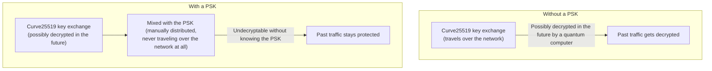

## Introduction

- **What You'll Learn From This Article**: The Curve25519 key exchange [how WireGuard works](/en/articles/wireguard-internals-guide) uses carries a theoretical weakness against a future quantum computer. In this article, you'll systematically understand how to practically reinforce that weakness using **PresharedKey (PSK)**, an optional symmetric key WireGuard provides as a standard feature.
- **Intended Audience**: Readers who understand WireGuard's basic key exchange mechanism, but can't explain what the optional PresharedKey feature actually means.
- **Estimated Reading Time**: About 18 minutes

This article is part of the [Top 1% Series Complete Article Guide](/en/sitemap), and article 2.1 in the [Modern VPN Protocols Deep Dive Series](/en/sitemap#series-list).

## Prerequisite Knowledge

- [How WireGuard Works](/en/articles/wireguard-internals-guide): A basic understanding of the Curve25519 key exchange.

## Getting the Big Picture

**"Harvest Now, Decrypt Later" is a known long-term concern. An attacker simply records and stores encrypted traffic they can't decrypt today, as-is. Then, once a sufficiently powerful quantum computer exists in the future, there's a real possibility they could retroactively break today's key exchange method (such as Curve25519), and later obtain the content of traffic they recorded in the past.** **WireGuard's PresharedKey (PSK) is a practical defense against exactly this attack.** That's because the PSK is a symmetric key the administrator manually distributes to both devices ahead of time, themselves — one that never once travels over the network at all.

## Deep Dive Into the Fundamentals

### A PSK Is Strong Precisely Because It's Never "Exchanged" at All

**WireGuard's ordinary key exchange (public-key cryptography via Curve25519) always travels over the network. If an attacker records that key-exchange traffic itself, there's a real possibility that, given enough future computing power to break the key exchange mechanism itself, it could theoretically be decrypted.** **The PresharedKey is fundamentally different. This symmetric key, generated with the `wg genpsk` command, is one the administrator manually copies into both devices' config files ahead of time, through a route entirely separate from the network's own key exchange** — a USB drive, SSH, or similar. **This PSK itself never once travels over the network during communication, so no matter how badly the key-exchange portion gets broken in the future, an attacker can never obtain the PSK's actual value.**

### The PSK Gets Mixed Into the Final Encryption Key's Derivation

**WireGuard cryptographically mixes the shared secret obtained from the Curve25519 key exchange together with this PSK, to derive the final encryption key.** **Because of this mixing, even if the Curve25519 portion gets broken in the future, the final encryption key can never be derived — and past traffic content can never be recovered — without also knowing this other secret, the PSK.**

A PSK Alone Doesn't Mean "Fully Quantum-Resistant"

**Using a PSK is a practical defense against the specific attack scenario of harvest-now-decrypt-later, but this doesn't mean "WireGuard has become fully quantum-resistant."** Separate efforts are also underway to make the key exchange itself quantum-resistant, using genuine post-quantum cryptography (quantum-resistant key encapsulation mechanisms like ML-KEM). **The PSK's real-world value is that it provides a practical defense through a comparatively simple mechanism: mixing in a secret distributed manually, never over the network at all.**

## What a Pro Sees Here (Top 1% Understanding)

### Not "Strengthening the Key Exchange" — Preparing a Second Route That Doesn't Depend on It at All

**A PSK's essence isn't making the Curve25519 key exchange mechanism itself any stronger.** **It's the idea of preparing one more, entirely separate route for distributing a secret — one that never goes through the key exchange at all — and making the final key's strength depend on that route too.** This design reveals a perspective: addressing a future risk doesn't always mean directly strengthening the weak part itself — it can also be achieved by adding a separate route that doesn't depend on that weak part at all.

## Common Misconceptions and Pitfalls

- **Misconception 1: "Setting up a PSK makes WireGuard fully quantum-resistant."**
  A PSK is a practical defense against a harvest-now-decrypt-later attack, but that doesn't mean it's fully quantum-resistant.
- **Misconception 2: "A PSK travels over the network too, just like the Curve25519 key exchange."**
  A PSK is a symmetric key the administrator manually distributes to both devices ahead of time, through a route entirely separate from the network — it never travels over the network during communication at all.
- **Misconception 3: "A PSK is automatically enabled in WireGuard's default settings."**
  A PSK is an optional feature — the administrator must generate it with `wg genpsk` and explicitly add it to the config file.

## Troubleshooting Perspective

1. **You set up a PSK, but the handshake never completes**: Check whether the exact same PSK value is correctly configured on both devices' config files.
2. **You want more robust, long-term quantum resistance**: Look into dedicated implementations and efforts using a quantum-resistant key encapsulation mechanism like ML-KEM.
3. **You're unsure whether the PSK's own distribution route was safe**: Check whether the route you used to distribute the PSK — a USB drive, SSH, or similar — was itself ever recorded or intercepted.

## Summary

- Harvest-now-decrypt-later is an attack that records today's encrypted traffic and retroactively decrypts it with a future quantum computer.
- WireGuard's PresharedKey (PSK) is a symmetric key, manually distributed ahead of time, that never once travels over the network.
- The PSK gets mixed with the result of the Curve25519 key exchange, strengthening the final encryption key.
- A PSK is a practical defense, but it's a comparatively simple mechanism, different from genuine post-quantum cryptography.

**Takeaways to Apply Today**
1. For communication where long-term confidentiality matters, consider enabling WireGuard's PresharedKey.
2. Also check the safety of the route you used to distribute the PSK itself.

## References

- [Quantum-Resistant VPN Connections | IVPN](https://ivpn.net/knowledgebase/general/quantum-resistant-vpn-connections/)
- [Post-Quantum WireGuard | engrXiv](https://engrxiv.org/preprint/view/5020)
