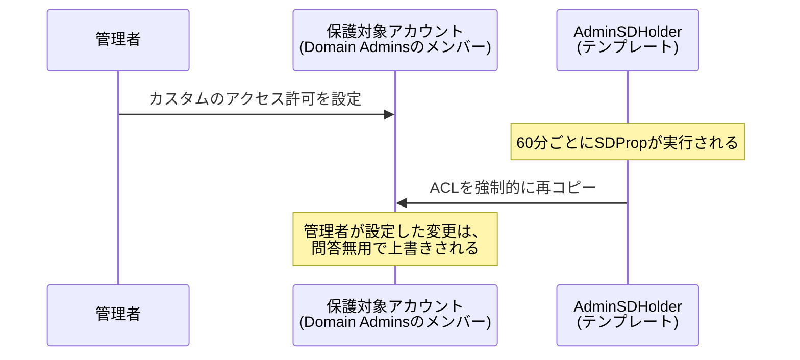

## はじめに

- **この記事で得られること**: `Domain Admins`のような特権グループのメンバーに対して、カスタムのアクセス許可を設定したはずなのに、**なぜか1時間ほど経つと、設定したはずの変更が元に戻ってしまう**という現象に遭遇することがあります。この記事では、この現象が、バグではなく、**`AdminSDHolder`というテンプレートオブジェクトのACLを、`SDProp`(Security Descriptor Propagator)というプロセスが、60分ごとにすべての保護対象アカウントへ強制的に再コピーしている**ために起きているという実態を理解した上で、**一度保護対象になったアカウントは、特権グループから外されても、`adminCount`というフラグが自動的にはリセットされない**という、意図的だがよく誤解される仕様までを体系的に理解します。
- **対象読者**: 特権グループのメンバーのアクセス許可を個別にカスタマイズしようとして、なぜか変更が時間差で元に戻ってしまうという現象に遭遇したことのある方を想定しています。
- **読むのにかかる想定時間**: 約18分

この記事は[『上位1%』シリーズ 全記事ガイド](/sitemap)の一部、[Active Directoryシリーズ](/sitemap#シリーズ一覧)の23.1本目です。

## 前提知識

- [ADとDC、ドメインとフォレストの違い](/articles/ad-dc-fundamentals-guide): AD DS上のオブジェクトが、それぞれアクセス制御リスト(ACL)を持つという理解が前提になっています。
- [FSMO(操作マスター)とは何か](/articles/fsmo-guide): PDCエミュレータという役割を持つDCが、ドメイン内で特別な処理を担うという理解が前提になっています。

## 全体像をつかむ

**`Domain Admins`・`Enterprise Admins`・`Schema Admins`・`Account Operators`・`Backup Operators`といった特権グループのメンバーは、「保護対象(Protected)」として扱われ、通常のオブジェクトとは異なる、特別なアクセス許可の管理ルールが適用されます。** **`AdminSDHolder`は、AD DS内に存在する、たった1つの特殊なオブジェクトで、保護対象アカウントすべてに適用されるべき、"正しい"アクセス許可のテンプレートとして機能します。** **`SDProp`(Security Descriptor Propagator)というプロセスが、既定では60分ごとに実行され、この`AdminSDHolder`のACLを、すべての保護対象アカウント・グループへ、強制的にコピーし直します。** つまり、保護対象アカウントに対して個別にカスタムのアクセス許可を設定しても、**次のSDPropの実行タイミングで、その変更は`AdminSDHolder`のACLによって、問答無用で上書きされてしまう**のです。

## 基礎から徹底解説

### なぜ、このような強制的な上書きの仕組みが必要なのか

**この仕組みが存在する理由は、特権アカウントへの権限昇格攻撃を防ぐためです。** もし、この自動的な再コピーが存在しなければ、攻撃者が、何らかの方法で一時的に権限を得た際、特権アカウントのACLに、自分自身にもアクセス許可を与えるような、こっそりとしたエントリを追加してしまう可能性があります。**`AdminSDHolder`による強制的な上書きは、こうした不正な変更を、最大でも1時間程度で自動的に無効化する**、組織的な防御機構として機能しています。**[Kerberoasting攻撃を再現するハンズオン](/articles/ad-kerberoasting-handson-guide)や[DCSyncが悪用する複製権限を監査するハンズオン](/articles/ad-dcsync-audit-handson-guide)で扱った、Tier 0という管理モデルの考え方**、つまり最も重要なアカウント群を、他の一般的な管理作業から明確に分離して保護するという発想と、この`AdminSDHolder`/`SDProp`の仕組みは、根本的に同じ目的を持っています。

### adminCountフラグ:保護対象であることの「印」

**あるアカウントが`AdminSDHolder`による保護の対象になると、そのアカウントの`adminCount`という属性に、`1`という値が設定されます。** これは、「このアカウントは、現在、保護対象として扱われている」ことを示す印です。

adminCountが、特権グループから外されても自動的にはリセットされない理由

**ここが、実務で最も誤解されやすいポイントです。** あるユーザーを、`Domain Admins`のような特権グループから外したとしても、**そのユーザーの`adminCount`属性は、`1`のまま、自動的にはリセットされません。** これは意図的な仕様です。Microsoftの説明によれば、この挙動は、**Windows 2000の時代に、顧客からのフィードバックを受けて、意図的にそのように設計された**ものです。**`adminCount=1`のまま残り続けると、そのアカウントに対する、親オブジェクトからのアクセス許可の継承(インヘリタンス)が、無効化された状態のまま残り続けます。** 結果として、「特権グループから外したのに、そのアカウントのアクセス許可が、他の一般的なユーザーと同じようには振る舞わない」という、分かりにくい状態が生まれます。**この状態を解消するには、`adminCount`属性を明示的に`0`へ戻し、アクセス許可の継承を手動で再度有効化する**という、追加の作業が必要です。

## プロが見ている視点(上位1%の理解)

### adminCount=1は、「現在保護されている」ことの、信頼できる証拠ではない

**`adminCount`属性が`1`であることを、「このアカウントは、今も特権グループのメンバーである」ことの証拠として扱ってしまう、実務上の誤りがよく見られます。** しかし、前述の通り、**`adminCount=1`は、過去に一度でも保護対象になったことがあるという履歴を示すだけであり、現在のグループメンバーシップの実態を正確に反映しているとは限りません。** **実際にそのアカウントが、現在も特権グループのメンバーであるかどうかを確認するには、`adminCount`属性ではなく、グループメンバーシップそのものを確認する必要がある**という点を、Microsoft自身も明確に注意喚起しています。**棋算や監査の場面で、`adminCount=1`のアカウントを「現在の特権アカウントの一覧」として扱ってしまうと、すでに権限を失った古いアカウントまで含んでしまう、不正確な結果につながります。**

## よくある誤解・つまずきポイント

- **誤解1: 「特権グループのメンバーに設定したカスタムのアクセス許可が、時間が経つと勝手に消えるのは、何かのバグだ」**
  これはバグではなく、`AdminSDHolder`のACLを、`SDProp`が60分ごとに強制的に再コピーする、意図的な設計です。
- **誤解2: 「特権グループからユーザーを外せば、そのアカウントの状態は完全に元に戻る」**
  `adminCount`属性は自動的にはリセットされず、アクセス許可の継承が無効化されたままの状態が、意図的に残り続けます。
- **誤解3: 「adminCount=1が設定されているアカウントは、現在も特権グループのメンバーである」**
  adminCount=1は、過去に保護対象になった履歴を示すだけであり、現在のメンバーシップの実態を保証するものではありません。

## 障害・トラブルシューティングの視点

1. **特権グループのメンバーに設定したカスタムのアクセス許可が、時間差で元に戻ってしまう**: その変更が、`AdminSDHolder`のACLと矛盾していないかを確認し、必要であれば`AdminSDHolder`自体のACLを変更します。
2. **特権グループから外したはずのユーザーで、アクセス許可の継承が無効化されたままになっている**: そのユーザーの`adminCount`属性を確認し、`1`のままであれば、明示的に`0`へリセットし、継承を再度有効化します。
3. **棋算・監査で、特権アカウントの一覧を作成したい**: `adminCount`属性だけに頼らず、実際のグループメンバーシップを確認の基準にします。

## まとめ

- `AdminSDHolder`は、保護対象アカウントすべてに適用されるべき、正しいアクセス許可のテンプレートとして機能する、特殊なオブジェクトです。
- `SDProp`は、既定で60分ごとに実行され、`AdminSDHolder`のACLを、すべての保護対象アカウントへ強制的に再コピーします。
- 保護対象になったアカウントには`adminCount=1`が設定されますが、特権グループから外されても、この値は自動的にはリセットされません。
- `adminCount=1`は、過去に保護対象になった履歴を示すだけであり、現在のグループメンバーシップの実態を保証するものではありません。

**今日から意識すべきこと**
1. 特権グループのメンバーに対するアクセス許可の変更は、個別のアカウントではなく、`AdminSDHolder`自体に対して行いましょう。
2. 特権アカウントの一覧を作成する際は、`adminCount`属性だけに頼らず、実際のグループメンバーシップを確認しましょう。

## 参考文献

- [Five common questions about AdminSdHolder and SDProp | Microsoft](https://techcommunity.microsoft.com/blog/askds/five-common-questions-about-adminsdholder-and-sdprop/396293)
- [Active Directory Security: Understanding the AdminSDHolder Object | Petri](https://petri.com/active-directory-security-understanding-adminsdholder-object/)
