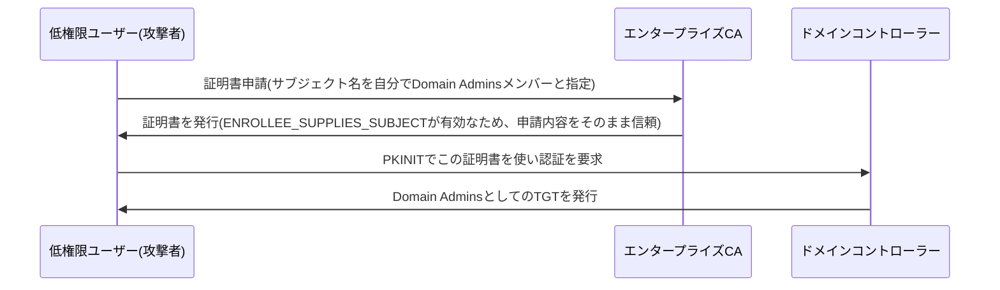

## はじめに

- **この記事で得られること**: [AD CS(証明書サービス)でエンタープライズCAを構築するハンズオン](/articles/ad-cs-handson-guide)で構築したCA環境を使い、**ESC1**と呼ばれる、誤設定された証明書テンプレートの悪用パターンを、教育・防御目的で自分の手で再現します。
- **対象読者**: AD CSでCAを構築できることは知っているものの、証明書テンプレートの設定ミスが、具体的にどうやって権限昇格につながるのかを説明できない方を想定しています。
- **読むのにかかる想定時間**: 約20分

この記事は[『上位1%』シリーズ 全記事ガイド](/sitemap)の一部、[ActiveDirectoryシリーズ](/sitemap#シリーズ一覧)の43.4本目です。

**本記事は教育・防御目的のセキュリティハンズオンです。自分が管理する検証環境以外では、絶対に実行しないでください。**

## 前提知識

- [AD CS(証明書サービス)でエンタープライズCAを構築するハンズオン](/articles/ad-cs-handson-guide): CA・証明書テンプレート・証明書の発行という概念の理解が前提になっています。
- [msDS-KeyCredentialLinkを悪用するシャドウクレデンシャル攻撃のハンズオン](/articles/ad-shadow-credentials-handson-guide): PKINITによる公開鍵認証という概念の理解が前提になっています。

## 全体像をつかむ

**ESC1は、ENROLLEE_SUPPLIES_SUBJECTというフラグが有効な証明書テンプレートを悪用し、証明書の申請者自身が、証明書に記載する識別情報(サブジェクト名)を自由に指定できてしまう設定ミスを突く攻撃**です。**このフラグが有効で、かつクライアント認証用のEKU(拡張キー使用法)が設定され、マネージャーの承認も不要で、低い権限のユーザーにも発行権限が与えられているテンプレートがあれば、攻撃者は「自分はDomain Adminsのメンバーである」という内容の証明書申請を、CAへ正規に送信**できます。**CAはこの申請を正規の手続きとして処理し、本当にDomain Adminsになりすませる証明書を発行してしまい、攻撃者はこの証明書を使ってPKINITで認証し、Domain AdminsとしてのTGTを手に入れます。**

## 基礎から徹底解説

### 悪用に必要な4つの条件

**ESC1が成立するには、次の4つの条件がすべて揃う必要**があります。**(1) ENROLLEE_SUPPLIES_SUBJECTが有効で、申請者がサブジェクト名を自由に指定できる。(2) クライアント認証・スマートカードログオン・Any Purposeのいずれかの拡張キー使用法(EKU)が設定されている。(3) マネージャーの承認が不要である。(4) 低い権限を持つユーザー(多くの場合Domain Users全体)に、そのテンプレートへの発行権限が与えられている。** **この4つがすべて揃った、意図的に(あるいは過去の互換性維持のために)緩く設定されたテンプレートが、実務のAD環境には驚くほど頻繁に残っています。**

### なぜパスワードリセットでは無効化できないのか

**この攻撃で発行された不正な証明書は、対象ユーザーのパスワードがリセットされても、証明書自体が無効化(失効)されない限り、有効なまま使い続けられます。** **[ゴールデンチケットの記事](/articles/ad-golden-ticket-handson-guide)で扱った、krbtgtのパスワードリセットだけでは不十分だった構造と、根っこの原理は同じ**です。**侵害が疑われるテンプレートから発行済みの証明書は、CAの証明書失効リスト(CRL)へ明示的に追加する必要があります。**

## プロが見ている視点(上位1%の理解)

### 鍵を「書く」ことと、証明書を「発行してもらう」ことは、同じ認証を乗っ取る別の経路

**シャドウクレデンシャル攻撃は、msDS-KeyCredentialLink属性へ、攻撃者が用意した鍵を書き込むことで、PKINITによる公開鍵認証を乗っ取るものでした。ESC1は、鍵を書き込むのではなく、CA自身に、攻撃者の望む内容の証明書を正規に発行させることで、同じPKINIT認証を乗っ取る、まったく別の経路**です。**「PKINIT認証を乗っ取る経路は、attributeへの書き込みだけではない」という理解をもって、AD CS環境では、証明書テンプレートのACLとフラグ設定そのものを、もう1つの重大な攻撃対象として監査する**視点が、上位1%のエンジニアの視点です。

## よくある誤解・つまずきポイント

- **誤解1: 「AD CSを導入しても、証明書テンプレートの設定は既定値のままで問題ない」**
  既定または緩く設定されたテンプレートが、ENROLLEE_SUPPLIES_SUBJECTを含む4条件を満たすと、低権限ユーザーからの権限昇格の直接の経路になります。
- **誤解2: 「侵害されたユーザーのパスワードをリセットすれば、発行済みの不正な証明書も無効になる」**
  証明書は、明示的に失効させない限り、パスワードリセット後も有効なまま使用できます。
- **誤解3: 「シャドウクレデンシャル攻撃への対策さえしておけば、PKINIT認証の悪用は防げる」**
  ESC1は、属性への書き込みを一切使わない、まったく別の経路でPKINIT認証を乗っ取るため、別の対策(テンプレートの監査)が必要です。

## 障害・トラブルシューティングの視点

1. **低権限ユーザーが、特権グループのメンバーを名乗る証明書を取得できてしまう**: 証明書テンプレートのENROLLEE_SUPPLIES_SUBJECTフラグと、発行権限の対象グループを確認します。
2. **侵害が疑われるが、パスワードリセット後も不正アクセスが続く**: 該当ユーザー名で発行済みの証明書を特定し、CRLへ明示的に追加して失効させます。
3. **どのテンプレートが危険か判断できない**: Certifyやcertipyのようなツールで、ENROLLEE_SUPPLIES_SUBJECT・EKU・承認要否・発行権限の4条件を、テンプレートごとに棚卸しします。

## まとめ

- ESC1は、ENROLLEE_SUPPLIES_SUBJECTが有効な、誤設定された証明書テンプレートを悪用し、低権限ユーザーが特権ユーザーになりすます証明書を、CAへ正規に発行させる攻撃です。
- 悪用には、サブジェクト自由指定・適切なEKU・承認不要・広い発行権限という4条件が必要です。
- 発行済みの不正な証明書は、パスワードリセットだけでは無効化されず、明示的な失効が必要です。
- シャドウクレデンシャル攻撃とESC1は、同じPKINIT認証を、異なる経路で乗っ取る、別々の攻撃です。

**今日から意識すべきこと**
1. AD CSを導入したら、既存のテンプレートすべてについて、ENROLLEE_SUPPLIES_SUBJECTフラグと発行権限の組み合わせを、必ず棚卸ししましょう。
2. 侵害対応では、パスワードリセットだけでなく、該当ユーザー名で発行された証明書の失効も、チェックリストに含めましょう。

## 参考文献

- [ESC1 – Misconfigured Certificate Templates | SpecterOps Certify Documentation](https://docs.specterops.io/ghostpack-docs/Certify.wik-mdx/esc1-misconfigured-client-authentication)
- [ESC4 – Vulnerable Certificate Template Access Control | SpecterOps Certify Documentation](https://docs.specterops.io/ghostpack-docs/Certify.wik-mdx/esc4-vulnerable-certificate-template-access-control.md)
