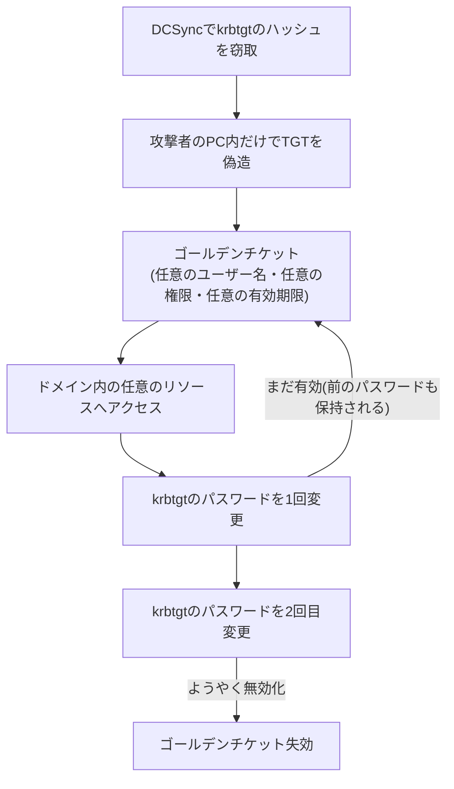

## はじめに

- **この記事で得られること**: [DCSyncのハンズオン](/articles/ad-dcsync-audit-handson-guide)で扱ったDCSyncは、`krbtgt`アカウントを含む全ユーザーのパスワードハッシュを盗み出す手法でした。この記事では、**盗んだ`krbtgt`のハッシュを使って、実際にゴールデンチケットという偽造TGTを作り、そしてなぜそれが、パスワードを1回変更しただけでは無効化できないのか**を、実際に手を動かして体系的に理解します。
- **対象読者**: DCSyncで`krbtgt`のハッシュが盗まれる、ということは知っているものの、そのハッシュが具体的に何に使われるのかを説明できない方を想定しています。
- **読むのにかかる想定時間**: 約25分
- **このハンズオンは、自組織の環境の防御力を高めるための、監査・防御目的のものです。**

この記事は[『上位1%』シリーズ 全記事ガイド](/sitemap)の一部、[Active Directoryシリーズ](/sitemap#シリーズ一覧)の43.05本目です。

## 前提知識

- [DCSyncのハンズオン](/articles/ad-dcsync-audit-handson-guide): `krbtgt`アカウントのハッシュが、DCSyncによって盗み出されうるという前提の理解が必要です。
- [Kerberos認証の仕組み](/articles/ad-kerberos-guide): TGT(Ticket Granting Ticket)の役割の理解が前提になっています。

## 全体像をつかむ

**`krbtgt`アカウントの秘密鍵は、ドメイン内で発行される、すべてのTGTに対して、署名を行うための鍵**です。**この鍵さえ手に入れば、攻撃者は、本物のドメインコントローラーに一切問い合わせることなく、自分のパソコンの中だけで、TGTを自由に作り出すことができ**ます。**このTGTには、存在しないユーザー名を書くことも、Domain Adminsグループへの所属を書くことも、有効期限を数年先に設定することもでき、これをゴールデンチケットと呼び**ます。

## 基礎から徹底解説

### なぜ、パスワードを1回変更しただけでは、ゴールデンチケットを無効化できないのか

**AD DSは、`krbtgt`アカウントについて、現在のパスワードと、1つ前のパスワードの、両方を同時に保持**しています。**これは、パスワード変更の瞬間に処理中だったチケットの検証が、突然失敗しないようにするための、Kerberosの key rollover 設計**です。**しかし、この設計のせいで、`krbtgt`のパスワードを1回変更しただけでは、攻撃者が盗んだ「1つ前のパスワード」で署名されたゴールデンチケットが、まだ有効なまま残ってしまい**ます。**本当に無効化するには、パスワードを2回連続で変更する必要があり、しかも2回目の変更は、既定のKerberosチケットの有効期間(10時間)が経過してから行うべき**とされています(1回目の変更直後に2回目を行うと、レプリケーションが完了する前に、一部のDCだけ古いパスワードのままになる、という別の問題を引き起こす可能性があるため)。

### ゴールデンチケットの検知が難しい理由と、着目すべき異常の手がかり

**ゴールデンチケットは、本物の`krbtgt`の鍵で正しく署名されているため、ドメインコントローラー側は、それを暗号学的に正当なチケットとして受け入れてしまい**ます。**検知のために着目すべきなのは、チケットの内容そのものではなく、チケットの使われ方の異常**です。**ありえないほど長いチケットの有効期間、ドメインに実在しないユーザー名でのアクセス、そして最新のドメインであるにもかかわらずRC4のような古い暗号化方式が使われている、という3つの手がかり**が、代表的な異常のパターンとして知られています。

mimikatzによる、krbtgtハッシュの窃取からゴールデンチケット生成までの流れ

**攻撃者は、DCSyncによって得られた`krbtgt`のNTLMハッシュを使い、`mimikatz`の`kerberos::golden`コマンドで、任意のユーザー名・任意のSID履歴・任意の有効期限を指定した、偽造TGTを生成**できます。**生成されたチケットを、`kerberos::ptt`(Pass the Ticket)でメモリ上にロードすれば、以降のあらゆるKerberos認証が、そのチケットの内容で成立してしまい**ます。

## プロが見ている視点(上位1%の理解)

### 「ハッシュを盗まれた」ことと、「パスワードを変更すれば安全になる」ことは、別の話である

**多くの認証情報の漏洩では、パスワードを変更すれば、漏洩した認証情報は無効になります。しかし、`krbtgt`のように、現在と1つ前の2世代の秘密情報を同時に保持する設計を持つアカウントでは、この直感が通用しません。** **この認証情報の設計そのものを一段掘り下げて確認する**習慣が、「パスワードは変更したから、もう安全だ」という、不完全な対処で終わらせてしまう失敗を避けるための、上位1%のエンジニアの視点です。

## よくある誤解・つまずきポイント

- **誤解1: 「`krbtgt`のパスワードを1回変更すれば、ゴールデンチケットは無効化される」**
  AD DSは`krbtgt`の現在のパスワードと1つ前のパスワードを両方保持するため、1回の変更では、1つ前のパスワードで署名されたゴールデンチケットが有効なまま残ります。
- **誤解2: 「ゴールデンチケットは、暗号学的に不正なチケットとして、DCに拒否される」**
  ゴールデンチケットは、本物の`krbtgt`の鍵で正しく署名されているため、DCは暗号学的に正当なチケットとして受け入れてしまいます。
- **誤解3: 「krbtgtのパスワードは、2回連続で、間隔を空けずに変更すべきだ」**
  2回目の変更は、既定のKerberosチケットの有効期間が経過してから行うべきとされており、間隔を空けずに行うと、レプリケーション未完了による別の問題を引き起こす可能性があります。

## 障害・トラブルシューティングの視点

1. **`krbtgt`のハッシュが漏洩した可能性があると判明した**: パスワードを1回変更しただけで終わらせず、既定のチケット有効期間を空けて、2回連続で変更します。
2. **ゴールデンチケットが使われている可能性を調査したい**: チケットの有効期間の異常、存在しないユーザー名でのアクセス、古い暗号化方式の使用という3つの手がかりを確認します。
3. **`krbtgt`のパスワード変更後も、不審なアクセスが続いている**: 2回目の変更が、十分な間隔を空けて実施されたかを確認します。

## まとめ

- ゴールデンチケットは、盗んだ`krbtgt`の秘密鍵を使い、任意のユーザー名・任意の権限・任意の有効期限を持つ、偽造TGTを作る手法です。
- AD DSが`krbtgt`の現在と1つ前の2世代のパスワードを同時に保持するため、1回のパスワード変更だけでは、ゴールデンチケットを無効化できません。
- 本当に無効化するには、既定のチケット有効期間を空けて、パスワードを2回連続で変更する必要があります。
- ゴールデンチケットの検知には、チケットの内容ではなく、使われ方の異常(有効期間・存在しないユーザー名・古い暗号化方式)に着目します。

**今日から意識すべきこと**
1. 認証情報が漏洩した際は、「パスワードを変更すれば安全になる」という前提が、そのアカウントの設計において本当に成り立つのかを確認しましょう。
2. `krbtgt`のパスワードローテーションを、定期的な運用に組み込みましょう。

## 参考文献

- [Steal or Forge Kerberos Tickets: Golden Ticket | MITRE ATT&CK T1558.001](https://attack.mitre.org/techniques/T1558/001)
- [Golden Ticket Attack Explained | Semperis](https://www.semperis.com/blog/golden-ticket-attack-explained/)
