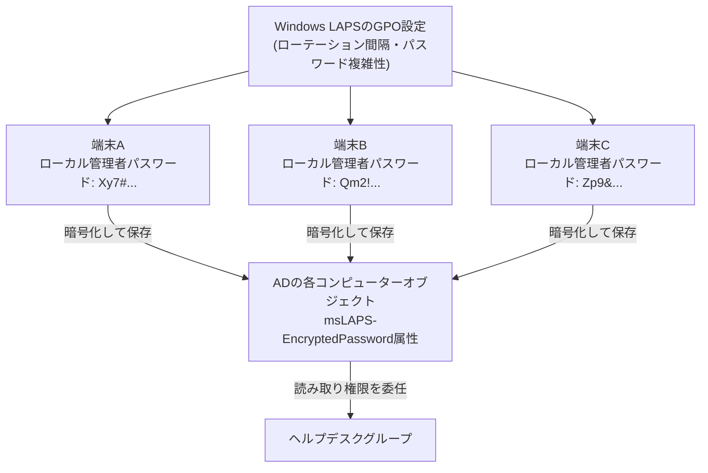

## はじめに

- **この記事で得られること**: [gMSA(グループ管理サービスアカウント)](/articles/ad-gmsa-handson-guide)は、**サービスアカウントのパスワード管理**から解放される仕組みでした。しかし、各端末の**ローカル管理者(Administrator)アカウント**のパスワードは、まだ別の問題として残っています。このハンズオンでは、**Windows LAPS**を使って、端末ごとに異なるランダムなローカル管理者パスワードを自動生成・定期ローテーションし、そのパスワードの読み取り権限を、[OUへの権限移譲](/articles/ad-delegation-handson-guide)の仕組みでヘルプデスクグループだけに絞る、という一連の流れを自分の手で構築します。
- **対象読者**: gMSAによるサービスアカウントのパスワード管理と、OUへの権限移譲の両方を経験済みで、ローカル管理者アカウントのパスワード管理という、もう1つの実務上の課題に取り組みたい方を想定しています。
- **読むのにかかる想定時間**: 約22分

この記事は[『上位1%』シリーズ 全記事ガイド](/sitemap)の一部、[ActiveDirectory学科](/sitemap#シリーズ一覧)の31.1本目です。

## 前提知識

- [gMSA(グループ管理サービスアカウント)でサービスアカウントのパスワード管理から解放される](/articles/ad-gmsa-handson-guide): パスワードの自動ローテーションという発想そのものが前提になっています。
- [OUへの権限移譲(Delegation of Control)](/articles/ad-delegation-handson-guide): 特定の属性だけを、特定のグループに読み取らせるという、委任の仕組みの理解が前提になっています。

## 全体像をつかむ

**多くの組織では、すべての端末のローカル管理者アカウントに、同じパスワードを設定してしまっています。** この運用には、致命的なリスクがあります。**1台の端末のローカル管理者パスワードが、何らかの方法で漏洩した瞬間、攻撃者はそのパスワードのハッシュを使って(パス・ザ・ハッシュ)、組織内の他のすべての端末へ、ログオン可能なアカウントとしてログインできてしまう**のです。

**Windows LAPS(Local Administrator Password Solution)は、端末ごとに、まったく異なるランダムなパスワードを自動生成し、AD上の端末オブジェクトの属性として、暗号化して保存**します。これにより、1台のパスワードが漏洩しても、他の端末への横展開ができなくなります。

## ハンズオン:Windows LAPSを構築し、パスワードの読み取り権限を委任する

### Step 1: スキーマ拡張を確認する

Windows LAPSは、ADのスキーマに、暗号化されたパスワードを保存するための新しい属性(`msLAPS-EncryptedPassword`など)を追加する必要があります。フォレストの機能レベルやOSのバージョンによっては、`Update-LapsADSchema`コマンドレットで、事前にスキーマ拡張を実行します。

### Step 2: GPOでWindows LAPSを有効化する

対象のコンピューターが所属するOUに、新しいGPOをリンクし、「コンピューターの構成」→「管理用テンプレート」→「LAPS」以下のポリシーを設定します。**パスワードの複雑性・長さ・ローテーション間隔**(既定30日)を指定し、バックアップ先として「Active Directory」を選択します。

### Step 3: 端末上での動作を確認する

GPOが適用された端末では、**バックグラウンドタスクが約1時間ごとに起動し、ポリシーの状態を確認**します。ローテーションのタイミングが来ると、新しいランダムパスワードが生成され、ローカル管理者アカウントへ設定された後、暗号化されてADへ書き込まれます。

旧Microsoft LAPSとの、決定的な違い

**旧来の「Microsoft LAPS」(別売りツール)は、パスワードをADの`ms-Mcs-AdmPwd`属性に、実は平文(クリアテキスト)のまま保存していました。** アクセス制御リスト(ACL)で読み取りを制限してはいたものの、ADに対する何らかの読み取り権限を持つアカウントが侵害された場合、パスワードそのものが、暗号化されずにそのまま読み取れてしまうという、構造的なリスクを抱えていました。**これに対し、Windowsに標準搭載されている「Windows LAPS」は、DPAPI-NGを使ってパスワードを暗号化した状態でADへ保存し、復号できるのは、明示的に許可されたプリンシパルだけ**です。旧LAPSと新LAPSは、同じ端末上で同じアカウントを同時に管理することはできません。

### Step 4: パスワードの読み取り権限を、ヘルプデスクグループだけに委任する

既定では、パスワードを復号して読み取れるのは、Domain Adminsなど、高い権限を持つグループだけです。[OUへの権限移譲](/articles/ad-delegation-handson-guide)で行った作業と同じ要領で、`Set-LapsADReadPasswordPermission`コマンドレットを使い、**対象OU上で、ヘルプデスクグループだけに、`msLAPS-EncryptedPassword`属性の読み取り権限を委任**します。これにより、ヘルプデスクの担当者は、Domain Adminsの権限を持たないまま、`Get-LapsADPassword`コマンドレットで、自分が担当する端末のローカル管理者パスワードだけを取得できるようになります。

## プロが見ている視点(上位1%の理解)

### gMSAとLAPSは、同じ「自動パスワードローテーション」という発想の、2つの異なる適用先

**[gMSA](/articles/ad-gmsa-handson-guide)は、サービスが使うドメインアカウントのパスワードを、ADが自動的にローテーションする仕組みでした。Windows LAPSは、各端末が持つローカル管理者アカウントのパスワードを、同じように自動的にローテーションする仕組みです。** この2つは、**「人間が手動で管理するパスワードを、できるだけゼロに近づける」という、同じ設計思想の、異なる適用対象**に過ぎません。「このアカウントのパスワードは、誰が、いつ、どうやってローテーションしているのか」という問いに、「IT担当者が手動で」以外の答えが返ってくるようにすることが、この分野全体の、一貫した改善の方向性です。

## よくある誤解・つまずきポイント

- **誤解1: 「LAPSは、Windows 11やWindows Server 2022以降なら、何もしなくても自動的に有効になっている」**
  Windows LAPSの機能自体はOSに組み込まれていますが、有効化にはGPOによる明示的な設定と、スキーマ拡張が必要です。
- **誤解2: 「旧Microsoft LAPSも、Windows LAPSも、保存されるパスワードの安全性は同じだ」**
  旧LAPSはパスワードを平文でADに保存していましたが、Windows LAPSはDPAPI-NGで暗号化して保存します。
- **誤解3: 「ドメイン管理者なら、誰でもすべての端末のパスワードを読み取れてよい」**
  実務上は、ヘルプデスクなど、実際に端末サポートを行う担当者だけに、必要なOUの範囲で読み取り権限を委任するべきです。

## 障害・トラブルシューティングの視点

1. **GPOを適用したのに、パスワードがADへ書き込まれない**: スキーマ拡張(`Update-LapsADSchema`)が事前に実行されているかを確認します。
2. **ヘルプデスクの担当者が、`Get-LapsADPassword`でパスワードを取得できない**: `Set-LapsADReadPasswordPermission`による委任が、対象のOUに対して正しく設定されているかを確認します。
3. **旧Microsoft LAPSから移行したのに、パスワードが2重に管理されている**: 旧LAPSのクライアントエージェントが、端末からアンインストールされていない可能性を確認します。

## まとめ

- Windows LAPSは、端末ごとに異なるランダムなローカル管理者パスワードを自動生成し、暗号化してADへ保存する仕組みです。
- これにより、1台の端末のパスワード漏洩が、他の端末へのパス・ザ・ハッシュによる横展開につながるリスクを防ぎます。
- 旧Microsoft LAPSは平文でパスワードを保存していましたが、Windows LAPSはDPAPI-NGで暗号化します。
- パスワードの読み取り権限は、委任の仕組みを使って、実際に必要なグループだけに絞るべきです。

**今日から意識すべきこと**
1. すべての端末に同じローカル管理者パスワードを設定する運用を見つけたら、Windows LAPSの導入を検討しましょう。
2. gMSAとLAPSを、「誰が手動でパスワードを管理しているか」という同じ軸で捉える習慣をつけましょう。

## 参考文献

- [LAPS concepts overview | Microsoft Learn](https://learn.microsoft.com/en-us/windows-server/identity/laps/laps-concepts-overview)
- [Windows LAPS schema extensions reference | Microsoft Learn](https://learn.microsoft.com/en-us/windows-server/identity/laps/laps-technical-reference)
