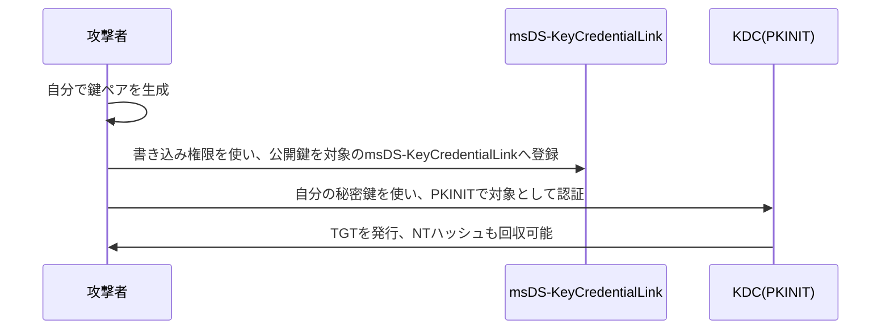

## はじめに

- **この記事で得られること**: [RBCDのハンズオン](/articles/ad-rbcd-handson-guide)で扱った、対象への書き込み権限を悪用する手法の、新しいバリエーションである、**シャドウクレデンシャル攻撃**を、実際に手を動かして体系的に理解します。
- **対象読者**: GenericWriteのような書き込み権限が、具体的にどのような攻撃に使われるのかを、もう1つ知りたい方を想定しています。
- **読むのにかかる想定時間**: 約25分(実際に構築しながら進める場合は40分程度を見込んでください)
- **このハンズオンは、自組織の環境の防御力を高めるための、監査・防御目的のものです。**

この記事は[『上位1%』シリーズ 全記事ガイド](/sitemap)の一部、[Active Directoryシリーズ](/sitemap#シリーズ一覧)の43.3本目です。

## 前提知識

- [RBCDのハンズオン](/articles/ad-rbcd-handson-guide): GenericWrite・GenericAllのような、書き込み権限を悪用する攻撃パターンの理解が前提になっています。
- [AD CSのハンズオン](/articles/ad-cs-handson-guide): PKINIT(証明書を使ったKerberos認証)の前提となる、AD CSの基本的な理解が前提になっています。

## 全体像をつかむ

**`msDS-KeyCredentialLink`は、Windows Hello for Businessのような、証明書を使ったパスワードレス認証(PKINIT)を支えるために、ユーザーやコンピューターのオブジェクトに保存される属性**です。**この属性に対する書き込み権限(GenericWrite・GenericAllなど)さえあれば、攻撃者は、対象のパスワードを一度も知る必要なく、自分が管理する鍵ペアを、この属性へ登録**できます。**そして、その鍵を使ってPKINITで認証すれば、攻撃者は対象になりすまし、さらにNTハッシュまで回収**できてしまいます。

## 基礎から徹底解説

### なぜ、パスワードを一度も知る必要がないのか

**通常のKerberos認証は、パスワードから導出した鍵を使いますが、PKINITは、公開鍵暗号を使った、まったく別の認証方式**です。**`msDS-KeyCredentialLink`に、自分の公開鍵を登録できれば、対象の実際のパスワードが何であるかとは無関係に、自分の秘密鍵だけで、PKINITによる認証を成立させることができ**ます。**このため、攻撃者は、対象のパスワードを変更する必要も、知る必要も一切ありません。**

### 攻撃には、AD CSによるPKINITの前提条件が必要

**この攻撃が成立するには、ドメインコントローラーが、PKINITによるKerberos認証を許可するための、サーバー認証証明書を持っている必要**があります。**多くの環境では、この証明書は、[AD CS(Active Directory Certificate Services)](/articles/ad-cs-handson-guide)によって発行されており、Key Trustという認証方式の前提条件になっている**ことも、忘れないでください。

この攻撃が「静かな」攻撃である理由

**多くの組織では、`msDS-KeyCredentialLink`属性への変更を、そもそも監視対象に含めていません。** **DCSyncやKerberoastingのような、よく知られた攻撃手法と比べて、この属性への変更は、検知の仕組みが整っていないことが多く、攻撃が見過ごされやすい**という特徴があります。

## プロが見ている視点(上位1%の理解)

### 「書き込み権限」という、1つの前提条件が、複数の異なる攻撃の入口になる

**[RBCD](/articles/ad-rbcd-handson-guide)も、このシャドウクレデンシャル攻撃も、根底にあるのは「対象オブジェクトへの書き込み権限」という、同じ1つの前提条件**です。**攻撃の具体的な手順は異なりますが、「誰が、どのオブジェクトに対して、書き込み権限を持っているか」を棚卸しすることが、複数の異なる攻撃手法に対する、共通の防御の出発点**になります。**1つの攻撃手法だけを個別に対策するのではなく、その攻撃が悪用している、より根本的な前提条件を特定する**習慣が、上位1%のエンジニアの視点です。

## よくある誤解・つまずきポイント

- **誤解1: 「対象のパスワードを変更すれば、この攻撃を防げる」**
  この攻撃はパスワードとは無関係に成立するため、パスワードの変更だけでは、攻撃者が登録した鍵を無効化できません。
- **誤解2: 「msDS-KeyCredentialLinkへの変更は、既定で監視されている」**
  多くの組織では、この属性への変更が監視対象に含まれておらず、攻撃が見過ごされやすくなっています。
- **誤解3: 「この攻撃は、AD CSが存在しない環境でも成立する」**
  PKINITによる認証には、サーバー認証証明書が必要であり、多くの環境ではこれがAD CSによって発行されているため、AD CSの存在が前提条件になります。

## 障害・トラブルシューティングの視点

1. **特定のアカウントへの不審なPKINIT認証を調査したい**: そのアカウントのmsDS-KeyCredentialLink属性に、見覚えのない鍵が登録されていないかを確認します。
2. **攻撃者が登録した鍵を無効化したい**: msDS-KeyCredentialLinkから該当する鍵を削除しますが、正規のWindows Hello for Business登録を誤って削除しないよう注意が必要です。
3. **自組織の環境で、この攻撃への耐性を評価したい**: 誰がどのオブジェクトのmsDS-KeyCredentialLinkへの書き込み権限を持っているかを、ACLから棚卸しします。

## まとめ

- シャドウクレデンシャル攻撃は、msDS-KeyCredentialLink属性への書き込み権限を悪用し、対象のパスワードを一度も知らずに、PKINITで対象になりすます攻撃です。
- この攻撃の成立には、ドメインコントローラーがPKINIT用のサーバー認証証明書を持っている必要があり、多くの環境ではAD CSが前提条件になります。
- 多くの組織では、この属性への変更が監視対象に含まれておらず、攻撃が見過ごされやすい、静かな攻撃手法です。
- RBCDとこの攻撃は、根底にある「対象オブジェクトへの書き込み権限」という、同じ前提条件を悪用しています。

**今日から意識すべきこと**
1. 重要なアカウントのmsDS-KeyCredentialLink属性への変更を、監視対象に含めましょう。
2. 誰がどのオブジェクトへの書き込み権限を持っているかという棚卸しを、複数の攻撃手法に共通する防御策として実施しましょう。

## 参考文献

- [Shadow Credentials | HackTricks](https://book.hacktricks.xyz/windows-hardening/active-directory-methodology/acl-persistence-abuse/shadow-credentials)
- [Shadow Credentials | ired.team](https://www.ired.team/offensive-security-experiments/active-directory-kerberos-abuse/shadow-credentials)
