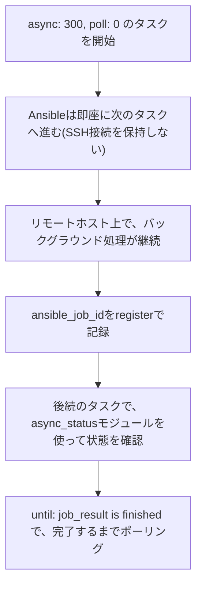

## はじめに

- **この記事で得られること**: [Moleculeによる自動テストのハンズオン](/articles/ansible-molecule-testing-handson-guide)で扱った冪等性テストとは異なる、**`async`/`poll`という、長時間かかるタスクを、SSH接続を切断したまま実行するための仕組み**を、実際に手を動かして体系的に理解します。
- **対象読者**: Ansibleタスクが、既定では処理完了までSSH接続を保持し続けることは知っているものの、`async`/`poll`が具体的にどう動くのかを説明できない方を想定しています。
- **読むのにかかる想定時間**: 約25分(実際に構築しながら進める場合は40分程度を見込んでください)

この記事は[『上位1%』シリーズ 全記事ガイド](/sitemap)の一部、[Ansible/IaCシリーズ](/sitemap#シリーズ一覧)の11.4本目です。

## 前提知識

- [Moleculeによる自動テストのハンズオン](/articles/ansible-molecule-testing-handson-guide): `changed_when`という、タスクの変更判定の仕組みの理解が前提になっています。

## 全体像をつかむ

**Ansibleのタスクは、既定では、リモートホスト上での処理が完了するまで、SSH接続を保持し続け**ます。**処理に時間がかかるタスクでは、この接続が、タイムアウトや切断によって中断されるリスクがあります。** **`async: N`は、タスクがバックグラウンドで実行できる最大時間(秒)を指定し、`poll: N`は、Ansibleがその完了を何秒おきに確認するかを指定**します。**そして、`poll: 0`を指定した場合だけ、Ansibleはタスクを開始した直後に、完了を一切待たず、次のタスクへ進み**ます。



## 基礎から徹底解説

### ハンズオン:長時間タスクを、SSH接続を切断したまま実行する

1. **`poll: 0`を指定し、長時間かかるコマンドを、バックグラウンドで実行**します。

```yaml
- name: 長時間かかる処理をバックグラウンドで開始
  ansible.builtin.command: /opt/scripts/long-running-task.sh
  async: 300
  poll: 0
  register: job_result
```

2. **`async_status`モジュールを使い、別のタスクで、先ほどのジョブの完了を確認**します。

```yaml
- name: ジョブの完了を確認する
  ansible.builtin.async_status:
    jid: "{{ job_result.ansible_job_id }}"
  register: job_status
  until: job_status.finished
  retries: 30
  delay: 10
```

**この2つのタスクの間で、Ansibleは一度もSSH接続を保持し続けていません。** **`poll: 0`を指定したタスクは、開始した瞬間にAnsible側の処理を完了させ、リモートホスト上のバックグラウンド処理だけが、独立して継続**します。

### 典型的な落とし穴:asyncタスクは、常にchangedとして報告される

**`async`を使ったタスクは、実際には何も変更していなくても、常に`changed`として報告される、という仕様上の制約があります。** **これは、[Moleculeのハンズオン](/articles/ansible-molecule-testing-handson-guide)で扱った冪等性テストと、直接衝突する特性**です。**`async`を使うタスクを含むロールを、Moleculeで冪等性テストする場合、このタスクだけを対象から除外するか、`changed_when: false`で明示的に上書きする必要**があります。

<details>
<summary>その他の落とし穴:ジョブキャッシュファイルの手動クリーンアップと、排他ロックの競合</summary>

**`poll: 0`で実行したジョブの状態ファイルは、Ansibleが自動的にクリーンアップしてくれません。`async_status`モジュールを`mode: cleanup`で呼び出し、手動で削除する必要**があります。**また、yumやaptのような、排他ロックを必要とする操作に対して`poll: 0`を使うと、バックグラウンド処理がまだロックを保持している状態で、後続のタスクが同じリソースへアクセスしようとして失敗する、という競合が発生する可能性もあります。**

</details>

## プロが見ている視点(上位1%の理解)

### 「非同期っぽい設定」と「本当に投げっぱなしの設定」は、別物である

**`async`だけを指定して`poll`を省略すると、Ansibleは既定のポーリング間隔で、やはり完了を待ち続けます。`poll: 0`という、明示的なゼロの指定だけが、本当の意味での「投げっぱなし」を実現**します。**設定項目が複数存在するとき、「どの値が、本当に求めている挙動の境界線なのか」を、一段掘り下げて確認する**習慣が、上位1%のエンジニアの視点です。

## よくある誤解・つまずきポイント

- **誤解1: 「asyncを指定すれば、自動的にSSH接続が切断される」**
  pollを省略するか、0より大きい値を指定すると、Ansibleは既定のポーリング間隔で完了を待ち続けます。切断を伴う「投げっぱなし」には、明示的に`poll: 0`が必要です。
- **誤解2: 「asyncタスクも、通常のタスクと同じように冪等性テストを通過できる」**
  asyncタスクは、実際には何も変更していなくても常に`changed`として報告されるため、冪等性テストと衝突します。
- **誤解3: 「poll: 0で実行したジョブの状態ファイルは、自動的に削除される」**
  ジョブの状態ファイルは自動的にクリーンアップされないため、`async_status`モジュールを`mode: cleanup`で明示的に呼び出す必要があります。

## 障害・トラブルシューティングの視点

1. **`async_status`での確認タスクが、ファイルが見つからないというエラーで失敗する**: 元のタスクの`async`の値が、実際の処理時間より短く、タイムアウトしてジョブ自体が失敗していないかを確認します。
2. **asyncタスクを含むロールが、Moleculeの冪等性テストで失敗する**: そのタスクに`changed_when: false`を明示的に設定するか、冪等性テストの対象から除外します。
3. **poll: 0で実行したジョブの状態ファイルが、リモートホスト上に残り続けている**: `async_status`を`mode: cleanup`で呼び出し、手動でクリーンアップします。

## まとめ

- `async: N`はバックグラウンド実行の最大時間を、`poll: N`は完了確認の間隔を指定します。
- `poll: 0`を指定した場合だけ、Ansibleはタスク開始後、完了を一切待たずに次のタスクへ進みます。
- asyncタスクは、実際には何も変更していなくても常に`changed`として報告され、冪等性テストと衝突します。
- `poll: 0`で実行したジョブの状態ファイルは、`async_status`を`mode: cleanup`で呼び出し、手動でクリーンアップする必要があります。

**今日から意識すべきこと**
1. 長時間かかるタスクを扱う際は、`poll`を省略せず、意図した挙動(待つか、投げっぱなしにするか)を明示的に指定しましょう。
2. asyncタスクを含むロールをMoleculeでテストする際は、`changed_when`の扱いを必ず確認しましょう。

## 参考文献

- [Asynchronous Actions and Polling | Ansible Documentation](https://docs.ansible.com/ansible/latest/playbook_guide/playbooks_async.html)
- [How to Run Async Tasks in Ansible With async and poll | OneUptime](https://oneuptime.com/blog/post/2026-02-21-how-to-run-async-tasks-in-ansible-with-async-and-poll/markdown)
