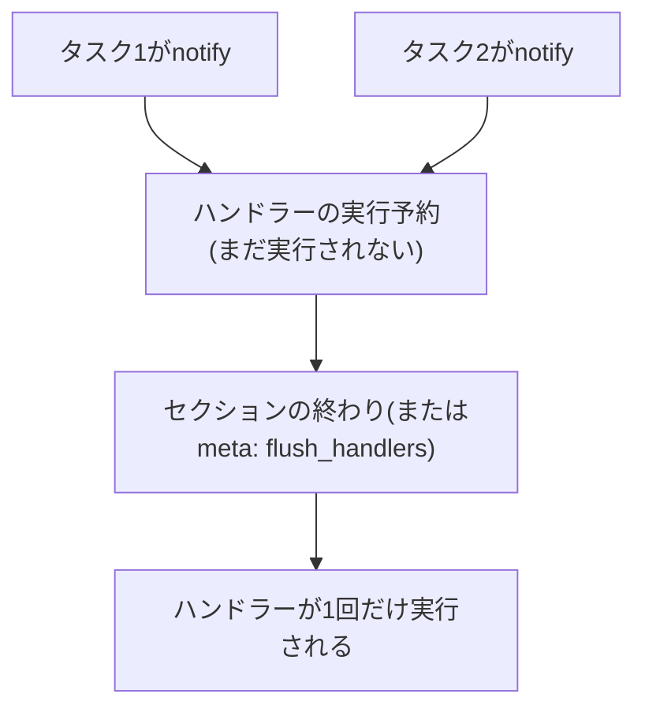

## はじめに

- **この記事で得られること**: [rolesとHandlers、テンプレートで実務レベルの構成管理を体験するハンズオン](/articles/ansible-roles-handson-guide)で扱った、notifyによるハンドラー呼び出しの先にある、**ハンドラーが実際に実行されるタイミング**を体系的に理解します。
- **対象読者**: notifyでハンドラーを呼び出せることは知っているものの、それが具体的にいつ実行されるのかを説明できない方を想定しています。
- **読むのにかかる想定時間**: 約16分

この記事は[『上位1%』シリーズ 全記事ガイド](/sitemap)の一部、[Ansible/IaCシリーズ](/sitemap#シリーズ一覧)の3.1本目です。

## 前提知識

- [rolesとHandlers、テンプレートで実務レベルの構成管理を体験するハンズオン](/articles/ansible-roles-handson-guide): notifyとハンドラーという概念の理解が前提になっています。

## 全体像をつかむ

**タスクがnotifyでハンドラーを呼び出しても、そのハンドラーは呼び出された瞬間には実行されません。** **Ansibleの既定の動作では、通知されたハンドラーは、pre_tasks・roles/tasks・post_tasksという、プレイ内の各セクションが終わった直後に、まとめて1回だけ実行**されます。**これは「即座に実行」ではなく「実行予約」であり、同じハンドラーが何度notifyされても、実行は1回だけに抑えられる**という設計です。

## 基礎から徹底解説

### flush_handlersで、予約を即座に消化する

**セクションの終わりを待たず、プレイの途中で、すでに通知されたハンドラーを即座に実行したい場合は、`meta: flush_handlers`というタスクを挿入**します。**これは、その時点までに通知されているハンドラーを、その場で実行するためのタスク**です。**そして、一度flushされたハンドラーも、プレイの後半で再びnotifyされれば、再度実行対象になる**という点も、忘れないでください。

### タスクが失敗すると、通知済みのハンドラーごと止まる

**タスクが途中で失敗すると、プレイ全体が停止し、それまでに通知されていたハンドラーも実行されないまま**になります。**`force_handlers`という設定(Playbook内、ansible.cfg、または`--force-handlers`)を有効にすると、タスクが失敗していても、通知済みのハンドラーだけは強制的に実行させることができる**ので、障害発生時でも後始末だけは済ませたい場合に使えます。

補足:ハンドラー名に変数を使うと、テンプレート展開の早さが裏目に出ることがある

**ハンドラー名は、プレイの非常に早い段階でテンプレート展開されるため、ハンドラー名の中で使っている変数の値が、その時点でまだ利用可能になっていない場合、プレイ全体が失敗する**ことがあります。

## プロが見ている視点(上位1%の理解)

### 「notifyした」と「実行された」は別の時刻の出来事

**notifyは、ハンドラーをその場で実行する命令ではなく、「後でまとめて実行してほしい」という予約を登録する命令に過ぎません。** **「このタスクの後なら、サービスはもう再起動されているはずだ」という思い込みを捨て、「次にハンドラーが実際に処理されるのはどのタイミングか」を、セクション境界とflush_handlersの両方を踏まえて確認する**習慣が、上位1%のエンジニアの視点です。

## よくある誤解・つまずきポイント

- **誤解1: 「notifyを呼び出した瞬間に、ハンドラーが実行される」**
  ハンドラーは、pre_tasks・roles/tasks・post_tasksという、各セクションの終わりに、まとめて1回だけ実行されます。
- **誤解2: 「同じハンドラーを3回notifyしたら、3回実行される」**
  同じハンドラーが何度notifyされても、該当セクションの終わりには1回だけしか実行されません。
- **誤解3: 「タスクが途中で失敗しても、それまでに通知したハンドラーは実行されるはずだ」**
  タスクの失敗でプレイが停止すると、通知済みのハンドラーも実行されません。force_handlersを有効にしない限り、後始末は行われません。

## 障害・トラブルシューティングの視点

1. **設定ファイルを変更するタスクの直後に、まだ古い設定のままサービスへアクセスしてしまう**: そのタスクの直後に`meta: flush_handlers`を挿入し、サービスの再起動を即座に確定させます。
2. **プレイの途中でタスクが失敗し、サービスが再起動されないまま中途半端な状態になる**: `force_handlers`を有効にし、失敗時でも通知済みのハンドラーだけは実行させるようにします。
3. **変数を使ったハンドラー名で、プレイ全体が失敗する**: その変数が、ハンドラー名がテンプレート展開される時点で、すでに利用可能になっているかを確認します。

## まとめ

- notifyは「実行予約」であり、ハンドラーはpre_tasks・roles/tasks・post_tasksの各セクションの終わりにまとめて1回だけ実行されます。
- meta: flush_handlersで、セクションの終わりを待たず即座に実行を確定できます。
- タスクの失敗でプレイが停止すると、通知済みのハンドラーも実行されません。force_handlersで対処できます。
- 同じハンドラーは何度notifyされても、1回だけ実行されます。

**今日から意識すべきこと**
1. 設定変更の直後にそのサービスへアクセスするタスクがある場合は、必ずmeta: flush_handlersの必要性を確認しましょう。
2. 障害発生時の後始末が必要なプレイでは、force_handlersの設定を検討しましょう。

## 参考文献

- [Handlers: running operations on change | Ansible Documentation](https://docs.ansible.com/ansible/latest/playbook_guide/playbooks_handlers.html)
