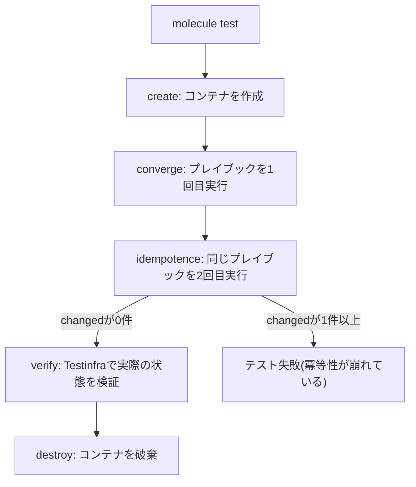

## はじめに

- **この記事で得られること**: [エラーハンドリングのハンズオン](/articles/ansible-error-handling-handson-guide)で扱った`changed_when`・`failed_when`は、タスク単体の挙動を制御する仕組みでした。この記事では、**Molecule**という、ロール全体を、使い捨てのDockerコンテナ上で自動テストするフレームワークを、実際に手を動かして体系的に理解します。
- **対象読者**: Ansibleのロールを書けるものの、そのロール自体を自動テストする方法を知らない方を想定しています。
- **読むのにかかる想定時間**: 約25分
- **ハンズオンの前提環境**: Docker(またはPodman)が動作するLinux環境、Python 3、`pip install molecule molecule-plugins[docker] pytest-testinfra`

この記事は[『上位1%』シリーズ 全記事ガイド](/sitemap)の一部、[Ansible/IaCシリーズ](/sitemap#シリーズ一覧)の11.3本目です。

## 前提知識

- [エラーハンドリングのハンズオン](/articles/ansible-error-handling-handson-guide): `changed_when`・`failed_when`の基本的な使い方の理解が前提になっています。
- [Ansibleロールのハンズオン](/articles/ansible-roles-handson-guide): ロールのディレクトリ構成の理解が前提になっています。

## 全体像をつかむ

**Moleculeは、Dockerコンテナを使い捨てのテスト環境として立て、作成・準備・実行・冪等性テスト・検証・破棄という、一連のテストシーケンスを、`molecule test`という1つのコマンドで自動化するフレームワーク**です。**中でも「冪等性テスト」は、同じプレイブックを2回実行し、2回目の実行で、たった1つでも`changed`なタスクが報告されれば、テスト自体を失敗させる**という、Ansibleの設計思想そのものを検証する仕組みです。



## 基礎から徹底解説

### 冪等性テストが失敗する、典型的な3つの原因

**冪等性テストが失敗する典型的な原因は、3つ**あります。**1つ目は、`command`モジュールや`shell`モジュールを使ったタスクに`changed_when`を設定しておらず、実際には変更がなくても、常に`changed`として報告されてしまうケース**です。**2つ目は、テンプレートの中に、実行時刻のような動的な値を含めてしまい、毎回ファイルの内容が変わってしまうケース**です。**3つ目は、パッケージのインストールタスクで`state: latest`を指定しており、新しいバージョンが存在する限り、毎回更新が発生してしまうケース**です。[エラーハンドリングのハンズオン](/articles/ansible-error-handling-handson-guide)で扱った`changed_when`は、まさにこの1つ目の原因への直接的な対処法でした。

### ハンズオン:Nginxをインストールするロールを、Moleculeでテストする

1. **Moleculeのシナリオを初期化する**(Molecule 6.0以降では、`molecule init role`は廃止されているため、ロール自体は`ansible-galaxy role init`で作成し、テストシナリオだけを別途追加します)。

```bash
ansible-galaxy role init nginx_role
cd nginx_role
molecule init scenario --driver-name docker
```

2. **`molecule/default/converge.yml`に、テスト対象のロールを適用するプレイブックを記述**します。

```yaml
- name: Converge
  hosts: all
  tasks:
    - name: "Include nginx_role"
      ansible.builtin.include_role:
        name: "nginx_role"
```

3. **`molecule test`を実行**すると、コンテナの作成・プレイブックの実行・冪等性テスト・検証・破棄が、順番に自動実行されます。

```bash
molecule test
```

4. **`molecule/default/tests/test_default.py`に、Testinfraを使った検証コードを記述**します。

```python
def test_nginx_is_running_and_enabled(host):
    nginx = host.service("nginx")
    assert nginx.is_running
    assert nginx.is_enabled

def test_nginx_listening_on_port_80(host):
    assert host.socket("tcp://0.0.0.0:80").is_listening
```

**`converge`が成功しただけでは、「エラーなく実行できた」ことしか分かりません。`verify`ステージで、実際にNginxが起動し、80番ポートをリスニングしているかまで確認することで、初めて「意図した状態になっている」ことが保証**されます。

<details>
<summary>molecule testの標準的なテストシーケンス</summary>

**既定の`molecule test`は、lint・dependency・syntax・create・prepare・converge・idempotence・verify・destroyという順序で、一連のテストを自動実行**します。**開発中は、`molecule converge`だけを繰り返し実行してロールを調整し、最後に`molecule test`で全シーケンスを通す**という使い分けが、実務では一般的です。

</details>

## プロが見ている視点(上位1%の理解)

### 「プレイブックが成功した」ことと、「ロールが正しい」ことは、まったく別の保証である

**プレイブックがエラーなく実行できたという事実は、「意図した状態に到達した」ことも、「再実行しても同じ結果になる」ことも、何も保証していません。** **ロールを書いたら、Moleculeで自動テストする環境を同時に整える**という習慣が、本番環境で予期しない`changed`に遭遇して初めて冪等性の崩れに気づく、という事後対応から脱却するための、上位1%のエンジニアの視点です。

## よくある誤解・つまずきポイント

- **誤解1: 「プレイブックがエラーなく実行できれば、ロールは正しく書けている」**
  エラーなく実行できることと、意図した状態になっていること、再実行しても同じ結果になることは、それぞれ別の保証であり、Moleculeはこの3つすべてを別々のステージで検証します。
- **誤解2: 「`molecule init role`で、ロールの作成とテストシナリオの追加が一度にできる」**
  Molecule 6.0以降では`molecule init role`は廃止されており、ロール自体は`ansible-galaxy role init`で作成し、テストシナリオは`molecule init scenario`で別途追加します。
- **誤解3: 「converge(1回目の実行)が成功すれば、冪等性テストは不要だ」**
  1回目の実行が成功しても、2回目の実行で`changed`なタスクが報告されることがあり、冪等性テストはこれを自動的に検出する、別の独立したステージです。

## 障害・トラブルシューティングの視点

1. **`molecule test`の冪等性テストで失敗する**: `command`・`shell`モジュールの`changed_when`設定、テンプレート内の動的な値、`state: latest`の使用を確認します。
2. **`converge`は成功するが`verify`で失敗する**: プレイブックがエラーなく実行できていても、意図した状態(サービスの起動状態やポートのリスニング状態)になっていない可能性があります。
3. **`molecule init role`というコマンドが見つからない**: Molecule 6.0以降では廃止されているため、`ansible-galaxy role init`と`molecule init scenario`を組み合わせて使います。

## まとめ

- Moleculeは、Dockerコンテナを使い捨てのテスト環境として立て、ロール全体を自動テストするフレームワークです。
- 冪等性テストは、同じプレイブックを2回実行し、2回目で`changed`なタスクが報告されれば失敗させる、Ansibleの設計思想そのものを検証する仕組みです。
- 冪等性テストが失敗する典型的な原因は、`changed_when`未設定の`command`/`shell`タスク、テンプレート内の動的な値、`state: latest`の3つです。
- `verify`ステージでは、Testinfraを使って、実際にサービスが意図した状態になっているかまで検証します。

**今日から意識すべきこと**
1. 新しいロールを書いたら、Moleculeによる自動テスト環境を同時に整えましょう。
2. 冪等性テストが失敗したら、まず`changed_when`の設定漏れを疑いましょう。

## 参考文献

- [How to Test Ansible with Molecule | OneUptime](https://oneuptime.com/blog/post/2026-01-22-ansible-molecule-testing/view)
- [How to Test Ansible Playbook/Role Using Molecule With Docker | Opstree](https://opstree.com/blog/how-to-test-ansible-playbook-role-using-molecule-with-docker/)
