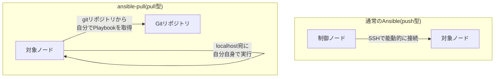

## はじめに

- **この記事で得られること**: [Ansibleとは何か](/articles/ansible-guide)で扱った、**制御ノードが対象サーバーへSSHで接続し、設定を押し込む**(push)という、Ansibleの基本モデルを前提にすると、**オートスケーリングで動的に増える新規インスタンスのように、制御ノード側が対象のIPアドレスをあらかじめ知り得ない環境では、この前提そのものが成立しない**という問題に気づきます。この記事では、**`ansible-pull`が、対象ノード自身がgitリポジトリからPlaybookを取得し**、自分自身に対してローカルで実行する、まったく逆方向の仕組みを体系的に理解します。
- **対象読者**: [Ansibleの基本的な使い方](/articles/ansible-handson-guide)は理解しているものの、インバウンドのSSH接続を前提としない構成で、Ansibleをどう使えばよいのかを説明できない方を想定しています。
- **読むのにかかる想定時間**: 約16分

この記事は[『上位1%』シリーズ 全記事ガイド](/sitemap)の一部、[Ansibleシリーズ](/sitemap#シリーズ一覧)の1.1本目です。

## 前提知識

- [Ansibleとは何か](/articles/ansible-guide): Ansibleが、制御ノードから対象サーバーへSSH接続し、設定を適用するという、エージェントレスな仕組みであるという理解が前提になっています。

## 全体像をつかむ

**Ansibleの基本モデルは、「制御ノード」が、SSHを使って「対象ノード」へ能動的に接続し、Playbookの内容を押し込んで実行する、プッシュ型の仕組みです。** この前提は、**制御ノードが、すべての対象ノードのIPアドレス(あるいはホスト名)を事前に知っていて、かつ、対象ノード側にインバウンドのSSHポートが開いている**ことを要求します。**しかし、オートスケーリンググループのように、新しいインスタンスが動的に、かつ自律的に起動する環境では、制御ノード側がその新しいインスタンスのIPアドレスを、起動時点で知っている保証はありません。** また、セキュリティ要件として、対象ノード側に、制御ノードからのインバウンドSSH接続をそもそも許可したくない、という場面もあります。**`ansible-pull`は、この前提を逆転させる**ことで、これらの問題を解決します。



## 基礎から徹底解説

### ansible-pullが、対象ノード自身の上で行っていること

**`ansible-pull`は、対象ノード自身の上で実行するコマンドです。** 実行すると、まず指定されたgitリポジトリ(Playbookが格納されている場所)を、そのノード自身へクローンまたはプル(更新取得)します。その後、`ansible-playbook`を、**接続先を`localhost`に固定したローカル実行として、取得したPlaybookに対して実行します。** **この一連の処理の間、制御ノードから対象ノードへのSSH接続は、一度も発生しません。** 対象ノードが必要とするのは、**gitリポジトリへの、アウトバウンドの到達性だけ**です。

<details>
<summary>具体的な実行例</summary>

```bash
# 対象ノード自身の上で実行する
ansible-pull -U https://github.com/example/playbooks.git site.yml
```

実務では、このコマンドを**手動で実行するのではなく、cronジョブ、あるいはクラウドインスタンスのユーザーデータ(起動時に自動実行されるスクリプト)として組み込む**ことが一般的です。これにより、**インスタンスが起動した瞬間に、自分自身でgitリポジトリから最新のPlaybookを取得し、自律的に構成を適用する**という、完全に自己完結した初期構成が実現します。

</details>

### なぜ、この逆転が、オートスケーリング環境で特に有効なのか

**オートスケーリンググループで新しいインスタンスが起動する瞬間、制御ノード側は、そのインスタンスの存在すら、まだ認識していないことが多くあります。** push型の構成では、「新しいインスタンスが起動した」という通知を受け取り、そのIPアドレスを動的インベントリへ反映し、ようやくSSH接続して構成を適用する、という複数の手順が必要になります。**pull型(`ansible-pull`)では、新しいインスタンス自身が、起動時のユーザーデータから`ansible-pull`を実行するだけで、制御ノード側の介入を一切必要とせずに、構成が完了します。** インスタンスの起動から構成完了までの手順が、構造的にシンプルになることが、この方式の実務上の強みです。

## プロが見ている視点(上位1%の理解)

### pull型には、push型にはないトレードオフがある

**`ansible-pull`は、インバウンドSSHが不要になるという利点の代わりに、いくつかの重要なトレードオフを抱えています。** まず、**制御ノード側が、個々の対象ノードでの実行結果を、リアルタイムに把握する手段を持ちません。** 各ノードは、自律的に、自分のタイミングで実行するため、「今、どのノードが、どんな結果で実行を終えたか」を中央から一括で確認する仕組みが、既定では存在しません。また、**[Ansible Vault](/articles/ansible-vault-handson-guide)による機密情報の復号も、対象ノード自身が、人間の介在なしに行う必要がある**ため、復号パスワードそのものを、対象ノード側にどう安全に配置するかという、別の設計課題が生まれます。**[Ansible Tower/AWX](/articles/ansible-tower-awx-overview-guide)のような中央管理の仕組みが提供する「実行結果の一元的な可視化」は、pull型を選んだ時点で、意識的に手放す対象になる**という理解が重要です。

## よくある誤解・つまずきポイント

- **誤解1: 「ansible-pullは、Ansibleの別バージョンや、別の製品だ」**
  ansible-pullは、通常のansible-playbookと同じAnsibleに標準で含まれているコマンドであり、実行方向(push/pull)が異なるだけで、Playbookの書き方自体は変わりません。
- **誤解2: 「ansible-pullを使えば、制御ノードという概念自体が不要になる」**
  制御ノードという役割自体は、Playbookを格納するgitリポジトリという形で、依然として存在しています。能動的にSSH接続する主体が変わるだけです。
- **誤解3: 「ansible-pullは、push型よりも必ず優れている」**
  ansible-pullは、実行結果の一元的な可視化や、機密情報の安全な配布という点で、push型やAnsible Towerのような中央管理の仕組みに劣るトレードオフを抱えています。

## 障害・トラブルシューティングの視点

1. **オートスケーリングで起動した新規インスタンスに、構成が適用されていない**: ユーザーデータに設定した`ansible-pull`コマンド自体が、起動時に正しく実行されているかを、該当インスタンスのログ(例: `cloud-init`のログ)で確認します。
2. **`ansible-pull`がgitリポジトリの取得に失敗する**: 対象ノードから、gitリポジトリへのアウトバウンドの到達性(ネットワーク・認証情報)を確認します。
3. **複数の対象ノードで、実行結果を一元的に確認したい**: ansible-pull単体ではこれを提供しないため、各ノードからログを集約する仕組み(ログ転送サービスなど)を別途用意する必要があります。

## まとめ

- Ansibleの基本モデルは、制御ノードがSSHで対象ノードへ能動的に接続する、push型の仕組みです。
- ansible-pullは、対象ノード自身がgitリポジトリからPlaybookを取得し、localhost宛にローカル実行する、pull型の仕組みです。
- pull型では、対象ノードへのインバウンドSSH接続が一切不要になるため、オートスケーリング環境のような、制御ノードが対象を事前に把握できない環境で特に有効です。
- pull型は、実行結果の一元的な可視化や機密情報の安全な配布という点で、push型にはないトレードオフを抱えています。

**今日から意識すべきこと**
1. インバウンドSSHを前提にできない環境でAnsibleを使いたい場合は、ansible-pullという選択肢を検討しましょう。
2. ansible-pullを採用する際は、実行結果の可視化と機密情報の配布を、別の仕組みで補う必要があることを、設計の初期段階で意識しましょう。

## 参考文献

- [ansible-pull | Ansible Documentation](https://docs.ansible.com/ansible/latest/cli/ansible-pull.html)
- [Pull-based Ansible playbooks | Ansible Documentation](https://docs.ansible.com/ansible/latest/playbook_guide/playbooks_pull.html)
