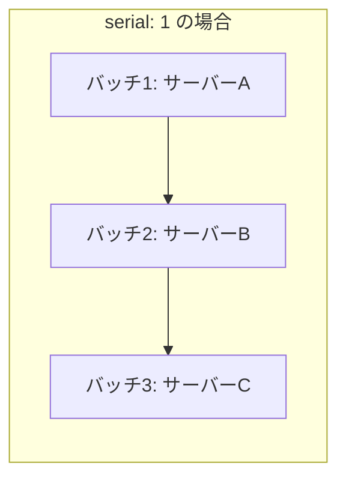

## はじめに

- **この記事で得られること**: Playbookを実行すると、既定ではインベントリ内のすべてのホストへ、ほぼ同時に変更が適用されます。サービスの再起動を伴う変更の場合、これは**全台が一瞬で同時に落ちる**ことを意味します。この記事では、**`serial`キーワードで一度に処理する台数を制限し、`delegate_to`でロードバランサーからの切り離し・復帰を組み込む**ことで、ゼロダウンタイムのローリングアップデートを実現する手順を、自分の手で構築します。**`serial`だけでは不十分であり、ロードバランサーからの明示的な切り離しが必要な理由**までを体験します。
- **対象読者**: [Ansibleで複数サーバーへの設定投入を自動化するハンズオン](/articles/ansible-handson-guide)を終えているものの、サービス再起動を伴う変更を、本番環境のサーバー群へ安全に適用する方法を説明できない方を想定しています。
- **読むのにかかる想定時間**: 約20分

この記事は[『上位1%』シリーズ 全記事ガイド](/sitemap)の一部、[Ansibleシリーズ](/sitemap#シリーズ一覧)の11.1本目です。

## 前提知識

- [Ansibleで複数サーバーへの設定投入を自動化するハンズオン](/articles/ansible-handson-guide): Playbookが、既定でインベントリ内のすべてのホストへ並行して処理を適用するという理解が前提になっています。
- [ロードバランサーからサーバーを安全に外す——コネクションドレイン](/articles/load-balancing-connection-draining-guide): 新規接続だけを止め、既存の接続は自然に終わるまで継続させる、DRAIN状態の仕組みが前提になっています。

## 全体像をつかむ

**Playbookは、既定では、対象となるすべてのホストに対して、各タスクを並行して(フォークの上限まで同時に)実行します。** これは、設定ファイルの配布のような、サービスの中断を伴わない変更では問題になりませんが、**アプリケーションのデプロイやサービスの再起動を伴う変更では、インベントリ内の全台が、ほぼ同時にサービスを停止する**ことを意味します。**この問題を解決するのが、`serial`キーワードです。** `serial`は、1回のPlaybook実行を、指定した台数ずつの「バッチ」に分割し、1つのバッチの処理が完全に終わってから、次のバッチへ進むという、逐次的な実行を強制します。



**しかし、`serial`だけでは、まだゼロダウンタイムは実現できません。** `serial`は、処理する「台数」を制限するだけであり、そのサーバーが、処理されている最中もロードバランサーからのトラフィックを受け続けている場合、サービスの再起動と同時に、処理中のリクエストが失われます。**`serial`による台数制限と、ロードバランサーからの明示的な切り離し(ドレイン)を組み合わせる**ことで、初めて実用的なゼロダウンタイムのローリングアップデートが成立します。

## やってみよう

### 手順1: serialでバッチサイズを指定する

Playbookの先頭で、`serial`キーワードを使い、一度に処理するホストの台数を指定します。

```yaml
---
- name: アプリケーションサーバーのローリングアップデート
  hosts: appservers
  serial: 1  # 1台ずつ処理する(パーセンテージ指定も可能: "25%")
  max_fail_percentage: 0  # 1台でも失敗したら、残りのバッチの実行を中止する
  tasks:
    # ...
```

**`max_fail_percentage`も合わせて設定しておくことを強く推奨します。** これは、あるバッチ内で失敗したホストの割合が、指定した値を超えた場合、以降のバッチの実行を中止する設定です。これがないと、1台目の処理で何らかの問題が発生していても、Ansibleは気づかずに2台目、3台目へと処理を進めてしまい、**全台を同じ不具合のある状態にしてしまう**危険があります。

### 手順2: delegate_toで、ロードバランサーからの切り離しを組み込む

`pre_tasks`に、**現在処理中のホストを、ロードバランサーから切り離す**タスクを追加します。このタスクは、処理中のサーバー自身の上で実行するのではなく、**ロードバランサーに対してAPIを呼び出す**必要があるため、`delegate_to`を使います。

```yaml
  pre_tasks:
    - name: HAProxyのRuntime API経由で、このホストをDRAIN状態にする
      community.general.haproxy:
        state: drained
        host: "{{ inventory_hostname }}"
        socket: /var/run/haproxy.sock
      delegate_to: haproxy_server  # ロードバランサー自身のホストで実行する

  tasks:
    - name: アプリケーションのデプロイとサービス再起動
      # ...(ここで実際のデプロイ・再起動処理)

  post_tasks:
    - name: ヘルスチェックが正常化するまで待機
      ansible.builtin.wait_for:
        port: 8080
        delay: 5

    - name: HAProxyのRuntime API経由で、このホストをREADY状態に戻す
      community.general.haproxy:
        state: enabled
        host: "{{ inventory_hostname }}"
        socket: /var/run/haproxy.sock
      delegate_to: haproxy_server
```

**`delegate_to`は、そのタスクを、現在Ansibleがループしているホスト(`inventory_hostname`)ではなく、指定した別のホスト上で実行する**という指示です。ここでは、「アプリケーションサーバー1台をDRAIN状態にする」という操作そのものは、[HAProxyのDRAIN状態](/articles/load-balancing-connection-draining-guide)で扱った通り、ロードバランサー自身のRuntime APIを呼び出す必要があるため、処理対象のホストではなく、ロードバランサーのホストへ処理を委任しています。

<details>
<summary>AWSのALBが対象の場合は、どう変わるか</summary>

[Application Load Balancer(ALB)のハンズオン](/articles/aws-alb-handson-guide)で扱った、AWSのALBを対象にする場合は、HAProxyのRuntime APIの代わりに、AWS CLIまたは`amazon.aws.elb_target`モジュールを使い、対象のEC2インスタンスをターゲットグループから登録解除・再登録します。**この場合も、ロードバランサー(AWSのAPIエンドポイント)へリクエストを送るという点は同じ**であり、`delegate_to: localhost`(AWS CLIを実行できる、Ansible実行元のマシン自身)を指定することになります。ロードバランサーの実装が変わっても、「処理対象のホストから切り離し、処理対象のホストへ処理を委任する」という構造自体は変わりません。

</details>

## プロが見ている視点(上位1%の理解)

### 「serialを設定した」だけで満足してはいけない

実務でよく見かける誤りが、**`serial`を設定しただけで「ローリングアップデートを実装した」と考えてしまう**ことです。`serial`は、あくまで「**何台を同時に処理するか**」という並行度の制御であり、**「処理中のホストが、ユーザーからのトラフィックを受け続けているかどうか」という、トラフィックの流れそのものの制御**とは、まったく別の軸にある設定です。**両方を組み合わせて初めて、実務で使えるゼロダウンタイムのローリングアップデートが完成する**ということを、常に意識しておく必要があります。[ロードバランシング学科](/articles/load-balancing-connection-draining-guide)で学んだ「新規流入の停止」と「既存処理の完了待ち」という設計思想が、ここではAnsibleの`pre_tasks`/`post_tasks`という具体的な実装として現れていることが分かります。

## よくある誤解・つまずきポイント

- **誤解1: 「serialを設定すれば、ゼロダウンタイムが自動的に実現される」**
  serialは処理する台数を制限するだけであり、ロードバランサーからの明示的な切り離しを別途組み込まなければ、処理中のリクエストが失われる可能性があります。
- **誤解2: 「delegate_toは、処理対象のホストを変更する機能だ」**
  delegate_toは、特定のタスクだけを別のホスト上で実行する機能であり、Playbook全体の対象ホストを変更するものではありません。
- **誤解3: 「max_fail_percentageを設定しなくても、serialがあれば十分安全だ」**
  max_fail_percentageがない場合、1台目のバッチで問題が発生していても、Ansibleはそれに気づかず残りのバッチの処理を続け、全台を同じ不具合のある状態にしてしまう危険があります。

## 障害・トラブルシューティングの視点

1. **ローリングアップデート中に、ユーザーからエラー報告が届く**: pre_tasksでのロードバランサーからの切り離しが、実際に成功しているかをログで確認します。
2. **1台目のバッチで失敗したのに、2台目の処理が始まってしまった**: max_fail_percentageが設定されているか、設定した値が適切かを確認します。
3. **delegate_toを指定したタスクが、意図したホストとは異なるホストで実行されている**: delegate_toに指定したホスト名が、インベントリ内で正しく解決されているかを確認します。

## まとめ

- serialキーワードは、Playbookの実行を指定した台数ずつのバッチに分割し、逐次的な実行を強制します。
- serialだけでは、処理中のホストがロードバランサーからのトラフィックを受け続けてしまうため、ゼロダウンタイムは実現できません。
- delegate_toを使い、ロードバランサーへの切り離し・復帰のリクエストを、処理対象のホストではなくロードバランサー自身に委任することで、実用的なゼロダウンタイムのローリングアップデートが実現します。
- max_fail_percentageを併用することで、初期のバッチで問題が発生した場合に、以降のバッチへの処理の拡大を防げます。

**今日から意識すべきこと**
1. サービス再起動を伴うPlaybookには、必ずserialとmax_fail_percentageをセットで設定しましょう。
2. ロードバランサーの背後にあるサーバーを更新する際は、pre_tasks/post_tasksでの明示的な切り離し・復帰を、serialとセットで組み込みましょう。

## 参考文献

- [Delegation, rolling updates, and local actions | Ansible Documentation](https://docs.ansible.com/ansible/latest/playbook_guide/playbooks_delegation.html)
- [community.general.haproxy module | Ansible Documentation](https://docs.ansible.com/ansible/latest/collections/community/general/haproxy_module.html)
