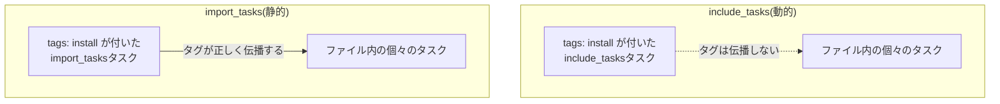

## はじめに

- **この記事で得られること**: Ansibleの`tags`キーワードは、タスクに「ラベル」を付けるだけで、実行するかどうかを決めるのは、コマンドラインの`--tags`/`--skip-tags`オプションだけです。この記事では、この基本ルールと、**`include_tasks`で外部ファイルを読み込んでいる場合、そのincludeタスク自体に付けたタグが、中に書かれている個々のタスクには伝播しない**という、実務でよく遭遇する落とし穴を体系的に理解します。
- **対象読者**: Playbookやroleは書けるものの、`--tags`オプションを使って、一部のタスクだけを選択実行したことがない方を想定しています。
- **読むのにかかる想定時間**: 約18分

この記事は[『上位1%』シリーズ 全記事ガイド](/sitemap)の一部、[Ansible/IaC学科](/sitemap#シリーズ一覧)の11.2本目です。

## 前提知識

- [Ansibleのroles・Handlers・テンプレート](/articles/ansible-roles-handson-guide): roleやタスクファイルの構造についての、基本的な理解が前提になっています。

## 全体像をつかむ

**`tags`キーワードは、タスクや再生(play)に「ラベル」を付けるだけの機能です。実際にそのラベルを使って実行するタスクを選択・除外するのは、コマンドライン実行時の`--tags`/`--skip-tags`オプションだけ**です。ここに、見落とされがちな落とし穴があります。**`include_tasks`(動的インクルード)を使って、別ファイルのタスク群を読み込んでいる場合、そのincludeタスク自体に付けたタグは、includeタスクそのものにしか適用されず、ファイルの中に書かれている個々のタスクには伝播しません。** 一方、**`import_tasks`(静的インポート)であれば、タグは、インポートされた個々のタスクまで、正しく伝わります。**

## 基礎から徹底解説

### `always`と`never`:2つの特別なタグ

**Ansibleには、`always`と`never`という、2つの特別な意味を持つタグが存在します。** **`always`タグが付いたタスクは、`--tags`でどのタグを指定していても、常に実行**されます(ただし`--skip-tags always`で明示的に除外した場合は除きます)。**`never`タグが付いたタスクは、`--tags never`のように明示的に指定しない限り、常にスキップ**されます。ファクト収集タスクが、内部的に`always`タグを持っているため、`--tags`でどんな値を指定しても、既定ではファクト収集自体はスキップされない、という挙動も、この仕組みに由来します。

### `include_tasks`と`import_tasks`:動的か静的かで、タグの挙動が変わる

**`include_tasks`は、Playbookの実行中に、動的にファイルを読み込みます。この「実行時に初めて読み込まれる」という性質のため、Ansibleは、includeタスク自体のタグを、ファイル内の個々のタスクへ、自動的には伝播させません。** **`import_tasks`は、Playbookの解析時(実行前)に、静的にファイルの内容を展開します。この「事前に展開される」という性質のため、タグが、個々のタスクまで正しく伝わります。**

includeタスクでも、タグを伝播させる方法がある

**`include_tasks`を使いながらも、タグを中のタスクへ伝播させたい場合、`apply`キーワードを使うか、includeタスク自体をタグ付きのブロック(`block`)で囲む**という、2つの回避策があります。どちらも、「includeという仕組み自体の挙動を変える」のではなく、「タグが本来届くべき範囲を、明示的に指定し直す」という発想です。

## プロが見ている視点(上位1%の理解)

### 「タグが効かない」と感じたら、まずincludeかimportかを確認する

**実務で、「`--tags`を指定したのに、期待したタスクが実行されない」という問題に遭遇したとき、多くの場合、原因は、対象のタスクが`include_tasks`経由で読み込まれている、というケース**です。**includeとimportを同じPlaybook内で混在させることは、Ansible自身のドキュメントでも、診断が難しいバグにつながると警告されている**組み合わせです。タグが効かないという症状に遭遇したら、**その前に、対象のタスクが、動的(include)か静的(import)かのどちらで読み込まれているのかを、まず確認する**ことが、上位1%のエンジニアが持っている視点です。

## よくある誤解・つまずきポイント

- **誤解1: 「tagsキーワードを書けば、そのタスクが自動的に選択・除外される」**
  tagsキーワードは、タスクにラベルを付けるだけの機能であり、実際に選択・除外するのは、実行時の`--tags`/`--skip-tags`オプションです。
- **誤解2: 「include_tasksとimport_tasksは、タグに関して同じ挙動を持つ」**
  include_tasksに付けたタグは、includeタスク自体にしか適用されず、ファイル内の個々のタスクには伝播しませんが、import_tasksでは正しく伝播します。
- **誤解3: 「`--skip-tags`を指定すれば、ファクト収集も含めて、すべてのタスクをスキップできる」**
  ファクト収集は内部的にalwaysタグを持っているため、`--skip-tags always`を明示的に指定しない限り、既定ではスキップされません。

## 障害・トラブルシューティングの視点

1. **`--tags`を指定したのに、期待したタスクが実行されない**: 対象のタスクが、include_tasks経由で読み込まれていないかを確認します。
2. **ファクト収集だけをスキップしたい**: `--skip-tags always`を明示的に指定するか、`gather_facts: false`を使うべきかを検討します。
3. **includeとimportが混在していて、タグの挙動が予測できない**: 1つのPlaybook内で、includeとimportの使い分け方針を統一することを検討します。

## まとめ

- `tags`キーワードは、タスクにラベルを付けるだけで、実際の選択・除外は、実行時の`--tags`/`--skip-tags`オプションが行います。
- `always`タグは常に実行され、`never`タグは明示的に指定しない限り常にスキップされます。
- `include_tasks`(動的)に付けたタグは、中の個々のタスクには伝播しませんが、`import_tasks`(静的)では正しく伝播します。
- タグが効かないという問題に遭遇したら、対象タスクがincludeかimportかを、まず確認しましょう。

**今日から意識すべきこと**
1. 「タグが効かない」と感じたら、対象のタスクがincludeかimportかを、最初に確認する習慣をつけましょう。
2. includeタスクにタグを付ける際は、本当に伝播が必要かどうかを意識し、必要なら`apply`キーワードを使いましょう。

## 参考文献

- [Tags | Ansible Documentation](https://docs.ansible.com/ansible/latest/playbook_guide/playbooks_tags.html)
- [Ansible tags for fast playbook runs | Red Hat](https://www.redhat.com/de/blog/ansible-tags-fast-playbook-runs)
