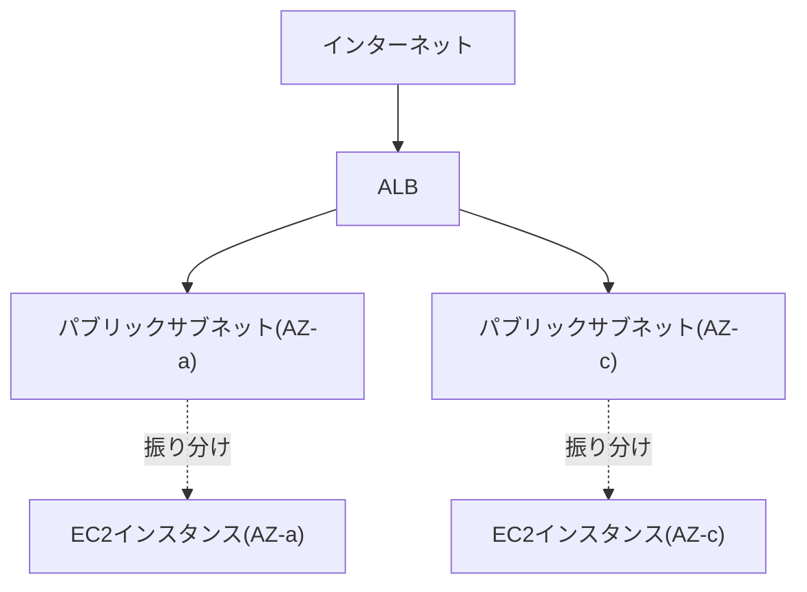

## はじめに

- **この記事で得られること**: [パブリック/プライベートサブネットを持つVPCを構築するハンズオン](/articles/aws-vpc-handson-guide)で作ったVPCを土台に、**Application Load Balancer**(ALB)を使い、複数のアベイラビリティーゾーン(AZ)に配置した複数のEC2インスタンスへ、トラフィックを振り分ける構成を自分の手で構築します。**ALBがなぜ最低2つのAZを要求するのか**、そして**セキュリティグループをどう設計すればEC2インスタンスを直接インターネットに晒さずに済むのか**を、実際に動かしながら体験します。
- **対象読者**: [EC2でWebサーバーを公開するハンズオン](/articles/aws-ec2-webserver-handson-guide)と[VPCハンズオン](/articles/aws-vpc-handson-guide)を終えているものの、複数のEC2インスタンスへトラフィックを振り分ける構成を、自分で構築したことがない方を想定しています。
- **読むのにかかる想定時間**: 約22分

この記事は[『上位1%』シリーズ 全記事ガイド](/sitemap)の一部、[AWS基礎シリーズ](/sitemap#シリーズ一覧)の5.1本目です。

## 前提知識

- [パブリック/プライベートサブネットを持つVPCを構築するハンズオン](/articles/aws-vpc-handson-guide): パブリックサブネットとプライベートサブネットの役割分担が前提になっています。
- [セキュリティグループとネットワークACL(NACL)の違い](/articles/aws-nacl-security-group-guide): セキュリティグループが、インスタンス単位のステートフルなファイアウォールであるという理解が前提になっています。
- [ロードバランサーのL4とL7の違い](/articles/load-balancing-fundamentals-guide): ALBが、HTTPの内容を理解して振り分けるL7ロードバランサーであるという理解があると、より深く理解できます。

## 全体像をつかむ

**1台のEC2インスタンスだけでWebサーバーを運用していると、そのインスタンスに障害が起きた瞬間、サービスは完全に停止します。** これを避けるため、**複数のEC2インスタンスへトラフィックを振り分け、1台が落ちても残りのインスタンスで応答を続けられる**構成が必要になります。AWSでは、この役割を**ALB**(Application Load Balancer)が担います。ALBは、インターネットからのリクエストを受け取り、登録された複数のEC2インスタンス(ターゲット)へ、ヘルスチェックの結果に基づいて振り分けます。**ここで重要なのが、ALBは設計上、最低2つの異なるアベイラビリティーゾーン(AZ)にあるサブネットを必要とする**という制約です。これは、1つのAZ全体が障害になった場合でも、別のAZでサービスを継続できるようにする、AWSの高可用性設計の根幹に関わる制約です。

## やってみよう

### 前提:2つ目のアベイラビリティーゾーンにサブネットを追加する

[VPCハンズオン](/articles/aws-vpc-handson-guide)で構築したVPCには、1つのAZにのみ、パブリック・プライベートサブネットが存在します。**ALBを構築するには、もう1つの異なるAZに、同じ構成のサブネットをもう1組追加する必要があります。** 既存のパブリックサブネットと同じルートテーブル(IGWへの経路を持つもの)を、2つ目のAZのパブリックサブネットにも関連付けてください。

なぜ「最低2つのAZ」という制約が存在するのか

ALBを作成する画面で、サブネットを1つしか選択しない状態で作成を進めようとすると、「**At least two subnets in two different Availability Zones must be specified**」というエラーが表示されます。**これは、ALB自身が、AWSの内部で複数のAZにまたがる形で構築される、分散されたリソースだから**です。1つのAZのみにALBを構築できてしまうと、そのAZが障害になった瞬間、ALB自身も機能を失ってしまい、高可用性という目的そのものが成立しません。この制約は、ALBの仕様上の都合ではなく、**高可用性を設計レベルで強制する、AWSの意図的な仕組み**として理解しておく必要があります。

### 手順1: 2つのAZに、EC2インスタンスを1台ずつ起動する

[EC2でWebサーバーを公開するハンズオン](/articles/aws-ec2-webserver-handson-guide)と同様の手順で、簡単なHTTPレスポンスを返すWebサーバーを、**それぞれのAZのプライベートサブネットに1台ずつ**、合計2台起動します。それぞれのレスポンスに、どちらのインスタンスが応答したかが分かるよう、インスタンスIDなどを含めておくと、後の確認がしやすくなります。

### 手順2: セキュリティグループを、2段構えで設計する

ここが、このハンズオンの核心です。**EC2インスタンス用のセキュリティグループを作成する際、インバウンドルールの許可元を、`0.0.0.0/0`(どこからでも)ではなく、ALB用のセキュリティグループに限定します。**

| セキュリティグループ | インバウンドルール |
|---|---|
| ALB用SG | 80番ポートを`0.0.0.0/0`(インターネット全体)から許可 |
| EC2用SG | 80番ポートを、**ALB用SGからの通信のみ**許可 |

**この2段構えにより、EC2インスタンスは、ALBを経由しない直接のインターネットからのアクセスを、そもそも受け付けなくなります。** EC2インスタンスがプライベートサブネットに配置されていることと合わせて、二重の防御層が構成されます。

### 手順3: ターゲットグループとALBを作成する

2台のEC2インスタンスを、1つのターゲットグループへ登録し、ヘルスチェックのパスを設定します。その後、2つのAZのパブリックサブネットをまたぐ形でALBを作成し、リスナー(80番ポート)の転送先として、このターゲットグループを指定します。

### 手順4: 振り分けを確認する

ALBのDNS名へブラウザでアクセスし、**何度かリロードを繰り返して、応答するインスタンスIDが交互に(あるいはランダムに)切り替わる**ことを確認します。次に、片方のインスタンスを停止し、ターゲットグループのヘルスチェックが`unhealthy`に変わった後、**もう一方のインスタンスだけが応答し続け、エラーが発生しない**ことを確認します。

## プロが見ている視点(上位1%の理解)

### ALBの「登録解除の遅延」は、ロードバランシングの世界共通の概念そのもの

ターゲットグループの詳細設定には、「**登録解除の遅延**(Deregistration Delay)」という項目があります。これは、ターゲットをターゲットグループから登録解除する際、**既存の接続への応答だけは、設定した秒数の間、継続させる**という設定です。これは、[コネクションドレイン(DRAIN)の仕組み](/articles/load-balancing-connection-draining-guide)で扱った、**「新規流入は止めるが、既存の処理は完了まで見届ける」という、ロードバランシングの世界で広く共通する設計思想が、AWSのALBという具体的な実装の中で、この名前として現れたもの**です。デプロイのためにインスタンスを入れ替える際は、この登録解除の遅延を、アプリケーションの最大応答時間より長く設定しておくことが、実務上の定石です。

## よくある誤解・つまずきポイント

- **誤解1: 「EC2インスタンスのセキュリティグループも、ALBと同様に`0.0.0.0/0`から許可しておけば安全だ」**
  ALBを経由させる構成では、EC2インスタンス自身は、ALBのセキュリティグループからの通信のみを許可するべきです。`0.0.0.0/0`から許可すると、ALBを迂回した直接アクセスを許してしまいます。
- **誤解2: 「ALBは1つのAZだけでも構築できる」**
  ALBは、高可用性を設計レベルで保証するため、最低2つの異なるAZにあるサブネットを必須とします。
- **誤解3: 「登録解除の遅延は、ALB特有の、他には存在しない機能だ」**
  登録解除の遅延は、他のロードバランサー実装における「コネクションドレイン」と、まったく同じ設計思想を持つ、AWSにおける具体的な実装名です。

## 障害・トラブルシューティングの視点

1. **ALB作成時に「At least two subnets in two different Availability Zones must be specified」というエラーが出る**: 選択しているサブネットが、実際に2つの異なるAZに属しているかを確認します。
2. **ターゲットグループのヘルスチェックが、ずっと`unhealthy`のままになる**: EC2用セキュリティグループが、ALB用セキュリティグループからのヘルスチェック通信を許可しているかを確認します。
3. **ALBのDNS名にはアクセスできるが、特定のタイミングでエラーが返る**: デプロイ中であれば、登録解除の遅延の設定時間が、アプリケーションの処理時間より短すぎないかを確認します。

## まとめ

- ALBは、複数のEC2インスタンスへトラフィックを振り分け、1台の障害がサービス全体の停止に直結しない構成を実現します。
- ALBは、高可用性を設計レベルで保証するため、最低2つの異なるAZにあるサブネットを必須とします。
- EC2インスタンス用のセキュリティグループは、ALB用セキュリティグループからの通信のみを許可し、直接のインターネットアクセスを遮断すべきです。
- ALBの「登録解除の遅延」は、ロードバランシングの世界で広く共通する、コネクションドレインという設計思想の、AWSにおける具体的な実装です。

**今日から意識すべきこと**
1. ALBの背後に置くEC2インスタンスのセキュリティグループは、必ずALB用セキュリティグループからの通信のみに限定しましょう。
2. デプロイのためにインスタンスを入れ替える際は、登録解除の遅延の設定時間を、必ずアプリケーションの最大応答時間より長く設定しましょう。

## 参考文献

- [What is an Application Load Balancer? | AWS Documentation](https://docs.aws.amazon.com/elasticloadbalancing/latest/application/introduction.html)
- [Availability Zones for your Application Load Balancer | AWS Documentation](https://docs.aws.amazon.com/elasticloadbalancing/latest/application/application-load-balancers.html#availability-zones)
