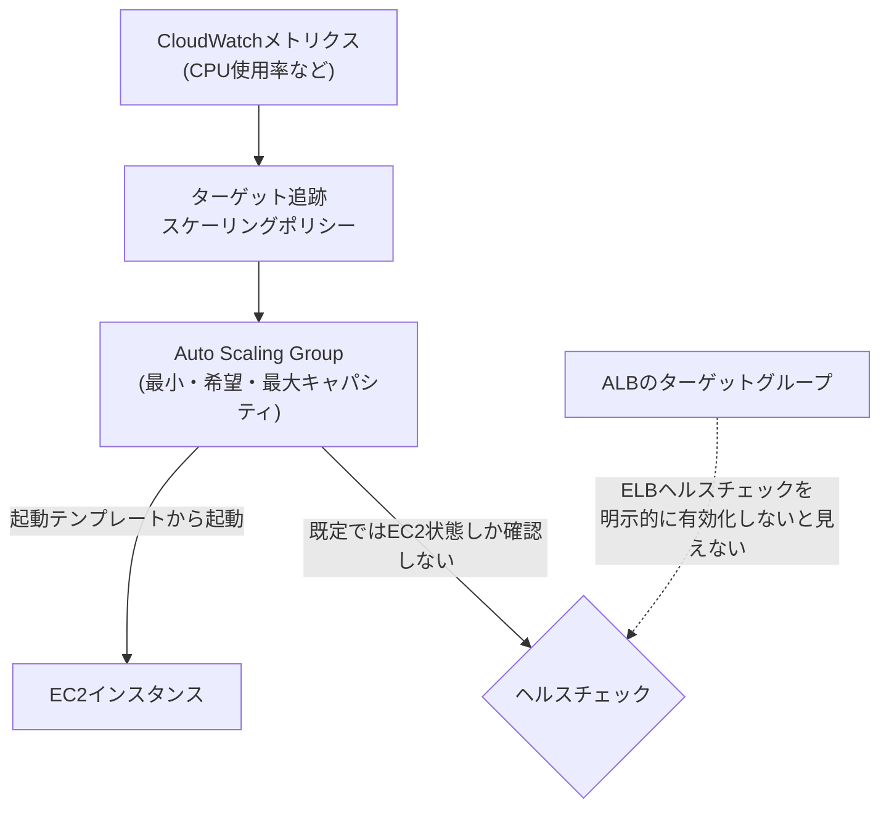

## はじめに

- **この記事で得られること**: [Application Load Balancer(ALB)のハンズオン](/articles/aws-alb-handson-guide)では、あらかじめ起動した複数のEC2インスタンスへ、トラフィックを振り分けました。このハンズオンでは、**Auto Scaling Group**(ASG)を使い、**負荷に応じてインスタンスの台数そのものを自動的に増減させる**仕組みを体験します。そして、ASGの既定のヘルスチェックが、**ALBのヘルスチェック結果を一切見ていない**という、実務で頻繁に遭遇する盲点も確認します。
- **対象読者**: ALBによる振り分けは経験済みで、インスタンスの台数そのものを、どうやって自動的に増減させるのかを知りたい方を想定しています。
- **読むのにかかる想定時間**: 約24分(ハンズオン)

この記事は[『上位1%』シリーズ 全記事ガイド](/sitemap)の一部、[AWS学科](/sitemap#シリーズ一覧)の5.3本目です。

## 前提知識

- [Application Load Balancer(ALB)のハンズオン](/articles/aws-alb-handson-guide): ターゲットグループへのEC2インスタンス登録という、前提の仕組みの理解が必要です。

## 全体像をつかむ

**ASGは、「起動テンプレート」(どんなEC2インスタンスを起動するかの設計図)と、「最小・希望・最大キャパシティ」(インスタンスを何台に保つか)を指定し、その台数を自動的に維持・増減させる仕組み**です。CPU使用率などのメトリクスに基づく「ターゲット追跡スケーリングポリシー」を設定すれば、負荷が上がれば自動的に台数が増え、下がれば減ります。**ここで重要な注意点があります。ASGの既定のヘルスチェックは、EC2自体が起動しているかという状態しか見ておらず、ALBのターゲットグループのヘルスチェック結果を、既定では一切見ていません。**

## ハンズオン:ASGを構築し、ALBヘルスチェックとの連携を確認する

### Step 1: 起動テンプレートを作成する

[ALBハンズオン](/articles/aws-alb-handson-guide)で使ったものと同じ設定(AMI、インスタンスタイプ、セキュリティグループ)を、起動テンプレートとして保存します。**起動テンプレートは、作成後に直接編集できず、変更する場合は新しいバージョンを作成する**という、イミュータブルな設計になっています。

### Step 2: ASGを作成し、最小・希望・最大キャパシティを設定する

最小1台、希望2台、最大4台のように設定し、ALBのターゲットグループへ、このASGを関連付けます。

### Step 3: ターゲット追跡スケーリングポリシーを設定する

CPU使用率の目標値(例: 50%)を指定し、実際の使用率がこれを超えたら台数を増やし、下回ったら減らす、ターゲット追跡スケーリングポリシーを設定します。

### Step 4: 意図的に負荷をかけ、スケールアウトを確認する

EC2インスタンス上で、CPU使用率を人為的に高めるコマンドを実行し、CloudWatchのメトリクスが上昇し、しばらくして、ASGが新しいインスタンスを自動的に起動する様子を確認します。

ASGの既定のヘルスチェックは、EC2状態しか見ていない

**ASGの既定のヘルスチェックタイプは「EC2」であり、これは、インスタンスがAWS側から見て正常に起動しているかどうかだけを確認**します。**アプリケーション自体がクラッシュしていて、ALBのヘルスチェックが失敗し続けている状態でも、EC2自体は正常に起動しているため、ASGの既定設定では、このインスタンスは「正常」と判断され、置き換えられません。** これを解決するには、**ASGのヘルスチェックタイプを明示的に「ELB」へ変更**し、ALBのターゲットグループのヘルスチェック結果も、判断材料に含める必要があります。

### Step 5: ヘルスチェックタイプをELBに変更し、グレースピリオドを確認する

ヘルスチェックタイプをELBへ変更すると、新しいインスタンスが起動してから、実際にヘルスチェックの判定対象となるまでの「ヘルスチェックグレースピリオド」(既定300秒)が適用されます。これは、アプリケーションの起動に時間がかかる場合に、起動直後の一時的な不健康状態を、誤って異常と判定しないための猶予期間です。

## プロが見ている視点(上位1%の理解)

### ライフサイクルフックは、ASGにおける「コネクションドレイン」の仕組み

**[ロードバランシング学科で扱ったコネクションドレイン](/articles/load-balancing-connection-draining-guide)は、サーバーを安全に外すための仕組みでした。ASGにも、インスタンスを終了する前に、カスタムの処理(既存の処理の完了待ちなど)を挟み込む、「ライフサイクルフック」という、同じ目的を持つ仕組みがあります。** インスタンスが突然終了されると、処理中のリクエストが失われる可能性がありますが、ライフサイクルフックを使えば、終了前に「待機」状態を挟み、安全な終了処理を実行できます。**異なる学科・異なる抽象化レイヤーで、同じ「安全に外す」という課題が、繰り返し形を変えて登場する**という、このシリーズ全体を通じた視点が、ここでも確認できます。

## よくある誤解・つまずきポイント

- **誤解1: 「ASGを設定すれば、アプリケーションの異常も自動的に検知して、インスタンスを置き換えてくれる」**
  既定のヘルスチェックタイプはEC2であり、アプリケーション層の異常(ALBのヘルスチェック失敗)は、明示的にELBヘルスチェックタイプへ変更しない限り検知されません。
- **誤解2: 「起動テンプレートは、いつでも直接編集してよい」**
  起動テンプレートは作成後に直接編集できず、変更する場合は新しいバージョンを作成する必要があります。
- **誤解3: 「インスタンスの終了は、常に即座に行われるべきだ」**
  ライフサイクルフックを使うことで、終了前に安全な処理(処理中のリクエストの完了待ちなど)を挟み込むことができます。

## 障害・トラブルシューティングの視点

1. **アプリケーションが異常なのに、ASGがインスタンスを置き換えてくれない**: ヘルスチェックタイプがEC2のままになっていないかを確認します。
2. **新しいインスタンスが、起動直後に異常と判定されて置き換えられ続ける**: ヘルスチェックグレースピリオドが、アプリケーションの起動時間に対して短すぎないかを確認します。
3. **インスタンス終了時に、処理中のリクエストが失われる**: ライフサイクルフックを設定し、終了前に安全な処理を挟み込めないかを検討します。

## まとめ

- ASGは、起動テンプレートと最小・希望・最大キャパシティを指定し、インスタンスの台数を自動的に維持・増減させる仕組みです。
- ターゲット追跡スケーリングポリシーは、CPU使用率などのメトリクスに基づいて、台数を自動調整します。
- ASGの既定のヘルスチェックタイプはEC2であり、ALBのヘルスチェック結果は、明示的にELBヘルスチェックタイプへ変更しない限り見られません。
- ライフサイクルフックは、インスタンス終了前に、安全な処理を挟み込むための仕組みです。

**今日から意識すべきこと**
1. ASGとALBを組み合わせる際は、ヘルスチェックタイプをELBへ変更することを、常に確認しましょう。
2. アプリケーションの起動時間に応じて、ヘルスチェックグレースピリオドを適切に設定しましょう。

## 参考文献

- [Amazon EC2 Auto Scaling | AWS Documentation](https://docs.aws.amazon.com/autoscaling/ec2/userguide/what-is-amazon-ec2-auto-scaling.html)
- [Auto Scaling Groups | dev.to](https://dev.to/aws-builders/auto-scaling-groups-4690)
