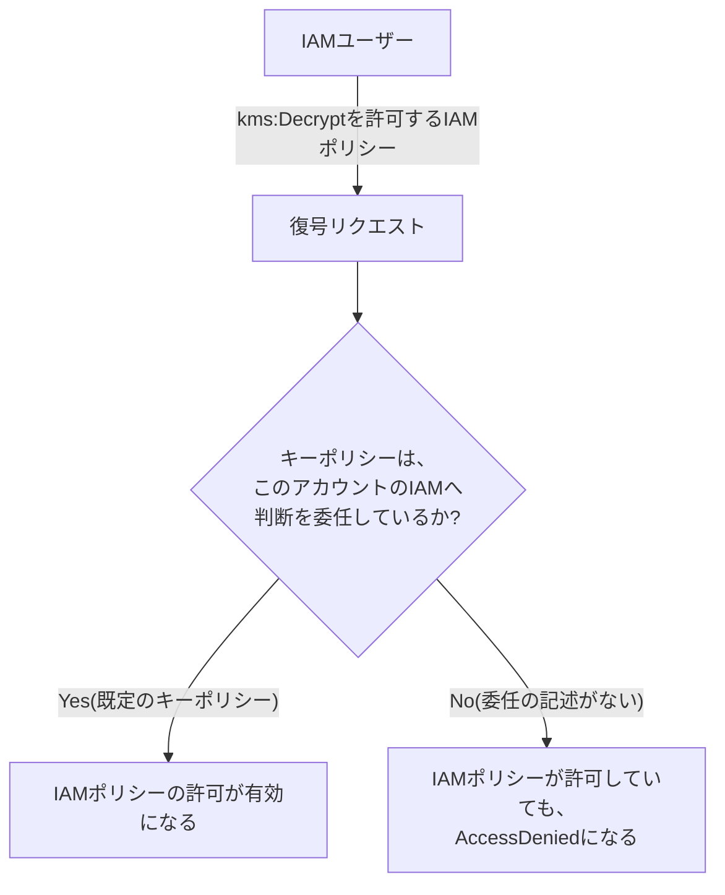

## はじめに

- **この記事で得られること**: [IAMポリシーの評価ロジック](/articles/aws-iam-policy-evaluation-guide)では、複数のIAMポリシーがある場合の、許可・拒否の決まり方を扱いました。この記事では、AWS KMS(**Key Management Service**)の暗号鍵が持つ、**キーポリシー**という、IAMポリシーとは別の、もう1つの絶対的な関所の仕組みを体系的に理解します。
- **対象読者**: IAMポリシーの評価ロジックは理解しているものの、「IAMポリシーでkms:Decryptを許可しているのに、なぜAccessDeniedになるのか」を説明できない方を想定しています。
- **読むのにかかる想定時間**: 約18分

この記事は[『上位1%』シリーズ 全記事ガイド](/sitemap)の一部、[AWS学科](/sitemap#シリーズ一覧)の14.1本目です。

## 前提知識

- [IAMポリシーの評価ロジック](/articles/aws-iam-policy-evaluation-guide): 複数のポリシーがある場合の、許可・拒否の基本的な評価ルールの理解が前提になっています。

## 全体像をつかむ

**多くのAWSサービスでは、IAMポリシーで許可されていれば、その操作が実行できます。しかし、KMSのカスタマー管理キーには、「キーポリシー」という、そのキー自身に紐づく、もう1つの絶対的な関所が存在します。** **IAMポリシーが、どれだけ明確に`kms:Decrypt`を許可していても、キーポリシー側が、その操作を許可していない(あるいは、IAMへの判断委任を宣言していない)限り、復号は一切できません。**

## 基礎から徹底解説

### 既定のキーポリシーには、「ルートアカウントへの委任」が含まれている

**新しいカスタマー管理キーを作成すると、既定のキーポリシーには、そのAWSアカウントのルートアカウント(`arn:aws:iam::<アカウントID>:root`)へ、フルアクセスを許可する文が、自動的に含まれています。** **この1文があるからこそ、同じアカウント内のIAMポリシーが、このキーに対する許可・拒否の判断を、実質的に担える**ようになっています。**もし、このルートアカウントへの委任の記述を、キーポリシーから削除してしまうと、IAMポリシー側でどれだけ許可を与えても、一切効果を持たなくなります。**

### Envelope Encryption(エンベロープ暗号化):KMSが直接暗号化しているのは、小さな「データキー」だけ

**KMSは、S3オブジェクトやRDSのデータベース全体を、直接暗号化しているわけではありません。実際には、「データキー」という、小さな対称鍵を生成・保護するだけ**です。**実際のデータ本体は、このデータキーを使って、各AWSサービス(またはクライアント側)でローカルに暗号化され、暗号化されたデータキー自身が、暗号化されたデータと一緒に保存**されます。**データを復号するには、暗号化されたデータキーを、KMSへ送り、復号してもらう権限(`kms:Decrypt`)が必要**になります。

KMS Grants:JSONのキーポリシーを書き換えずに、動的に権限を委任する

**KMS Grantsは、JSON形式のキーポリシーそのものを編集することなく、動的かつきめ細かい権限の委任を行うための、別の仕組み**です。**EBSのような、AWSの内部サービスは、ユーザーがキーポリシーを直接編集しなくても、必要な暗号化・復号の権限を得るために、このGrantsの仕組みを内部的に利用**しています。

## プロが見ている視点(上位1%の理解)

### 「IAMポリシーが最終的な判断者だ」という思い込みが、KMSでは通用しない

**多くのAWSサービスでの経験から、「IAMポリシーが許可すれば、操作は実行できる」という前提を持ってしまいがちですが、KMSのカスタマー管理キーには、この前提が通用しない、もう1つの独立したレイヤー(キーポリシー)が存在します。** **「このサービスでは、本当にIAMポリシーだけで判断が完結するのか」を、サービスごとに一段掘り下げて確認する**習慣が、「IAMポリシーで許可したのに動かない」という、原因不明のAccessDeniedに対処するための、上位1%のエンジニアの視点です。

## よくある誤解・つまずきポイント

- **誤解1: 「IAMポリシーでkms:Decryptを許可すれば、必ず復号できる」**
  キーポリシー側が、その操作を許可(またはIAMへの判断委任を宣言)していない限り、IAMポリシーの許可だけでは復号できません。
- **誤解2: 「KMSは、データ全体を直接暗号化している」**
  KMSが直接暗号化・保護しているのは、小さなデータキーだけであり、データ本体は、そのデータキーを使って別の場所でローカルに暗号化されています。
- **誤解3: 「キーポリシーを変更するには、常にJSONを直接編集する必要がある」**
  KMS Grantsを使えば、JSON形式のキーポリシーを編集せずに、動的な権限委任が可能です。

## 障害・トラブルシューティングの視点

1. **IAMポリシーでkms:Decryptを許可しているのに、AccessDeniedになる**: そのキーのキーポリシーが、ルートアカウントへの委任を含んでいるか、あるいは該当のプリンシパルを直接許可しているかを確認します。
2. **暗号化されたデータを復号できない**: 対象データキー自体に対する、`kms:Decrypt`権限があるかを確認します(データそのものへのアクセス権限だけでは不十分です)。
3. **キーポリシーを頻繁に変更する必要があり、運用が煩雑になっている**: KMS Grantsによる、動的な権限委任への切り替えを検討します。

## まとめ

- KMSのカスタマー管理キーには、IAMポリシーとは別に、キーポリシーという、絶対的な関所が存在します。
- 既定のキーポリシーは、ルートアカウントへの委任を含んでおり、これによってIAMポリシーが実質的な判断を担えます。
- KMSは、データキーという小さな対称鍵だけを保護し、データ本体は、そのデータキーでローカルに暗号化されます(エンベロープ暗号化)。
- KMS Grantsを使えば、JSONのキーポリシーを編集せずに、動的な権限委任が可能です。

**今日から意識すべきこと**
1. KMSに関連するAccessDeniedに遭遇したら、IAMポリシーだけでなく、キーポリシーも必ず確認しましょう。
2. 新しいAWSサービスを使う際は、「このサービスの権限判断は、IAMポリシーだけで完結するのか」を、一段掘り下げて確認しましょう。

## 参考文献

- [IAM Policy Examples - AWS Key Management Service | AWS Documentation](https://docs.aws.amazon.com/kms/latest/developerguide/customer-managed-policies.html)
- [Unlocking AWS KMS: The Security Professional's Guide to Encryption | DEV Community](https://dev.to/arandomguy/unlocking-aws-kms-the-security-professionals-guide-to-encryption-37np)
