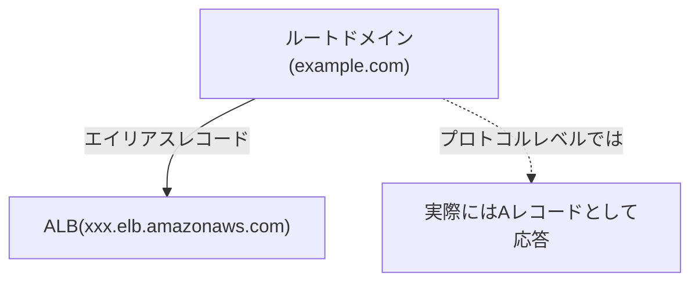

## はじめに

- **この記事で得られること**: [Application Load Balancer(ALB)のハンズオン](/articles/aws-alb-handson-guide)でALBを構築した後、実務では必ず、**ルートドメイン(`example.com`そのもの)をそのALBへ割り当てたい**という要求が出てきます。しかし、[なぜルートドメインにCNAMEを設定できないのか](/articles/dns-cname-apex-guide)で扱った通り、DNSの仕様上、CNAMEをゾーンの頂点に置くことはできません。この記事では、**Route 53のエイリアスレコード**が、プロトコルレベルでは実際にAレコードとして応答することで、この制約を回避している仕組みと、**CNAMEとの決定的な違い**を体系的に理解します。
- **対象読者**: ALBやCloudFrontを構築した経験はあるものの、Route 53の「エイリアス」という選択肢が、通常のCNAMEと何が違うのかを説明できない方を想定しています。
- **読むのにかかる想定時間**: 約16分

この記事は[『上位1%』シリーズ 全記事ガイド](/sitemap)の一部、[AWS基礎シリーズ](/sitemap#シリーズ一覧)の5.2本目です。

## 前提知識

- [Application Load Balancer(ALB)のハンズオン](/articles/aws-alb-handson-guide): ALBが、固定ではないDNS名を持つという理解が前提になっています。
- [なぜルートドメインにCNAMEを設定できないのか](/articles/dns-cname-apex-guide): CNAMEが他のレコードと共存できないというDNSの仕様上の制約と、ゾーンの頂点にSOA・NSが必須という要件が衝突するという理解が前提になっています。

## 全体像をつかむ

**ALBは、作成時に固定のIPアドレスを持たず、`xxx.elb.amazonaws.com`のような、変化しうるDNS名で提供されます。** ルートドメインをこのALBへ割り当てたい場合、通常であればCNAMEレコードを使いたくなりますが、**[ゾーンの頂点にはCNAMEを置けない](/articles/dns-cname-apex-guide)という、DNSの構造的な制約**に直面します。Route 53は、この問題に対し、**エイリアス(Alias)レコード**という、Route 53独自の仕組みを提供しています。**エイリアスレコードは、DNSプロトコルのレベルでは、実際にはAレコードとして応答するため、ゾーンの頂点に置いても、SOA・NSレコードとの共存制約に抵触しません。**

## 基礎から徹底解説

### エイリアスレコードが対応している、AWSリソースの範囲

**エイリアスレコードが指し示せる対象は、AWSが明示的にサポートしているリソースに限定されています。** 代表的な対象には、**ALB・NLB・CLBといったロードバランサー、CloudFrontディストリビューション、S3の静的Webサイトエンドポイント、API Gateway、VPCインターフェイスエンドポイント**などがあります。これらはいずれも、[Route 53側でIPアドレスを直接解決できる](/articles/dns-cname-apex-guide)、AWS基盤と統合された仕組みを持つリソースです。**AWS外部の、任意のドメインを指したい場合は、エイリアスレコードではなく、通常のCNAMEレコードを使う必要があります**(ただし、ゾーンの頂点には置けません)。

### なぜエイリアスレコードは、通常のCNAMEより名前解決が1往復少ないのか

**通常のCNAMEレコードでは、クライアントの名前解決は2段階になります。** まず`example.com`のCNAMEレコードを問い合わせ、その結果得られたターゲット名(`xxx.elb.amazonaws.com`)を、さらに別のクエリとして正引きし、最終的なIPアドレスを得る、という2回の問い合わせが必要です。**一方、エイリアスレコードでは、Route 53自身が、内部的にターゲット(ALBなど)のIPアドレスをすでに把握しているため、クライアントからの最初の問い合わせに対して、直接IPアドレスを返すことができます。** この結果、**エイリアスレコードは、通常のCNAMEと比べて、名前解決にかかる往復(ラウンドトリップ)が1回少なく**、特に、DNSリゾルバまでの経路のレイテンシが高い環境では、わずかながら名前解決が速くなります。

エイリアスレコードへの問い合わせは、課金されない

**AWSのリソースを対象としたエイリアスレコードへの問い合わせは、Route 53のクエリ課金の対象外(無料)です。** これに対し、**通常のレコード(AレコードやCNAMEレコードなど)への問い合わせは、クエリ数に応じた課金が発生します**(月間最初の10億クエリまでは、100万クエリあたり0.40ドル程度)。大量のトラフィックを受けるWebサイトであれば、この違いは、運用コストの観点でも無視できない要素になります。

## プロが見ている視点(上位1%の理解)

### 「エイリアスはCNAMEの一種」ではなく、「Route 53独自の、プロトコル外の仕組み」

**[DNSのゾーンApexに関する記事](/articles/dns-cname-apex-guide)で扱った、ALIAS/ANAMEという、標準のDNSプロトコルには存在しないプロバイダー独自の仕組みを思い出してください。** Route 53のエイリアスレコードは、**まさにこのALIAS/ANAMEという概念の、AWSにおける具体的な実装**です。**「エイリアス」という名前から、CNAMEの単なる別名・上位互換だと誤解してしまいがちですが、実際には、DNSプロトコルのレベルでは存在しない、Route 53が提供する独自の抽象化**です。この理解があれば、他のクラウドプロバイダー(GCPの「CNAME flattening」、Cloudflareの「CNAME flattening」など)で、同じ概念が別の名前で提供されていることに気づいたときも、素早く本質を理解できます。

## よくある誤解・つまずきポイント

- **誤解1: 「エイリアスレコードは、CNAMEの単なる別名であり、どちらを使っても結果は同じだ」**
  エイリアスレコードは、プロトコルレベルでは実際にAレコードとして応答する、Route 53独自の仕組みであり、ゾーンの頂点に置けるかどうか、課金の有無、名前解決の往復数など、CNAMEとは複数の点で異なります。
- **誤解2: 「エイリアスレコードは、どんなドメインでも指し示せる」**
  エイリアスレコードが指し示せるのは、AWSが明示的にサポートしているリソース(ALB、CloudFrontなど)に限定されており、AWS外部の任意のドメインを指すには、通常のCNAMEが必要です。
- **誤解3: 「ルートドメインにALBを割り当てる方法は存在しない」**
  標準のDNSの制約(CNAMEをゾーンの頂点に置けない)は、Route 53のエイリアスレコードを使うことで、具体的に回避できます。

## 障害・トラブルシューティングの視点

1. **ルートドメインをALBへ割り当てたいが、通常のCNAME設定では保存できない**: Route 53のレコード作成画面で、「エイリアス」のトグルを有効にし、対象としてALBを選択します。
2. **エイリアスレコードの対象にしたいリソースが、選択肢に出てこない**: そのリソースが、エイリアスレコードのサポート対象(ALB、CloudFront、S3静的Webサイトなど)に含まれているかを確認します。
3. **Route 53以外のDNSプロバイダーで、同じようにルートドメインをAWSリソースへ割り当てたい**: そのプロバイダーが提供する、ALIAS/ANAME相当の機能(名称はプロバイダーごとに異なる)を確認します。

## まとめ

- Route 53のエイリアスレコードは、プロトコルレベルでは実際にAレコードとして応答するため、ゾーンの頂点に置いても、CNAMEのような制約に抵触しません。
- エイリアスレコードが指し示せる対象は、ALB・CloudFront・S3静的Webサイトなど、AWSが明示的にサポートしているリソースに限定されています。
- エイリアスレコードは、通常のCNAMEと比べて、名前解決の往復が1回少なく、AWSリソースを対象とする場合は問い合わせ自体が無料です。
- エイリアスレコードは、標準のDNSプロトコルには存在しない、Route 53独自の仕組みであり、ALIAS/ANAMEという概念のAWSにおける具体的な実装です。

**今日から意識すべきこと**
1. ルートドメインをAWSリソースへ割り当てたい場合は、CNAMEではなく、Route 53のエイリアスレコードを使いましょう。
2. 他のクラウドプロバイダーに触れたときは、「このサービスでのRoute 53エイリアスに相当する機能は何か」を確認する習慣をつけましょう。

## 参考文献

- [Choosing between alias and non-alias records | AWS Documentation](https://docs.aws.amazon.com/Route53/latest/DeveloperGuide/CreatingAliasRRSets.html)
- [Amazon Route 53 FAQs | AWS](https://aws.amazon.com/route53/faqs/)
