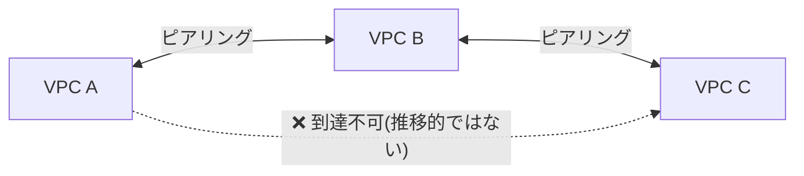

## はじめに

- **この記事で得られること**: [VPCハンズオン](/articles/aws-vpc-handson-guide)で扱った、1つのVPC内でのサブネット設計の先にある、**複数のVPCを互いに接続する際の、VPCピアリングという仕組みと、その限界を解決するTransit Gateway**を体系的に理解します。
- **対象読者**: 1つのVPCの設計は理解しているものの、複数のVPCを接続する際に、VPCピアリングとTransit Gatewayのどちらを選ぶべきか判断できない方を想定しています。
- **読むのにかかる想定時間**: 約18分

この記事は[『上位1%』シリーズ 全記事ガイド](/sitemap)の一部、[AWS学科](/sitemap#シリーズ一覧)の5.4本目です。

## 前提知識

- [VPCハンズオン](/articles/aws-vpc-handson-guide): 1つのVPC内でのサブネット設計の理解が前提になっています。

## 全体像をつかむ

**VPCピアリングは、2つのVPCの間に、1対1の直接的な接続を作る仕組み**です。**しかし、この接続は「推移的ではない」という、見過ごされがちな制約があります。VPC AとピアリングしたVPC Bが、さらにVPC Cとピアリングしていても、AからCへは、Bを経由して到達することはできません。** **AとCの間で通信したい場合は、AとCの間に、別途、直接のピアリング接続を作る必要**があります。

## 基礎から徹底解説

### VPCの数が増えるほど、接続数が爆発的に増える

**N個のVPCを、すべて互いに直接通信できるようにする(フルメッシュ)には、N×(N-1)/2個のピアリング接続が必要**になります。**例えば52個のVPCをフルメッシュで接続する場合、1,326個のピアリング接続と、各VPC内のルートテーブルへの、少なくとも2,652個のエントリが必要**になり、運用上、現実的に管理できない規模になります。

### Transit Gateway:ハブ&スポーク型で、推移的な接続を実現する

**Transit Gatewayは、中央のハブとなるゲートウェイに、各VPCが1回だけアタッチメントを作成し、Transit Gateway自身のルートテーブルが、どのアタッチメント同士が通信できるかを決める、ハブ&スポーク型の構成**です。**Transit Gatewayを経由した接続は推移的であり、新しいVPCを追加する際も、既存のVPCすべてとの間に個別のピアリング接続を作る必要がなく、Transit Gatewayへの1本のアタッチメントを追加するだけで済み**ます。

セキュリティアプライアンスを挟めるのは、ハブ構成だからこそ

**VPCピアリングでは、通信がピア同士で直接流れるため、ファイアウォールやGateway Load Balancerのようなセキュリティアプライアンスを、通信経路の途中に挟む場所がそもそも存在しません。** **Transit Gatewayのようなハブ構成であれば、ハブとなる検査用VPCに、セキュリティアプライアンスを配置し、すべてのセグメント間の通信を、そこを必ず経由させることができます。**

## プロが見ている視点(上位1%の理解)

### 「接続できている」ことと、「推移的に接続できている」ことは、別の理解である

**VPCピアリングを設定した直後は、「これでネットワーク全体がつながった」と考えてしまいがちですが、実際には、ピアリングした相手同士の、その先までは、つながっていません。** **ネットワーク構成図を見たときに、「この接続は、本当に推移的なのか、それとも1対1のリンクが連続しているだけなのか」を一段掘り下げて確認する**習慣が、上位1%のエンジニアの視点です。

## よくある誤解・つまずきポイント

- **誤解1: 「VPC AとピアリングしたVPC Bが、VPC Cとピアリングしていれば、AからCへも到達できる」**
  VPCピアリングは推移的ではないため、AとCの間で通信するには、別途直接のピアリング接続が必要です。
- **誤解2: 「VPCの数が増えても、ピアリング接続の管理は、それほど複雑にならない」**
  N個のVPCをフルメッシュで接続するには、N×(N-1)/2個のピアリング接続が必要になり、VPCの数が増えるほど、管理の複雑さが急激に増加します。
- **誤解3: 「VPCピアリングでも、Transit Gatewayと同じように、セキュリティアプライアンスを通信経路に挟める」**
  VPCピアリングは通信がピア同士で直接流れるため、セキュリティアプライアンスを挟む場所が存在しません。

## 障害・トラブルシューティングの視点

1. **VPC AからVPC Cへ通信できない(AとBが、BとCがそれぞれピアリング済み)**: VPCピアリングが推移的ではないことを確認し、AとCの間に直接のピアリング接続が必要かどうかを検討します。
2. **VPCの数が増え、ピアリング接続とルートテーブルの管理が煩雑になっている**: Transit Gatewayへの移行を検討します。
3. **複数のVPC間の通信を、一箇所で検査・制御したい**: Transit Gatewayのハブ構成と、検査用VPCへのセキュリティアプライアンスの配置を検討します。

## まとめ

- VPCピアリングは、2つのVPCの間に1対1の直接的な接続を作りますが、この接続は推移的ではありません。
- N個のVPCをフルメッシュで接続するには、N×(N-1)/2個のピアリング接続が必要になり、VPCの数が増えるほど管理が複雑になります。
- Transit Gatewayは、ハブ&スポーク型の構成により、推移的な接続を実現し、新しいVPCの追加も1本のアタッチメントで済みます。
- セキュリティアプライアンスを通信経路に挟めるのは、Transit Gatewayのようなハブ構成だからこそ可能です。

**今日から意識すべきこと**
1. 複数のVPCを接続する際は、将来的にVPCの数が増える可能性を踏まえ、ピアリングとTransit Gatewayのどちらが適切かを検討しましょう。
2. ネットワーク構成図を見る際は、「この接続は本当に推移的なのか」を必ず確認しましょう。

## 参考文献

- [VPC Peering or Transit Gateway | Barking Iguana](https://barkingiguana.com/writing/vpc-peering-or-transit-gateway/)
