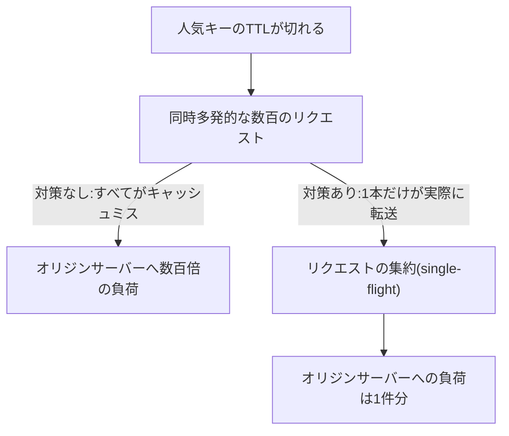

## はじめに

- **この記事で得られること**: [Cache-ControlとVaryヘッダーの仕組み](/articles/cache-control-vary-guide)は、キャッシュの保存期間を決める仕組みでした。この記事では、**人気のあるキャッシュエントリの有効期限が切れた瞬間に発生する、キャッシュスタンピード**という現象と、それを防ぐ3つの対策を体系的に理解します。
- **対象読者**: Cache-Controlによるキャッシュの保存期間の設定は理解しているものの、「キャッシュの期限切れ」という正常な動作が、なぜオリジンサーバーへの障害につながるのかを説明できない方を想定しています。
- **読むのにかかる想定時間**: 約18分

この記事は[『上位1%』シリーズ 全記事ガイド](/sitemap)の一部、[Webプロキシ/キャッシュ基礎シリーズ](/sitemap#シリーズ一覧)の6.1本目です。

## 前提知識

- [Cache-ControlとVaryヘッダーの仕組み](/articles/cache-control-vary-guide): キャッシュの保存期間(TTL)という、基本的な仕組みの理解が前提になっています。

## 全体像をつかむ

**人気のあるキャッシュエントリの有効期限(TTL)が切れた、まさにその瞬間、そのキーに対する、同時多発的なリクエストすべてが、一斉にキャッシュミスとなります。** **キャッシュがない状態で、これらすべてのリクエストが、同時にオリジンサーバーへ転送されてしまうと、通常は1件のリクエストだけで済むはずだったオリジンサーバーへの負荷が、一瞬で数百・数千倍に跳ね上がり、オリジンサーバー自身をダウンさせてしまう**ことがあります。これが**キャッシュスタンピード**(サンダリングハード問題の、キャッシュにおける具体的な現れ方で、ドッグパイル効果とも呼ばれます)です。**キャッシュの期限切れという、完全に正常な動作が、意図せず、オリジンサーバーへの自爆的なDDoS攻撃になってしまう**のです。

## 基礎から徹底解説

### リクエストの集約(single-flight):1本だけを通す

**同じキーに対する複数の同時リクエストがあった場合、プロキシは、最初の1本だけを実際にオリジンサーバーへ転送し、残りのリクエストは、その結果が返ってくるまで待機させます。** 結果が返ってきたら、待機していたすべてのリクエストへ、同じ結果を配布します。**この仕組みにより、1つのキーに対する同時リクエストが、何百件あっても、オリジンサーバーへの転送は、常に1件に抑えられます。**

### stale-while-revalidate:古いデータを即座に返しながら、裏側で更新する

**`stale-while-revalidate`は、Cache-Controlディレクティブの拡張で、TTLが切れた直後の一定期間、古い(stale)データを、そのままクライアントへ即座に返しつつ、裏側で1本だけ、オリジンサーバーへの再検証リクエストを送る**という仕組みです。**この方式では、同時に発生したリクエストのほとんどが、オリジンサーバーへの同期的な問い合わせを、一切発生させません。** クライアントは、わずかに古いデータを受け取る代わりに、応答速度の低下を、まったく経験しません。

TTLジッター:有効期限が一斉に揃ってしまうことを防ぐ

**複数のキャッシュエントリのTTLが、まったく同じ値に設定されていると、それらが一斉に期限切れを迎え、複数のキャッシュスタンピードが、同時に発生してしまう**ことがあります。**TTLジッターは、設定したTTLの値に、小さなランダムな揺らぎ(ジッター)を加えることで、複数のキャッシュエントリの期限切れのタイミングを、わずかにずらし、一斉期限切れを防ぐ**という、簡単ながら効果的な対策です。実務では、リクエストの集約・stale-while-revalidate・TTLジッターの3つを、組み合わせて使うことが推奨されています。

## プロが見ている視点(上位1%の理解)

### 「個々のリクエストは正しく動いている」のに、全体としては障害になるという、集団的な挙動の罠

**キャッシュスタンピードの恐ろしさは、個々のリクエスト・個々のキャッシュの挙動を見ると、何も間違ったことをしていない**ことです。**TTLが切れればキャッシュミスになるのは正しい挙動であり、キャッシュミスになったらオリジンサーバーへ問い合わせるのも正しい挙動です。問題は、この「正しい挙動」が、大量に、同時に発生したときにだけ現れる**という点にあります。**個々のコンポーネントの正しさを検証するだけでは見えない、集団としての挙動を想像する**習慣が、この種の障害を未然に防ぐための、上位1%のエンジニアの視点です。

## よくある誤解・つまずきポイント

- **誤解1: 「オリジンサーバーが落ちたのは、キャッシュが正しく機能していなかったからだ」**
  キャッシュスタンピードは、キャッシュが「正しく」期限切れを迎えた、まさにその瞬間に発生する現象であり、キャッシュの故障ではありません。
- **誤解2: 「リクエストの集約があれば、stale-while-revalidateは不要だ」**
  リクエストの集約は同じキーへの同時リクエストしか救えず、多数の異なるキーが同時に期限切れを迎える場合には、stale-while-revalidateやTTLジッターと組み合わせる必要があります。
- **誤解3: 「TTLをすべて同じ値に揃えておけば、運用が簡単になる」**
  TTLを揃えると、複数のキャッシュエントリが一斉に期限切れを迎え、キャッシュスタンピードが同時多発するリスクが高まります。

## 障害・トラブルシューティングの視点

1. **特定の時間帯に、オリジンサーバーへの負荷が突発的に跳ね上がる**: 人気コンテンツのTTLが、その時間帯に一斉に切れていないかを確認します。
2. **キャッシュの仕組み自体は正しく動いているはずなのに、オリジンサーバーが頻繁にダウンする**: リクエストの集約(single-flight)が、プロキシ側で実際に機能しているかを確認します。
3. **キャッシュスタンピード対策を導入したい**: リクエストの集約、stale-while-revalidate、TTLジッターの3つを、組み合わせて導入することを検討します。

## まとめ

- キャッシュスタンピードは、人気のあるキャッシュエントリのTTLが切れた瞬間、同時多発的なリクエストが一斉にキャッシュミスとなり、オリジンサーバーへ押し寄せる現象です。
- リクエストの集約(single-flight)は、同じキーへの同時リクエストを1本だけに絞り、残りを待機させます。
- stale-while-revalidateは、古いデータを即座に返しながら、裏側で1本だけ再検証リクエストを送ります。
- TTLジッターは、複数のキャッシュエントリの期限切れのタイミングをずらし、一斉期限切れを防ぎます。

**今日から意識すべきこと**
1. 人気コンテンツのキャッシュを設計する際は、キャッシュスタンピード対策を、最初から組み込みましょう。
2. 複数のキャッシュエントリに、まったく同じTTLを設定することを避け、TTLジッターを検討しましょう。

## 参考文献

- [Cache Stampede: When TTL Expiry Becomes a Self-Inflicted DDoS | Codemia](https://codemia.io/archive/cache-stampede-protection)
- [Varnish Cache Stampede & Thundering Herd | Netdata](https://www.netdata.cloud/guides/varnish/varnish-cache-stampede-thundering-herd/)
