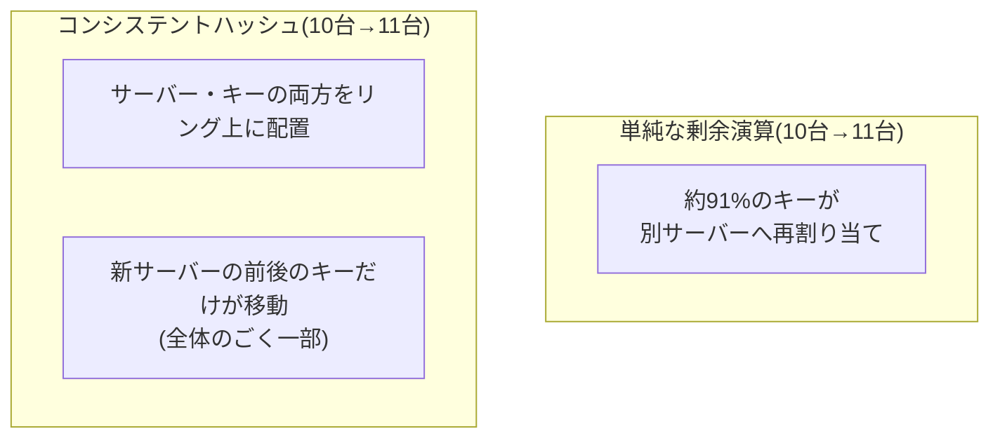

## はじめに

- **この記事で得られること**: [ロードバランシングのアルゴリズムとヘルスチェックの仕組み](/articles/load-balancing-algorithms-guide)で扱ったIPハッシュ方式は、`hash(キー) % サーバー台数`という単純な計算で、同じクライアントを同じサーバーへ固定していました。この記事では、**この単純な計算方式が抱える、サーバーの増減時に起こる致命的な弱点**、そして、その弱点を解決する**コンシステントハッシュ**という仕組みを体系的に理解します。
- **対象読者**: IPハッシュ方式でセッション永続化を実現する仕組みは理解しているものの、サーバーの台数が変化したときに、何が起きるのかを考えたことがない方を想定しています。
- **読むのにかかる想定時間**: 約17分

この記事は[『上位1%』シリーズ 全記事ガイド](/sitemap)の一部、[ロードバランシング基礎シリーズ](/sitemap#シリーズ一覧)の2.1本目です。

## 前提知識

- [ロードバランシングのアルゴリズムとヘルスチェックの仕組み](/articles/load-balancing-algorithms-guide): IPハッシュ方式による、セッション永続化の基本的な理解が前提になっています。

## 全体像をつかむ

**`hash(キー) % サーバー台数`という、単純な剰余演算によるハッシュ方式には、致命的な弱点があります。サーバーの台数が1台増減するだけで、ほとんどすべてのキーの割り当て先サーバーが変わってしまう**のです。例えば、10台のサーバーを11台に増やすだけで、**約91%のキーが、別のサーバーへ再割り当て**されます。キャッシュサーバーの台数を1台増やしただけで、既存のキャッシュのほとんどが無効化され、オリジンサーバーへのアクセスが急増するという、実務上の深刻な障害につながります。**コンシステントハッシュは、サーバーとキーの両方を、1つの円環(リング)上に配置するという発想**で、この問題を解決します。

## 基礎から徹底解説

### リング上に、サーバーとキーの両方を配置する

**コンシステントハッシュでは、各サーバーとキーの両方を、同じハッシュ関数で、1つの円環(リング)上の位置に変換**します。**あるキーがどのサーバーに割り当てられるかは、「そのキーの位置から、リングを時計回りに進んで、最初に出会うサーバー」という規則で決まります。** サーバーが追加・削除されると、**そのサーバーの前後に位置していたキーだけが、隣のサーバーへ移動**し、リング上の他の位置にあるキーは、まったく影響を受けません。

### 仮想ノード:物理サーバーが少ないと、負荷が偏ってしまう問題への対処

**物理サーバーの台数が少ない場合、リング上の配置がランダムになりやすく、一部のサーバーが、他のサーバーよりも広い範囲(より多くのキー)を担当してしまう、負荷の偏りが起きます。** これに対処するため、**1台の物理サーバーを、リング上の複数の位置(仮想ノード)に、繰り返し配置**します。仮想ノードの数を増やすほど、各サーバーが担当するキーの範囲が均等に近づき、サーバー追加・削除時の再分散も、よりスムーズになります。

コンシステントハッシュは、キャッシュクラスタやNoSQLデータベースで広く使われている

**コンシステントハッシュは、Memcachedのクライアントライブラリ、Amazon DynamoDB、Apache Cassandra、Redis Clusterといった、分散キャッシュや分散データベースで広く採用**されています。これらのシステムは、ノードの追加・削除(スケールアウト・スケールイン、あるいは障害による脱落)が、運用中に頻繁に発生するため、単純な剰余演算では、再分散のたびにシステム全体へ大きな負荷がかかってしまい、実用になりません。

## プロが見ている視点(上位1%の理解)

### 「同じキーを、同じサーバーへ固定する」という目的は同じでも、変化への耐性がまったく違う

**IPハッシュ方式も、コンシステントハッシュも、「同じキーを、できるだけ同じサーバーへ固定する」という目的は同じ**です。**しかし、サーバーの台数が変化したときに、再割り当てされるキーの範囲が、全体のほぼすべてか、ごく一部かという、決定的な違い**があります。**「このシステムは、ハッシュで振り分けている」という説明を聞いたときに、「サーバー構成が変わったときに、何パーセントのキーが影響を受けるのか」まで、一段掘り下げて確認する**ことが、上位1%のエンジニアが持っている視点です。

## よくある誤解・つまずきポイント

- **誤解1: 「ハッシュで振り分けていれば、サーバーの増減は特に問題にならない」**
  単純な剰余演算によるハッシュ方式では、サーバーが1台増減するだけで、ほとんどすべてのキーの割り当て先が変わってしまいます。
- **誤解2: 「コンシステントハッシュを使えば、サーバー追加時にキーの移動が一切発生しない」**
  コンシステントハッシュでも、新しいサーバーの前後に位置していたキーは移動します。移動する範囲が、全体のごく一部に抑えられるだけです。
- **誤解3: 「仮想ノードの数は、多ければ多いほど必ず良い」**
  仮想ノードの数を増やすと負荷の均等化は進みますが、管理するメタデータも増えるため、実務では適切なバランスが求められます。

## 障害・トラブルシューティングの視点

1. **キャッシュサーバーを1台増やした直後、オリジンサーバーへのアクセスが急増した**: 単純な剰余演算によるハッシュ方式を使っていないか、コンシステントハッシュへの移行を検討します。
2. **特定のサーバーだけ、負荷が明らかに高い**: 仮想ノードの数が少なく、リング上の配置に偏りが生じている可能性を確認します。
3. **サーバーを追加したのに、期待したほど負荷が分散されない**: ハッシュ関数自体が、キーの偏りを生みやすい実装になっていないかを確認します。

## まとめ

- `hash(キー) % サーバー台数`という単純な方式では、サーバーが1台増減するだけで、ほとんどすべてのキーの割り当て先が変わってしまいます。
- コンシステントハッシュは、サーバーとキーの両方をリング上に配置し、サーバー増減時に移動するキーの範囲を、ごく一部に抑えます。
- 仮想ノードは、物理サーバーの台数が少ないときに生じる、負荷の偏りを解消する仕組みです。
- コンシステントハッシュは、Memcached・DynamoDB・Cassandraといった、分散キャッシュ・分散データベースで広く採用されています。

**今日から意識すべきこと**
1. 「ハッシュで振り分けている」という説明を聞いたら、サーバー構成が変わったときの影響範囲を確認する習慣をつけましょう。
2. キャッシュクラスタやNoSQLデータベースを選定する際は、内部でコンシステントハッシュが使われているかを確認しましょう。

## 参考文献

- [Consistent Hashing Explained | AlgoMaster](https://blog.algomaster.io/p/consistent-hashing-explained)
- [Understanding Consistent Hashing | LevelUp](https://levelup.gitconnected.com/understanding-consistent-hashing-concepts-pitfalls-and-real-world-use-cases-2b0571689330)
