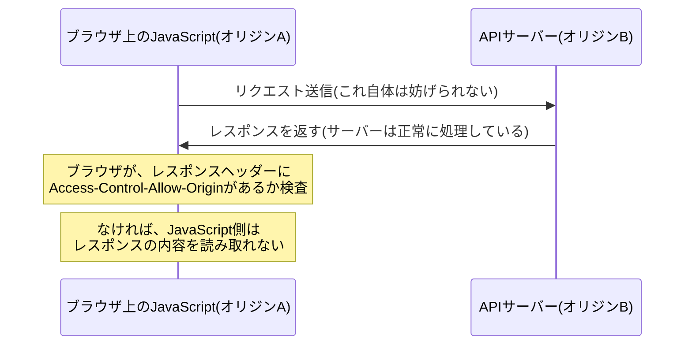

## はじめに

- **この記事で得られること**: [自分の手でシンプルなRESTful APIを構築するハンズオン](/articles/restful-api-handson-guide)で作ったAPIは、curlやPostmanからは問題なく呼び出せるのに、**ブラウザ上のJavaScriptから呼び出すと「CORSエラー」で失敗する**ことがあります。この記事では、この現象が**サーバーが動いていないからではなく、ブラウザ自身が持つ同一オリジンポリシーという防御機構が働いているから**だという実態を理解します。**CORSが、サーバーを守るための仕組みではなく、ユーザーを守るための仕組みであること**、そして`Content-Type: application/json`を使うだけで、既定では**プリフライト**という事前確認が発生する理由までを体系的に理解します。
- **対象読者**: curlやPostmanではAPIの動作を確認できているのに、ブラウザのJavaScriptから同じAPIを呼び出すと「CORS」というエラーが出て失敗する現象に遭遇したことはあるものの、何が起きているのかを説明できない方を想定しています。
- **読むのにかかる想定時間**: 約17分

この記事は[『上位1%』シリーズ 全記事ガイド](/sitemap)の一部、[Web/APIシリーズ](/sitemap#シリーズ一覧)の3.1本目です。

## 前提知識

- [自分の手でシンプルなRESTful APIを構築するハンズオン](/articles/restful-api-handson-guide): HTTPのメソッドとステータスコードの基本が前提になっています。

## 全体像をつかむ

**CORSエラーで最初に理解すべきことは、「サーバーがリクエストを拒否している」のではなく、「ブラウザが、サーバーからの応答をJavaScriptに読み取らせることを拒否している」という点です**。この2つは、まったく別の現象です。**ブラウザには、同一オリジンポリシー(Same-Origin Policy)という、デフォルトの防御機構が組み込まれています。** これは、あるオリジン(スキーム・ホスト・ポートの組み合わせ)から読み込まれたJavaScriptが、**別のオリジンへリクエストを送ること自体は妨げませんが、その応答の内容を読み取ることを、既定では禁止する**というルールです。CORS(Cross-Origin Resource Sharing)は、サーバー側が「このオリジンからの読み取りは許可する」と明示的に宣言することで、この既定の禁止を、安全な形で例外的に解除するための仕組みです。

## 基礎から徹底解説

### なぜcurlやPostmanでは成功するのに、ブラウザだけ失敗するのか

**同一オリジンポリシーは、ブラウザというソフトウェア自身が持つ制約であり、HTTPプロトコル自体の制約ではありません。** curlやPostmanは、ブラウザではないため、そもそも同一オリジンポリシーという概念自体を持たず、サーバーからの応答をそのまま受け取って表示します。**一方、ブラウザ上で動くJavaScriptが`fetch`や`XMLHttpRequest`でリクエストを送る場合だけ、この制約が働きます。** つまり、「curlでは成功するのにブラウザだけ失敗する」という現象は、**サーバー側の問題ではなく、リクエストを送っているクライアントの種類の違いによって、まったく別の挙動になっている**ことの結果です。

### CORSは、サーバーを守るためではなく、ユーザーを守るための仕組み

**CORSが存在する理由を、「サーバーを不正なアクセスから守るため」だと誤解している人が多くいます。** しかし実際には、**CORSが守っているのは、ブラウザを操作している「ユーザー」自身**です。想像してみてください。もしこの制約がなければ、悪意のあるWebサイトを開いただけで、そのページのJavaScriptが、ユーザーがログイン済みの別のサイト(銀行やSNSなど)へ、ユーザーのクッキーを使ってリクエストを送り、**その応答(個人情報や残高情報)を読み取ってしまう**ことが可能になります。同一オリジンポリシーは、この種の攻撃から、ユーザーのブラウザセッションを守るための、ブラウザ自身の防御機構なのです。

### `Content-Type: application/json`が、既定でプリフライトを発生させる

クロスオリジンのリクエストには、「**シンプルなリクエスト**」と「**プリフライトが必要なリクエスト**」という、2つの種類があります。シンプルなリクエストとして認められるのは、メソッドがGET/POST/HEADのいずれかで、独自のヘッダーを含まず、`Content-Type`が`application/x-www-form-urlencoded`・`multipart/form-data`・`text/plain`のいずれかである場合に限られます。**ここで多くの実務者が驚くのが、現代のAPIで最も一般的な`Content-Type: application/json`は、このシンプルなリクエストの条件に含まれていない**という事実です。つまり、**JSONを送信する現代的なAPI呼び出しは、ほぼ例外なく「プリフライトが必要なリクエスト」に分類されます。**

プリフライトとは、具体的に何が起きているのか

プリフライトが必要なリクエストの場合、ブラウザは、**実際にJavaScriptが送ろうとしているリクエストの前に、`OPTIONS`メソッドを使った事前確認のリクエストを、自動的に先に送信**します。このプリフライトリクエストには、`Access-Control-Request-Method`(本来送りたいメソッド)や`Access-Control-Request-Headers`(本来送りたいヘッダー)という情報が含まれており、**サーバーは、この事前確認に対して、「そのメソッド・ヘッダーでのアクセスを許可する」ことを示すレスポンスヘッダーを返す必要があります。** この事前確認が成功して初めて、ブラウザは本来のリクエスト(POSTやPUTなど)を実際に送信します。**この一連のやり取りは、JavaScriptのコードからは完全に隠されており、開発者がブラウザの開発者ツールのネットワークタブを開かない限り、プリフライトが発生していること自体に気づきにくい**のが実務上の落とし穴です。

## プロが見ている視点(上位1%の理解)

### `Access-Control-Allow-Origin: *`と、認証情報を含むリクエストは共存できない

クッキーなどの認証情報を含むクロスオリジンリクエスト(`fetch`の`credentials: 'include'`など)を許可したい場合、サーバー側は`Access-Control-Allow-Credentials: true`を返す必要があります。**ここで重要な制約があります。`Access-Control-Allow-Credentials: true`を使う場合、`Access-Control-Allow-Origin`の値に、ワイルドカード(`*`)を指定することはできません。** 必ず、リクエスト元の具体的なオリジンを、明示的に指定する必要があります。**これは、ブラウザ仕様によって意図的に設けられた制約**であり、「認証情報を伴うリクエストを、不特定多数のオリジンに対して無条件に許可してしまう」という、最も危険な設定ミスを、仕様レベルで未然に防いでいます。

## よくある誤解・つまずきポイント

- **誤解1: 「CORSエラーは、サーバーがリクエストを拒否しているから発生する」**
  多くの場合、サーバーはリクエストを正常に処理し、応答を返しています。CORSエラーは、ブラウザがその応答をJavaScriptに読み取らせることを拒否していることによって発生します。
- **誤解2: 「クライアント側のコードに、特定のヘッダーを追加すればCORSエラーは解決する」**
  CORSを許可するヘッダー(`Access-Control-Allow-Origin`など)は、サーバー側のレスポンスに含める必要があり、クライアント側のリクエストに追加しても効果がありません。
- **誤解3: 「JSONを送るだけの単純なリクエストなら、プリフライトは発生しない」**
  `Content-Type: application/json`は、シンプルなリクエストの条件に含まれていないため、JSONを送るほとんどのAPI呼び出しで、プリフライトが発生します。

## 障害・トラブルシューティングの視点

1. **curlやPostmanでは成功するのに、ブラウザのJavaScriptからだけ失敗する**: サーバーの応答に`Access-Control-Allow-Origin`ヘッダーが含まれているか、ブラウザの開発者ツールのネットワークタブで確認します。
2. **ネットワークタブに、本来送っていないはずのOPTIONSリクエストが見える**: これはプリフライトであり、エラーではありません。そのOPTIONSリクエストへのレスポンスが、適切な`Access-Control-Allow-*`ヘッダーを返しているかを確認します。
3. **認証情報を含むリクエストだけがCORSエラーになる**: `Access-Control-Allow-Origin`にワイルドカード(`*`)が指定されていないか、具体的なオリジンが明示的に指定されているかを確認します。

## まとめ

- CORSエラーは、サーバーがリクエストを拒否しているのではなく、ブラウザが応答の読み取りを拒否していることによって発生します。
- 同一オリジンポリシーは、サーバーを守るためではなく、ユーザーのブラウザセッションを悪用する攻撃から、ユーザー自身を守るための仕組みです。
- `Content-Type: application/json`はシンプルなリクエストの条件に含まれず、JSONを送る現代的なAPI呼び出しのほとんどで、プリフライトが発生します。
- 認証情報を含むリクエストを許可する場合、`Access-Control-Allow-Origin`にワイルドカードを使うことはできません。

**今日から意識すべきこと**
1. CORSエラーに遭遇したら、まずブラウザの開発者ツールのネットワークタブで、サーバーの応答ヘッダーとOPTIONSリクエストの有無を確認しましょう。
2. CORSを許可する設定は、必ずサーバー側で行うものであり、クライアント側では解決できないことを覚えておきましょう。

## 参考文献

- [Cross-Origin Resource Sharing (CORS) | MDN Web Docs](https://developer.mozilla.org/en-US/docs/Web/HTTP/Guides/CORS)
- [Fetch Standard - CORS protocol | WHATWG](https://fetch.spec.whatwg.org/#http-cors-protocol)
