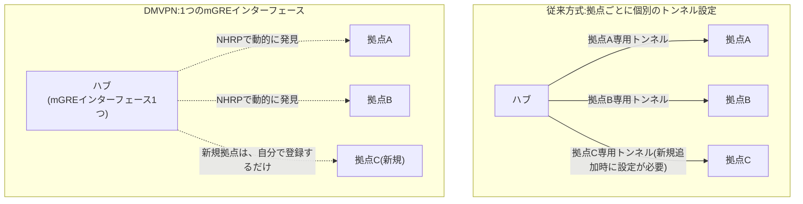

## はじめに

- **この記事で得られること**: [拠点間VPN(Site-to-Site VPN)の基礎](/articles/site-to-site-vpn-guide)で、拠点数が増えるほど、拠点間VPNの運用が複雑になるという課題に触れました。この記事では、**DMVPN**(Dynamic Multipoint VPN)という、Ciscoが開発した、**拠点が増えても、新しい拠点1台の設定だけで済むようにする**、拠点間VPNの拡張方式を体系的に理解します。
- **対象読者**: 2拠点間の、点対点のIPsecトンネルは構築できるものの、拠点数が数十・数百に増えたときに、構成管理がどう変わるのかを理解していない方を想定しています。
- **読むのにかかる想定時間**: 約19分

この記事は[『上位1%』シリーズ 全記事ガイド](/sitemap)の一部、[拠点間VPN(Site-to-Site VPN)シリーズ](/sitemap#シリーズ一覧)の3.1本目です。

## 前提知識

- [拠点間VPN(Site-to-Site VPN)の基礎](/articles/site-to-site-vpn-guide): 点対点のIPsecトンネルを、拠点ごとに個別に構築するという、従来の方式の理解が前提になっています。

## 全体像をつかむ

**従来のIPsec拠点間VPNでは、新しい拠点を1つ追加するたびに、ハブ側(本社)で、その拠点専用のトンネル設定を、個別に追加する必要があります。** 拠点数が数十・数百に増えると、「拠点ごとに個別のトンネル設定」という、この**運用そのものが、スケーラビリティの壁**になります。**DMVPNは、mGRE(multipoint GRE)という、ハブ側に1つだけ持つ、どの拠点にでもつながるトンネルインターフェースと、NHRP(Next Hop Resolution Protocol)という、仮想IPと実際の公開IPアドレスを動的に対応させる仕組みを組み合わせ**、新しい拠点の追加を、その拠点自身の設定だけで完結させます。

## 基礎から徹底解説

### mGRE:ハブが持つのは、1つだけの「誰にでもつながる」トンネルインターフェース

**従来の拠点間VPNでは、ハブ側に、拠点の数だけ、個別のトンネルインターフェース(またはトンネル設定)が必要**でした。**mGRE(multipoint GRE)は、ハブ側に、たった1つのトンネルインターフェースだけを用意し、そのインターフェースが、複数の拠点からの接続を、まとめて受け付ける**仕組みです。拠点が増えても、ハブ側のこのインターフェース自体には、変更が不要です。

### NHRP:仮想IPから、実際の公開IPアドレスを動的に調べる仕組み

**NHRP(Next Hop Resolution Protocol)は、DMVPNの仮想的なトンネルIPアドレスと、各拠点の実際の(動的な場合もある)公開IPアドレスとの対応関係を、動的に管理する仕組み**です。新しい拠点が起動すると、その拠点は、自分の仮想IPと実際の公開IPの対応を、ハブへ登録(NHRP登録)します。他の拠点が、その新しい拠点と通信したいとき、NHRPへ問い合わせることで、実際の宛先アドレスを動的に解決できます。**この仕組みがあるからこそ、拠点追加の際に、ハブ側の設定変更が不要**になります。

DMVPNには、スポーク間通信の成立方法が異なる、3つのPhaseが存在する

**DMVPNには、スポーク(拠点)同士が直接通信できるかどうかという観点で、3つのPhaseが存在**します。**Phase 1は、すべての通信が必ずハブを経由**し、スポーク間の直接トンネルは成立しません。**Phase 2は、スポーク間の直接トンネルが動的に成立しますが、ネクストホップの情報を保持するため、各スポークが、他のすべてのスポークへの詳細なルート情報を持つ必要があり、経路の集約ができません。** **Phase 3は、ハブがNHRPリダイレクトメッセージを使って、通信元のスポークへ直接トンネルの確立を促すため、スポーク間の直接トンネルを実現しつつ、各スポークはハブへのデフォルトルートだけを持てばよく、経路の集約が可能**です。現在の実務では、Phase 3が推奨されています。

## プロが見ている視点(上位1%の理解)

### DMVPNは、「トンネルの確立・発見」と「暗号化」という、2つの独立した問題を分けて解決している

**DMVPNという1つの名前は、実際には、「どの拠点と、どうやってトンネルを確立するか」という問題を解決するmGRE・NHRPと、「そのトンネルの中を、どう暗号化するか」という問題を解決するIPsecという、2つの独立した仕組みの組み合わせ**です。**[SD-WANとエッジルーター選定](/articles/sdwan-edge-router-guide)で扱った、SD-WANという現代的な方式は、このDMVPNが先駆けて解決していた「拠点が増えてもスケールする、動的なトンネル管理」という課題を、ベンダー独自の集中管理コントローラーという、より洗練された形で引き継いでいる**、と理解すると、VPN技術の歴史的な流れが、一本の線でつながります。

## よくある誤解・つまずきポイント

- **誤解1: 「DMVPNは、IPsecとは別の、独立した暗号化方式だ」**
  DMVPNは、トンネルの確立・発見(mGRE・NHRP)と、暗号化(IPsec)という、2つの独立した仕組みの組み合わせであり、暗号化自体は従来通りIPsecが担っています。
- **誤解2: 「DMVPNなら、常にスポーク間の直接通信ができる」**
  Phase 1では、すべての通信が必ずハブを経由し、スポーク間の直接トンネルは成立しません。
- **誤解3: 「Phase 2とPhase 3は、どちらも経路の集約ができる」**
  Phase 2はネクストホップの情報を保持するため経路の集約ができず、Phase 3のNHRPリダイレクトの仕組みによって、初めて経路の集約が可能になります。

## 障害・トラブルシューティングの視点

1. **新しい拠点を追加したのに、他の拠点と通信できない**: その拠点のNHRP登録が、ハブに対して正しく完了しているかを確認します。
2. **スポーク間の通信が、常にハブを経由してしまう**: DMVPNのPhaseが1になっていないか、Phase 2/3の設定が正しく行われているかを確認します。
3. **拠点が増えたら、各スポークのルーティングテーブルが肥大化した**: Phase 2を使っている可能性があり、経路の集約が可能なPhase 3への移行を検討します。

## まとめ

- 従来の拠点間VPNでは、拠点が増えるたびに、ハブ側で個別のトンネル設定を追加する必要がありました。
- DMVPNは、mGRE(1つのトンネルインターフェース)とNHRP(動的なIPアドレス解決)を組み合わせ、新しい拠点の追加を、その拠点自身の設定だけで完結させます。
- DMVPNには、スポーク間通信の成立方法が異なる3つのPhaseが存在し、現在ではPhase 3が推奨されています。
- DMVPNは、トンネルの確立・発見という問題と、暗号化という問題を、別々の仕組み(mGRE・NHRPとIPsec)で解決しています。

**今日から意識すべきこと**
1. 拠点数が今後増える可能性がある拠点間VPNを設計する際は、DMVPNのような、動的な拠点追加に対応できる方式を検討しましょう。
2. 「DMVPN」という言葉に出会ったら、トンネルの確立方法(mGRE・NHRP)と暗号化方法(IPsec)を、まず切り分けて考えましょう。

## 参考文献

- [Introduction to DMVPN | NetworkLessons](https://networklessons.com/vpn/introduction-to-dmvpn)
- [DMVPN Phase 3: Overview & Configuration | INE](https://blog.ine.com/2008/12/23/dmvpn-phase-3)
