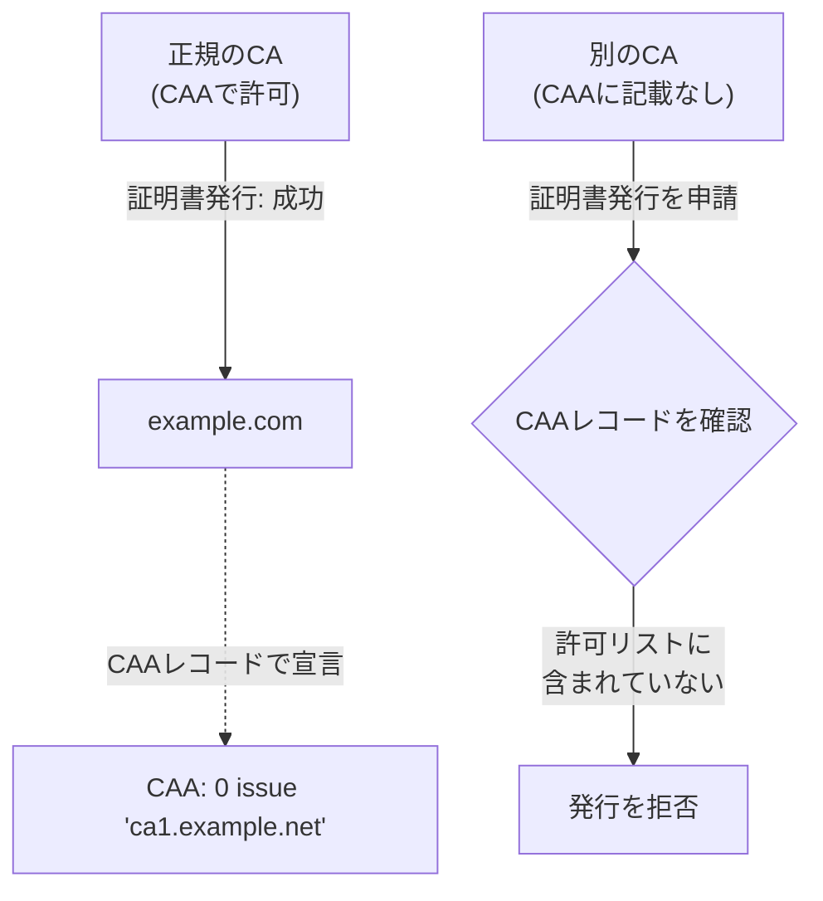

## はじめに

- **この記事で得られること**: [DNSSECの仕組み](/articles/dns-dnssec-fundamentals-guide)は、DNSの応答そのものが本物であることを証明する仕組みでした。この記事では、**CAA(Certification Authority Authorization)レコード**という、もう1つの、ほとんど意識されていないDNSセキュリティレコードについて体系的に理解します。これは、「このドメインの証明書は、このCAだけが発行してよい」という許可リストを、DNS上で宣言する仕組みです。
- **対象読者**: HTTPS証明書の発行自体は経験しているものの、CAAレコードという言葉を聞いたことがない、あるいは、何のために存在するのかを説明できない方を想定しています。
- **読むのにかかる想定時間**: 約16分

この記事は[『上位1%』シリーズ 全記事ガイド](/sitemap)の一部、[DNSサーバー基礎シリーズ](/sitemap#シリーズ一覧)の4.1本目です。

## 前提知識

- [DNSSECの仕組み](/articles/dns-dnssec-fundamentals-guide): DNSの応答の信頼性を保証する、別の仕組みの理解があると、2つのセキュリティレコードの役割の違いが、より明確になります。

## 全体像をつかむ

**HTTPS証明書は、理論上、世界中のどの認証局(CA)に対しても発行を申請できます。** ここに、意外と見過ごされがちなリスクがあります。**ドメインの持ち主が一切関与していない、まったく別の認証局が、誤って(あるいは不正な手続きによって)そのドメインの証明書を発行してしまう**可能性が、構造的に存在するのです。**CAAレコードは、「このドメインの証明書は、この認証局だけが発行してよい」という許可リストを、DNS上で宣言する仕組み**です。

## 基礎から徹底解説

### CAAレコードがなければ、どのCAでも発行できてしまう

**ドメインにCAAレコードが一切設定されていない場合、既定では、どの認証局でもそのドメインの証明書を発行できます。** これは、CAAレコードが「指定した1つのCAだけに制限する」ための、**オプトイン方式**の仕組みだからです。何も宣言しなければ、制限は一切かかりません。

### issue・issuewild・iodefという3つのタグ

CAAレコードには、主に3つのタグがあります。**`issue`タグは、通常の証明書(ワイルドカード証明書を含む)の発行を許可するCAを指定**します。**`issuewild`タグは、ワイルドカード証明書だけに適用される、より限定的な許可**であり、このタグが存在する場合、ワイルドカード証明書に関しては`issue`タグの内容は無視されます。**`iodef`タグは、ポリシーに違反する発行の試みがあった場合に、通知を送る連絡先(メールアドレスやURL)を指定**します。

CAAチェックは、2017年9月から、すべてのCAにとって義務になった

**CAAレコードの仕組み自体は、それ以前から存在していましたが、認証局がこれを確認することは、長らく任意でした。** これが変わったのは、CA/Browser Forumが2017年3月に採択した「Ballot 187」という決議により、**2017年9月8日以降、すべての公的な認証局が、証明書発行前にCAAレコードを確認することが義務化された**ためです。この義務化以降、CAAレコードに記載されていないCAは、証明書の発行を拒否しなければなりません。**DNSの問い合わせ自体が失敗した場合(SERVFAILなど)も、安全側に倒して発行を拒否する**、という「フェイルセーフ」の設計になっています。

## プロが見ている視点(上位1%の理解)

### CAAレコードは、「過去に設定されたまま忘れられている」ことが実務上の落とし穴になる

**実務でよく起こる落とし穴は、過去に別のCAを使っていた時代に設定したCAAレコードが、そのまま残り続けている**ことです。その後、別の認証局(例えばLet's Encrypt)へ切り替えようとしたとき、**CAAレコードが古いCAだけを許可したまま更新されていないと、新しいCAからの発行が、原因不明のまま拒否される**という事態につながります。証明書の発行エラーに遭遇したときは、証明書そのものの設定だけでなく、**ドメインのCAAレコードが、現在使っているCAを正しく許可しているか**を、確認するべき項目の1つに加えておくことが、上位1%のエンジニアが持っている視点です。

## よくある誤解・つまずきポイント

- **誤解1: 「CAAレコードを設定しなくても、セキュリティ上の問題はない」**
  CAAレコードを設定しない場合、既定ではどの認証局でもそのドメインの証明書を発行できるため、意図しないCAによる発行を防ぐ手段がありません。
- **誤解2: 「issueタグを設定すれば、ワイルドカード証明書の発行制限も自動的にかかる」**
  `issuewild`タグが存在する場合、ワイルドカード証明書に関しては`issue`タグの内容は無視されるため、両方を意図通りに設定する必要があります。
- **誤解3: 「CAAレコードは、DNSSECと同じ目的のためのレコードだ」**
  DNSSECはDNSの応答そのものの真正性を証明する仕組みであり、CAAは証明書を発行できるCAを制限する仕組みで、目的が異なります。

## 障害・トラブルシューティングの視点

1. **新しい認証局から証明書を発行しようとしたのに、原因不明のまま拒否される**: ドメインのCAAレコードを確認し、そのCAが許可リストに含まれているかを確認します。
2. **ワイルドカード証明書だけが発行できない**: `issuewild`タグが設定されており、そのCAがワイルドカード用の許可リストに含まれていない可能性を確認します。
3. **不正な証明書発行の試みに気づかない**: `iodef`タグを設定し、ポリシー違反の通知を受け取れるようにしていないか確認します。

## まとめ

- CAAレコードは、「このドメインの証明書は、この認証局だけが発行してよい」という許可リストを、DNS上で宣言する仕組みです。
- CAAレコードが設定されていない場合、既定ではどの認証局でも証明書を発行できます。
- `issue`・`issuewild`・`iodef`という3つのタグが、それぞれ異なる役割を持っています。
- 2017年9月以降、すべての公的な認証局が、発行前にCAAレコードを確認することが義務化されています。

**今日から意識すべきこと**
1. 証明書の発行エラーに遭遇したら、ドメインのCAAレコードを確認する項目をチェックリストに加えましょう。
2. 認証局を切り替える際は、古いCAAレコードが残っていないかを、必ず確認しましょう。

## 参考文献

- [DNS Certification Authority Authorization | Wikipedia](https://en.wikipedia.org/wiki/CAA_record)
- [CAA Records Explained | Encryption Consulting](https://www.encryptionconsulting.com/caa-records-explained-defining-which-certificate-authorities-can-issue-for-your-domain/)
