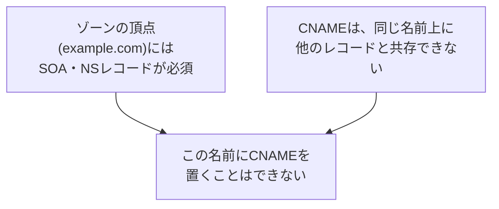

## はじめに

- **この記事で得られること**: CDNやロードバランサーのドキュメントには、「CNAMEレコードで割り当てられたホスト名を指すよう設定してください」と書かれていることがよくあります。しかし、これを**ルートドメイン(`example.com`そのもの)に対して行おうとすると、多くのDNSプロバイダーで設定を拒否されます。** この記事では、この制約が、**CNAMEが他のレコードと同じ名前上に共存できないというDNSの仕様**と、**ゾーンの頂点(ゾーンApex)には必ずSOA・NSレコードが存在しなければならないという、もう1つの要件**が衝突するために生まれているという構造を理解した上で、**ALIAS/ANAMEレコードがどうやってこの制約を回避しているのか**までを体系的に理解します。
- **対象読者**: [DNSサーバーの基礎](/articles/dns-server-fundamentals-guide)でゾーンファイルの構造は理解しているものの、ルートドメインにCNAMEを設定できない理由を、仕組みから説明できない方を想定しています。
- **読むのにかかる想定時間**: 約16分

この記事は[『上位1%』シリーズ 全記事ガイド](/sitemap)の一部、[DNSサーバー基礎シリーズ](/sitemap#シリーズ一覧)の1.1本目です。

## 前提知識

- [DNSサーバーの基礎](/articles/dns-server-fundamentals-guide): ゾーンファイルが、SOA・NS・A・CNAMEといった複数のレコード種別を持つという理解が前提になっています。

## 全体像をつかむ

**CNAMEレコードには、「このレコードが存在する名前には、他のどんな種類のレコードも共存できない」という、DNSの仕様(RFC 1034)上の制約があります。** 一方で、**ドメインのゾーンの頂点(ゾーンApex。`example.com`のように、サブドメインの部分を持たない、ドメインそのものの名前)には、そのゾーンが機能するために、SOAレコードとNSレコードが必ず存在していなければなりません。** **この2つの要件を重ね合わせると、ゾーンの頂点にCNAMEを置くことは、構造的に不可能**だということが分かります。CNAMEを置いた瞬間、同じ名前に必須のSOA・NSレコードが共存できなくなってしまうからです。

## 基礎から徹底解説

### なぜCNAMEは、他のレコードと共存できないのか

CNAME(Canonical Name)レコードは、「この名前への問い合わせは、別の名前(正規名)への問い合わせとして扱ってください」という、**名前そのものに対する別名の宣言**です。**ある名前がCNAMEを持っている場合、その名前への問い合わせは、すべてCNAMEが指す先の名前にある情報で代替される**ため、もし同じ名前にAレコードなど他のレコードも存在していたら、「CNAMEの指す先の情報を使うべきか、この名前に直接書かれたAレコードを使うべきか」という、矛盾した状態が生まれてしまいます。**DNSの仕様は、この矛盾をそもそも発生させないため、CNAMEを持つ名前には、他のどんなレコード種別も共存できない**という、明確なルールを設けています。

### なぜゾーンの頂点には、SOA・NSが必須なのか

**SOAレコードは、そのゾーンの管理情報(シリアル番号、再試行間隔など)を記録する、ゾーンごとに1つだけ存在する必須のレコード**です。**NSレコードは、そのゾーンを権威的に管理しているネームサーバーを示す**レコードです。この2つは、**ゾーンというものが機能するために、必ずゾーンの頂点に存在していなければならない、根幹的なレコード**です。[DNSサーバーの基礎](/articles/dns-server-fundamentals-guide)で扱ったゾーンファイルを実際に見ると、ファイルの先頭に必ずSOAレコードが、そのすぐ後にNSレコードが記述されていることが確認できます。

実際に設定を試みると、どう失敗するのか

多くのDNSプロバイダーの管理画面で、ルートドメイン(`@`やゾーン名そのもの)に対してCNAMEレコードの作成を試みると、**「CNAMEレコードはゾーンの頂点には作成できません」といった趣旨のエラーが表示され、保存自体が拒否されます。** 一部のプロバイダーでは、この制約を検証しないまま保存を許可してしまうこともありますが、その場合、**ゾーンの頂点にあった既存のMXレコード(メール配送先)やその他のレコードが、暗黙的に失われるか、矛盾した状態になり、しばらく経ってからメールの配送が停止するといった、分かりにくい障害につながる**ことがあります。

## プロが見ている視点(上位1%の理解)

### ALIAS/ANAMEレコードは、CNAMEの制約を回避する、プロバイダー独自の仕組み

**CDNやロードバランサーをルートドメインに割り当てたいという、実務上の強い需要**に応えるため、多くのDNSプロバイダーが、**ALIAS(または ANAME)という、標準のDNSプロトコルには存在しない、独自のレコード種別**を提供しています。ALIAS/ANAMEレコードは、**DNSプロトコルのレベルでは、実際には(CNAMEではなく)Aレコードとして応答します。** DNSサーバー自身が、裏側で定期的に、ALIASが指す先のホスト名を解決し、その結果得られたIPアドレスを、まるでそこに直接Aレコードが書かれているかのように、クライアントへ返す**という、サーバー側での事前解決・合成の仕組み**です。これは「**CNAMEフラットニング**」と呼ばれることもあります。**この仕組みにより、ゾーンの頂点に、SOA・NS・MXなど他のレコードが共存している状態を保ちながら、同じ名前がCDNの提供するホスト名の実体を指し続けることが可能になります。**

## よくある誤解・つまずきポイント

- **誤解1: 「CNAMEは、どの名前にでも自由に設定できる」**
  CNAMEは、同じ名前上に他のレコードが存在しない場合にのみ設定できます。ゾーンの頂点は、SOA・NSが必須のため、構造的にCNAMEを置けません。
- **誤解2: 「ALIAS/ANAMEレコードは、CNAMEの一種に過ぎない」**
  ALIAS/ANAMEは、標準のDNSプロトコルには存在しない、プロバイダー独自の仕組みであり、DNSプロトコルのレベルでは実際にはAレコードとして応答します。
- **誤解3: 「一部のプロバイダーがルートドメインへのCNAME設定を許可しているなら、安全に使える」**
  許可されていても、ゾーンの頂点にある他の必須レコード(MXなど)が暗黙的に失われ、後から分かりにくい障害につながる危険があります。

## 障害・トラブルシューティングの視点

1. **ルートドメインにCNAMEを設定しようとして、保存時にエラーが出る**: ゾーンの頂点には、SOA・NSの共存が必須であるため、この制約自体を回避する手段(プロバイダーのALIAS/ANAME機能)がないかを確認します。
2. **以前は届いていたメールが、ある時点から届かなくなった**: ゾーンの頂点のレコードに、最近CNAME(または、CNAMEと矛盾する変更)が加えられていないかを、`dig example.com ANY`相当の確認で調べます。
3. **CDNをルートドメインに割り当てたい**: CNAMEではなく、使用しているDNSプロバイダーのALIAS/ANAME機能、またはCNAMEフラットニング機能を使用します。

## まとめ

- CNAMEレコードは、DNSの仕様上、同じ名前に他のどんなレコード種別も共存できません。
- ゾーンの頂点には、ゾーンが機能するために、SOA・NSレコードが必ず存在していなければなりません。
- この2つの要件が衝突するため、ゾーンの頂点にCNAMEを置くことは構造的に不可能です。
- ALIAS/ANAMEレコードは、DNSサーバー側での事前解決・合成により、CNAMEの制約を回避する、プロバイダー独自の仕組みです。

**今日から意識すべきこと**
1. ルートドメインをCDNやロードバランサーに割り当てたい場合は、CNAMEではなくALIAS/ANAME機能を使いましょう。
2. ゾーンの頂点のレコードを変更する際は、SOA・NS・MXなど、同じ名前に共存している他の必須レコードへの影響を必ず確認しましょう。

## 参考文献

- [RFC 1034: Domain Names - Concepts and Facilities](https://www.rfc-editor.org/rfc/rfc1034)
- [CNAME record | Wikipedia](https://en.wikipedia.org/wiki/CNAME_record)
