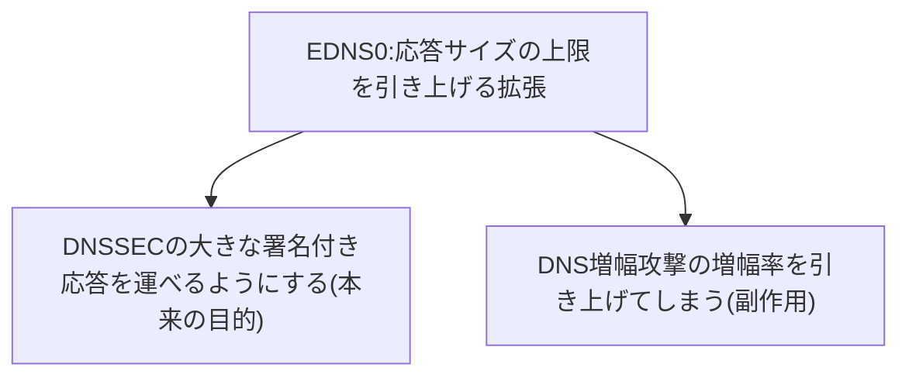

## はじめに

- **この記事で得られること**: [DNSSECの仕組みを『上位1%』の視点で理解する](/articles/dns-dnssec-fundamentals-guide)と[DNS増幅攻撃のハンズオン](/articles/dns-amplification-rrl-handson-guide)の両方に関わる、**EDNS0**という拡張仕様の役割を体系的に理解します。
- **対象読者**: DNSSECの署名が大きなデータであることは知っているものの、従来のDNSがどうやってそれを運べるようになったのかを説明できない方を想定しています。
- **読むのにかかる想定時間**: 約16分

この記事は[『上位1%』シリーズ 全記事ガイド](/sitemap)の一部、[DNS基盤シリーズ](/sitemap#シリーズ一覧)の4.3本目です。

## 前提知識

- [DNSSECの仕組みを『上位1%』の視点で理解する](/articles/dns-dnssec-fundamentals-guide): 署名付きのDNS応答が、通常のDNS応答よりはるかに大きいという前提の理解が必要です。

## 全体像をつかむ

**従来のDNSは、UDPでの応答サイズを512バイトまでに制限するという、古い制約を抱えていました。** **EDNS0(Extension Mechanisms for DNS)は、クライアント側が「自分はもっと大きな応答を受け取れる」ということをサーバーへ伝え、512バイトという上限を、実質的に引き上げるための拡張仕様**です。**DNSSECの署名(RRSIG)や鍵(DNSKEY)は、512バイトに収まらないことが多いため、EDNS0は、DNSSECを実用的に運用するための、必須の土台になっています。しかし、「応答を大きくできる」というこの同じ性質は、DNS増幅攻撃の増幅率を何倍にも引き上げてしまう、まったく別の顔も持っています。**

## 基礎から徹底解説

### EDNS0がなければ、DNSSECは実用にならない

**EDNS0を使わない場合、DNSの応答サイズはおよそ512バイトに制限され、これを超えるとTCPへのフォールバックが必要になり、DNSの大きな利点である「UDPによる低オーバーヘッドな問い合わせ」が失われてしまいます。** **DNSSECの署名(RRSIG)やDNSKEYレコードは、この512バイトを容易に超えるサイズを持つため、EDNS0によって、クライアントが「4096バイトまで受け取れる」といった、より大きなバッファサイズを宣言できるようになったことが、DNSSECを実用的に運用するための前提条件**になっています。

### 同じ拡張が、増幅攻撃の効率を引き上げる

**DNS増幅攻撃は、送信元IPアドレスを詐称した小さなクエリを、公開されている再帰リゾルバへ送り、本来のクエリよりはるかに大きな応答を、詐称された被害者のIPアドレスへ送らせる攻撃**です。**EDNS0登場以前は、応答サイズが512バイト程度に制限されていたため、増幅率は8倍程度に留まっていましたが、EDNS0によってサーバーがより大きな応答を返せるようになった結果、同じ手法での増幅率が、大幅に引き上げられてしまいました。** **[DNS増幅攻撃のハンズオン](/articles/dns-amplification-rrl-handson-guide)で扱ったレスポンスレートリミティング(RRL)という対策は、まさにこの「応答を大きくできる」という性質が生む副作用への、直接の対応策でした。**

補足:応答サイズを小さく宣言する緩和策とその限界

**権威DNSサーバーの運用者は、EDNS0のバッファサイズを、1280バイト程度の小さい値で宣言することで、増幅率を抑える緩和策を取ることがあります。** **しかし、送信元を詐称するクエリ自体を止めることはできないため、この対策だけでは不十分で、根本的な対策は、送信元IPアドレスの詐称自体を防ぐBCP 38(Ingress Filtering)の、インターネット全体での普及**です。

## プロが見ている視点(上位1%の理解)

### 便利さを生む拡張は、たいてい同じ理由で悪用もされる

**EDNS0は、DNSSECという重要なセキュリティ機能を実用化した、紛れもない功労者ですが、「応答を大きくできる」という同じ性質は、送信元を詐称できるUDPの上に乗ることで、増幅攻撃の効率を引き上げるという副作用も生みました。** **ある拡張仕様を評価するとき、「これは何を可能にするのか」だけでなく、「同じ性質が、悪用された場合に何を可能にしてしまうのか」を、必ずセットで問い直す**習慣が、上位1%のエンジニアの視点です。

## よくある誤解・つまずきポイント

- **誤解1: 「EDNS0は、DNSSECのためだけに存在する、専用の拡張だ」**
  EDNS0自体は、DNSの応答サイズ上限を引き上げる汎用的な拡張であり、DNSSECはその恩恵を受ける代表的な用途の1つに過ぎません。
- **誤解2: 「EDNS0のバッファサイズを小さく宣言すれば、増幅攻撃を完全に防げる」**
  送信元IPアドレスの詐称自体は防げないため、バッファサイズの制限だけでは不十分です。根本的な対策にはBCP 38のような、送信元詐称自体を防ぐ仕組みが必要です。
- **誤解3: 「EDNS0が登場する前から、DNSSECは問題なく運用できていた」**
  EDNS0登場以前は、512バイトの制約により、DNSSECの大きな署名付き応答を運ぶことが実質的に困難でした。

## 障害・トラブルシューティングの視点

1. **DNSSECを有効化した後、一部のクライアントでDNS解決が失敗する**: そのクライアントや経路上のファイアウォールが、EDNS0に対応しているか、大きなUDPパケットを許可しているかを確認します。
2. **自組織の権威DNSサーバーが、DNS増幅攻撃の踏み台として使われている**: EDNS0のバッファサイズ宣言と、レスポンスレートリミティング(RRL)の設定を見直します。
3. **EDNS0非対応の古いリゾルバで、DNSSEC関連のクエリが失敗する**: TCPへのフォールバックが正しく機能しているかを確認します。

## まとめ

- EDNS0は、DNSのUDP応答サイズの上限(512バイト)を引き上げる拡張仕様です。
- DNSSECの大きな署名付き応答は、EDNS0なしでは実用的に運用できません。
- 同じ「応答を大きくできる」という性質が、DNS増幅攻撃の増幅率を引き上げる副作用も持っています。
- 増幅攻撃への根本的な対策には、バッファサイズの制限だけでなく、BCP 38のような送信元詐称対策が必要です。

**今日から意識すべきこと**
1. DNSSECを導入する際は、EDNS0が経路上で正しく機能しているか(大きなUDPパケットがブロックされていないか)を確認しましょう。
2. 権威DNSサーバーを運用する際は、EDNS0のバッファサイズ設定が、増幅攻撃の踏み台リスクとどう関係しているかを意識しましょう。

## 参考文献

- [What Is a DNS Amplification Attack? | NameSilo](https://www.namesilo.com/blog/en/dns/what-is-a-dns-amplification-attack-ddos-reflection)
- [draft-ietf-dnsop-avoid-fragmentation | IETF Datatracker](https://datatracker.ietf.org/doc/html/draft-ietf-dnsop-avoid-fragmentation-16)
