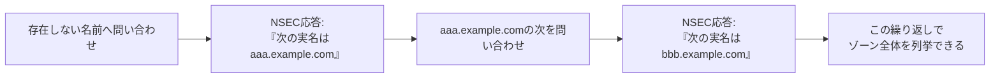

## はじめに

- **この記事で得られること**: [DNSSECの仕組み](/articles/dns-dnssec-fundamentals-guide)は、RRSIG・DNSKEY・DSという3種類のレコードで、応答の真正性を証明する仕組みでした。この記事では、DNSSECが「このレコードは存在しない」ことを証明するために使う、**NSEC**というレコードが、意図せず**ゾーン内のすべての名前を列挙できる地図**になってしまうという、見過ごされがちな副作用を体系的に理解します。
- **対象読者**: DNSSECの基本的な仕組みは理解しているものの、NSECレコードが、ゾーン内の情報を列挙する手段として使われてしまうことを知らない方を想定しています。
- **読むのにかかる想定時間**: 約17分

この記事は[『上位1%』シリーズ 全記事ガイド](/sitemap)の一部、[DNSサーバー基礎シリーズ](/sitemap#シリーズ一覧)の4.2本目です。

## 前提知識

- [DNSSECの仕組み](/articles/dns-dnssec-fundamentals-guide): RRSIG・DNSKEY・DSによる、応答の真正性を証明する仕組みの理解が前提になっています。

## 全体像をつかむ

**DNSSECは、「あるレコードが存在する」ことだけでなく、「あるレコードが存在しない」ことも、暗号学的に証明する必要があります。この「存在しないことの証明」を担うのが、NSECレコード**です。**NSECは、「問い合わせた名前は存在しないが、ゾーン内をソート順に辿ると、次に実在する名前はこれだ」という形式で応答します。** **この「次の名前」を、存在しない名前への問い合わせを繰り返しながら辿っていくだけで、ゾーン内に存在する、すべての名前を、順番に列挙できてしまう**のです。これが「ゾーンウォーキング」と呼ばれる手法です。

## 基礎から徹底解説

### NSEC3:実名の代わりに、ハッシュ値を連結する

**NSEC3は、NSECと同じ「次の名前」を使う仕組みを維持しながら、実際の名前の代わりに、その名前をハッシュ化した値を連結**します。**これにより、ゾーンウォーキングを行っても、得られるのはハッシュ値の列であり、元の名前そのものではなくなる**ため、カジュアルな列挙は、大幅に難しくなります。

### NSEC3は、完全な防御ではない

**NSEC3のハッシュは、不可逆ではありません。攻撃者が、ありそうな名前(辞書攻撃)を、あらかじめハッシュ化して、公開されているハッシュ値と比較することで、元の名前を特定できる**可能性があります。特に、`www`・`mail`・`admin`のような、予測しやすい名前は、この辞書攻撃に対して脆弱です。

NSEC3のsaltとイテレーション回数、推奨値は時代によって変わっている

**NSEC3には、ハッシュ化の前に加える「salt」と、ハッシュ化を繰り返す「イテレーション回数」という、2つのパラメータが存在**し、これらを増やすことで、辞書攻撃への耐性を高められる、と、かつては推奨されていました。**しかし、RFC 9276という、より新しい推奨では、saltを空にし、イテレーション回数をゼロにすることが、現在の推奨とされています。** これは、saltやイテレーションの増加が、鍵のロールオーバーを複雑にする一方で、現代の計算能力に対しては、実質的な安全性の向上にはつながらない、という判断に基づいています。

## プロが見ている視点(上位1%の理解)

### 「セキュリティのための仕組み」が、別の軸で「プライバシーの問題」を生むことがある

**DNSSECは、応答の真正性という、1つのセキュリティ上の目的のために設計されましたが、その実装(NSEC)が、意図していなかった別の軸——ゾーン内の情報の秘匿性(プライバシー)——において、新たな弱点を生み出しました。** **「このレコードは存在しない」という、一見単純で無害に見える応答の裏側に、ゾーン全体を暴露する地図が隠れている**という可能性を、常に一段掘り下げて検討する視点が、上位1%のエンジニアが持っている視点です。

## よくある誤解・つまずきポイント

- **誤解1: 「DNSSECを導入すれば、ゾーン内の情報はすべて保護される」**
  DNSSECは応答の真正性を証明する仕組みであり、NSECを使う場合、ゾーン内のすべての名前が、列挙可能な状態になってしまいます。
- **誤解2: 「NSEC3を使えば、ゾーンウォーキングは完全に防げる」**
  NSEC3のハッシュは不可逆ではなく、予測しやすい名前は、辞書攻撃によって特定される可能性があります。
- **誤解3: 「NSEC3のsaltとイテレーション回数は、多ければ多いほど安全だ」**
  RFC 9276の現在の推奨は、saltを空にし、イテレーション回数をゼロにすることです。

## 障害・トラブルシューティングの視点

1. **ゾーン内の、まだ公開していないはずのサブドメイン名が、外部に知られてしまった**: DNSSECでNSECを使用しており、ゾーンウォーキングによって列挙された可能性を確認します。
2. **NSEC3を導入しているのに、一部の名前が特定されてしまった**: その名前が、辞書攻撃で特定しやすい、予測可能な文字列になっていないかを確認します。
3. **NSEC3のパラメータ設定に迷う**: RFC 9276の最新の推奨(salt空・イテレーション0)を確認します。

## まとめ

- NSECは、「存在しないことの証明」のために、ゾーン内の実在する名前を、ソート順で連結する仕組みです。
- この仕組みを順番にたどることで、ゾーン内のすべての名前を列挙できてしまう「ゾーンウォーキング」が可能になります。
- NSEC3は、実名の代わりにハッシュ値を連結することで、この問題を軽減しますが、完全には防げません。
- RFC 9276の現在の推奨は、NSEC3のsaltを空にし、イテレーション回数をゼロにすることです。

**今日から意識すべきこと**
1. DNSSECを導入する際は、NSECではなくNSEC3を使うことを、まず検討しましょう。
2. ゾーン内に、公開したくないサブドメイン名がある場合は、ゾーンウォーキングのリスクを、事前に評価しましょう。

## 参考文献

- [What Are NSEC and NSEC3 Records? | DNSimple](https://support.dnsimple.com/articles/nsec-nsec3-records/)
- [DNSSEC NSEC: The Accidental Treasure Map to Your Subdomains | Pen Test Partners](https://www.pentestpartners.com/security-blog/dnssec-nsec-the-accidental-treasure-map-to-your-subdomains/)
