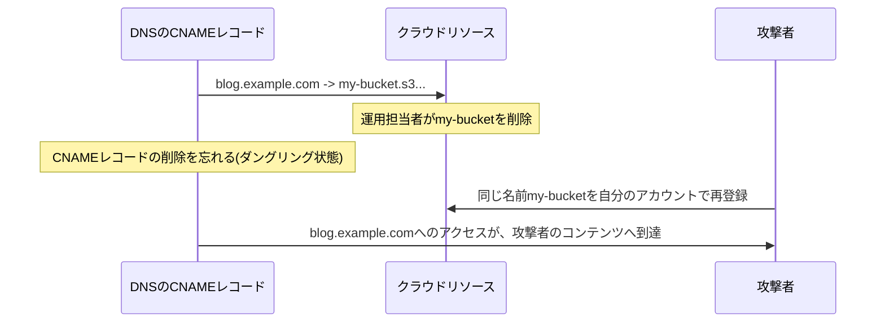

## はじめに

- **この記事で得られること**: [CNAMEとApex問題](/articles/dns-cname-apex-guide)で扱ったCNAMEは、ある名前から別の名前への「別名」でした。この記事では、**その指し示す先のクラウドリソースが削除され、宙ぶらりんになったCNAMEを、攻撃者が乗っ取る**「サブドメインテイクオーバー」という、実際に多発している攻撃手法を体系的に理解します。
- **対象読者**: CNAMEレコードの基本的な仕組みは理解しているものの、サブドメインテイクオーバーという攻撃がどういう仕組みで成立するのかを説明できない方を想定しています。
- **読むのにかかる想定時間**: 約18分

この記事は[『上位1%』シリーズ 全記事ガイド](/sitemap)の一部、[DNS基盤シリーズ](/sitemap#シリーズ一覧)の1.2本目です。

## 前提知識

- [CNAMEとApex問題](/articles/dns-cname-apex-guide): CNAMEレコードが、ある名前から別の名前への別名であるという、基本的な仕組みの理解が前提になっています。

## 全体像をつかむ

**`blog.example.com`のようなサブドメインに、CNAMEで`example.herokuapp.com`のようなクラウドサービスのリソース名を指し示す設定は、非常に一般的**です。**しかし、このHerokuアプリやS3バケット、Azure App Serviceを削除したときに、DNS側のCNAMEレコードを削除し忘れると、このCNAMEは「宙ぶらりん」(ダングリング)な状態で残り続け**ます。**攻撃者が、同じリソース名(例えば同じバケット名)を、自分のクラウドアカウントで再登録してしまえば、あなたの会社の正規のサブドメイン上で、攻撃者のコンテンツが表示されるようになる、というのがサブドメインテイクオーバー**です。

## 基礎から徹底解説

### なぜ、クラウドリソースの再登録が、他社のドメインを乗っ取ることにつながるのか

**S3やHeroku、Azure App Serviceのようなクラウドサービスは、多くの場合、リソース名(バケット名やアプリ名)を、全ユーザー共有の1つの名前空間の中で管理**しています。**ある名前のリソースが削除されると、その名前は再び誰でも登録できる状態に戻るため、攻撃者が、まだDNS側にCNAMEとして残っている名前を見つけ出し、同じ名前で新しいリソースを作成すれば、クラウド側はそのDNS名からのアクセスを、攻撃者が作成したリソースへそのまま転送**してしまいます。

### 実際に起きた被害:削除されたS3バケットへの、800万件を超えるアクセス

**ある調査では、削除されたS3バケット約150個を研究目的で再取得したところ、ソフトウェアのアップデートを求めるものを含め、合計800万件を超えるアクセスが到達**しました。**2025年には、Hazy Hawkと呼ばれる攻撃者グループが、ダングリングDNSレコードを悪用し、政府機関や大企業を含む標的への攻撃を行っていたことも報告**されています。**乗っ取られたサブドメインは、あなたの会社が正規に保有するドメインの一部として扱われるため、フィッシング・マルウェア配布・Cookieの窃取など、利用者からの信頼を直接悪用した攻撃に使われ**ます。

検知の手がかり:クラウドサービス特有の、特徴的なエラーメッセージ

**ダングリング状態のCNAMEを検知するには、サブドメインを列挙し、それぞれのCNAMEの指し示す先が、実際に解決できるかを確認**します。**さらに、AWSが返す`NoSuchBucket`のような、サービスごとに特徴的なエラーメッセージ自体が、「このリソース名は、まだ誰も取得していない、乗っ取り可能な状態だ」という、重要な手がかり**になります。

## プロが見ている視点(上位1%の理解)

### リソースの削除とDNSレコードの削除は、常に1セットの操作として扱う

**クラウドリソースを削除する作業と、そのリソースを指し示していたDNSレコードを削除する作業は、別々のチームや別々のタイミングで行われがちですが、この間に生じる『宙ぶらりんの時間』こそが、攻撃者にとっての侵入窓**になります。**リソースを削除する前に、必ずDNSレコード側を先に削除する、あるいは同時に削除するという運用上の順序**を徹底する習慣が、このような、設定ミスとも呼べない「ただの消し忘れ」に起因する侵害を防ぐための、上位1%のエンジニアの視点です。

## よくある誤解・つまずきポイント

- **誤解1: 「クラウドリソースを削除すれば、そのリソースを指し示していたDNS設定は、自動的に無効化される」**
  DNS側のCNAMEレコードは、クラウドリソースの削除とは独立して存在するため、手動で削除しない限り、ダングリング状態のまま残り続けます。
- **誤解2: 「サブドメインテイクオーバーは、DNSサーバー自体への不正アクセスが必要な、高度な攻撃だ」**
  攻撃者は、DNSサーバーへの不正アクセスを一切必要とせず、クラウドサービス側で、同じ名前のリソースを再登録するだけで、乗っ取りが成立します。
- **誤解3: 「乗っ取られたサブドメインは、見た目が怪しいため、利用者はすぐに気づく」**
  乗っ取られたサブドメインは、あなたの会社の正規ドメインの一部として表示されるため、利用者が見た目だけで異常に気づくことは、一般的に困難です。

## 障害・トラブルシューティングの視点

1. **自社のサブドメインが、意図しないコンテンツを表示している**: 該当サブドメインのCNAMEが指し示す先のクラウドリソースが、すでに削除・再登録されていないかを確認します。
2. **クラウドリソースを削除する予定がある**: 削除の前に、そのリソースを指し示すDNSレコードが存在するかを棚卸しし、DNSレコード側を先に削除します。
3. **自社が保有するすべてのサブドメインの状態を、継続的に監視したい**: サブドメインを列挙し、各CNAMEの解決可否と、クラウドサービス特有のエラーメッセージを定期的に確認する仕組みを導入します。

## まとめ

- サブドメインテイクオーバーは、CNAMEが指し示す先のクラウドリソースが削除され、ダングリング状態になったDNSレコードを、攻撃者が同じリソース名を再登録することで乗っ取る攻撃です。
- クラウドサービスの多くは、リソース名を全ユーザー共有の名前空間で管理しているため、削除された名前は、再び誰でも登録できる状態に戻ります。
- 乗っ取られたサブドメインは、正規ドメインの一部として扱われるため、フィッシングやマルウェア配布に悪用されても、利用者が見た目だけで気づくことは困難です。
- 予防の基本は、クラウドリソースを削除する前に、それを指し示すDNSレコードを先に、または同時に削除することです。

**今日から意識すべきこと**
1. クラウドリソースを削除する際は、それを指し示すDNSレコードの削除も、必ずセットの作業として扱いましょう。
2. 自社が保有するサブドメインとCNAMEの指し示す先を、定期的に棚卸しする仕組みを検討しましょう。

## 参考文献

- [Test for Subdomain Takeover | OWASP Web Security Testing Guide](https://owasp.org/www-project-web-security-testing-guide/latest/4-Web_Application_Security_Testing/02-Configuration_and_Deployment_Management_Testing/10-Test_for_Subdomain_Takeover)
- [How to Detect Dangling DNS and Prevent Subdomain Takeovers | IONIX](https://www.ionix.io/writing-center/how-to-detect-dangling-dns-and-prevent-subdomain-takeovers-in-2026)
