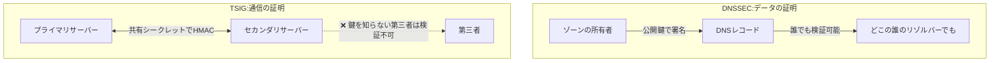

## はじめに

- **この記事で得られること**: [BINDサーバーのハンズオン](/articles/dns-server-handson-guide)で扱った、プライマリとセカンダリの間のゾーン転送を、第三者から保護するための仕組みである、**TSIG**(Transaction SIGnature)を体系的に理解します。
- **対象読者**: DNSSECの仕組みは理解しているものの、TSIGがDNSSECと何が違うのか、なぜ別に必要なのかを説明できない方を想定しています。
- **読むのにかかる想定時間**: 約18分

この記事は[『上位1%』シリーズ 全記事ガイド](/sitemap)の一部、[DNS基盤シリーズ](/sitemap#シリーズ一覧)の2.1本目です。

## 前提知識

- [BINDサーバーのハンズオン](/articles/dns-server-handson-guide): プライマリ・セカンダリ間のゾーン転送の基本的な仕組みの理解が前提になっています。

## 全体像をつかむ

**TSIGは、共有シークレット(あらかじめ両者が知っている鍵)を使い、HMACという仕組みで、特定の2台のサーバーの間でやり取りされるメッセージそのものを認証**します。**これにより、ゾーン転送の要求・応答や、動的更新のリクエストが、本当に許可された相手から送られてきたものかを検証**できます。**DNSSECが「このデータは、ゾーンの所有者が署名した、正当なデータである」ことを証明するのに対し、TSIGは「この特定の2台の間でやり取りされたこの通信は、改ざんされていない」ことを証明する**という、証明する対象そのものが異なります。

## 基礎から徹底解説

### TSIGの信頼の前提:共有シークレットは、事前に、帯外で配布する必要がある

**TSIGの鍵配布そのものは、プロトコルの仕様の対象外**です。**管理者は、プライマリとセカンダリの両方へ、同じ共有シークレットを、あらかじめ、帯外(DNSプロトコル自体とは別の経路)で配布しておく必要**があります。**この性質上、TSIGは、特定の少数のサーバー間での認証に向いていますが、不特定多数との認証には、鍵の組み合わせ数が急増してしまい、現実的ではありません。**

### なぜDNSSECだけでは、ゾーン転送を保護できないのか

**DNSSECが保護しているのは、署名されたレコードのデータそのものであり、グルーレコードや、署名されていないレコードは保護対象外**です。**そしてDNSSECは、「誰が、どのサーバーへゾーン転送を要求してよいか」という、転送そのもののアクセス制御を行う仕組みではありません。** **TSIGは、ゾーン転送のやり取り全体(グルーレコードを含む)を対象に、特定のセカンダリサーバーだけがゾーン転送を要求できるように制限する、DNSSECとは補完的な役割**を果たします。

DNSSECとTSIGは、競合する選択肢ではなく、組み合わせて使うもの

**DNSSECとTSIGは、どちらか一方を選ぶものではなく、組み合わせて使うことで、それぞれが保護できない範囲を補い合う**仕組みです。**TSIGで、プライマリ・セカンダリ間のゾーン転送そのものを保護しながら、DNSSECで、公開されたDNSレコードの真正性を、インターネット上の誰でも検証できるようにする**という、2つの異なるレイヤーの対策を、同時に実施するのが実務上の定石です。

## プロが見ている視点(上位1%の理解)

### 「認証されている」という言葉だけでは、何を証明しているのかが分からない

**「DNSSECで認証されているから安全だ」「TSIGで認証されているから安全だ」という言葉だけでは、具体的に何が、誰に対して証明されているのかが分かりません。** **「この認証は、データの真正性を証明しているのか、それとも、この2者間の通信であることを証明しているのか」を、一段掘り下げて確認する**習慣が、上位1%のエンジニアの視点です。

## よくある誤解・つまずきポイント

- **誤解1: 「DNSSECを導入していれば、ゾーン転送も自動的に保護される」**
  DNSSECは署名されたレコードのデータを保護する仕組みであり、ゾーン転送そのものへのアクセス制御は行いません。
- **誤解2: 「TSIGは、DNSSECの代わりになる、より簡単な仕組みだ」**
  TSIGは共有シークレットを使う、特定の2者間の通信を証明する仕組みであり、インターネット上の誰でも検証できるDNSSECとは、証明する対象そのものが異なります。
- **誤解3: 「TSIGの鍵配布も、DNSプロトコル自体が自動的に行ってくれる」**
  TSIGの鍵配布はプロトコルの対象外であり、管理者が帯外で、両方のサーバーへ同じ共有シークレットを配布する必要があります。

## 障害・トラブルシューティングの視点

1. **ゾーン転送が、意図しない第三者から要求されてしまう**: TSIGを導入し、特定のセカンダリサーバーだけがゾーン転送を要求できるように制限します。
2. **TSIGを設定したのに、ゾーン転送が失敗する**: プライマリとセカンダリの両方で、同じ共有シークレットが正しく設定されているかを確認します。
3. **DNSSECを導入したのに、ゾーン転送のセキュリティが心配**: DNSSECとTSIGは補完的な役割を持つため、両方を組み合わせて導入することを検討します。

## まとめ

- TSIGは、共有シークレットを使い、特定の2台のサーバーの間でやり取りされるメッセージそのものを認証する仕組みです。
- DNSSECはデータの真正性を証明し、TSIGは特定の2者間の通信を証明するという、証明する対象そのものが異なります。
- TSIGの鍵配布はプロトコルの対象外であり、管理者が帯外で配布する必要があります。
- DNSSECとTSIGは、競合する選択肢ではなく、組み合わせて使うことで、それぞれの保護できない範囲を補い合います。

**今日から意識すべきこと**
1. ゾーン転送を外部へ公開している場合は、TSIGによるアクセス制御を導入しましょう。
2. 「認証されている」という言葉を見たら、それが何を、誰に対して証明しているのかを、必ず一段掘り下げて確認しましょう。

## 参考文献

- [RFC 8945: Secret Key Transaction Authentication for DNS (TSIG) | IETF](https://datatracker.ietf.org/doc/rfc8945/)
