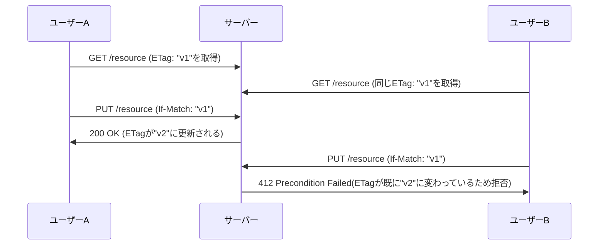

## はじめに

- **この記事で得られること**: [自分の手でシンプルなRESTful APIを構築するハンズオン](/articles/restful-api-handson-guide)で扱った、PUTが冪等であるという性質は、**同じリクエストを2回送っても結果が変わらないことを保証するだけ**です。しかし、**2人のユーザーが同時に同じリソースを更新し、片方の変更がもう片方に黙って上書きされてしまう「ロストアップデート」問題は、冪等性では一切防げません。** この記事では、**ETag**と**条件付きリクエスト**(`If-Match`/`If-None-Match`)が、キャッシュの効率化だけでなく、この同時更新の競合を検出し、HTTPの標準的な仕組みの中で防ぐための、**楽観的ロック**の実装でもあることを体系的に理解します。
- **対象読者**: ETagがキャッシュのために使われることは知っているものの、同時更新の競合防止にも使われるという、もう1つの用途を説明できない方を想定しています。
- **読むのにかかる想定時間**: 約17分

この記事は[『上位1%』シリーズ 全記事ガイド](/sitemap)の一部、[Web/APIシリーズ](/sitemap#シリーズ一覧)の3.2本目です。

## 前提知識

- [自分の手でシンプルなRESTful APIを構築するハンズオン](/articles/restful-api-handson-guide): PUTが冪等であり、同じリクエストを繰り返しても同じ結果に収束するという理解が前提になっています。

## 全体像をつかむ

**冪等性は、「同じリクエストを繰り返し送った場合」の安全性だけを保証する性質です。** これに対し、**「ロストアップデート」問題は、まったく別の種類の問題**です。2人のユーザーAとBが、同じリソースを同時に読み取り、それぞれが異なる変更を加えて、それぞれ別々にPUTで送信したとします。**どちらのPUTリクエストも、個別に見れば完全に冪等ですが、後から送信されたPUTが、先に送信されたPUTの変更内容を、黙って完全に上書きしてしまいます。** Aの変更が、何の警告もなく失われてしまう——これが、冪等性だけでは防げない、ロストアップデート問題です。**ETagと条件付きリクエストは、この問題に対する、HTTP標準の答え**です。

## 基礎から徹底解説

### ETagとは何か:リソースの状態に対する、一意な指紋

**ETag(Entity Tag)は、サーバーが、あるリソースの現在の状態に対して発行する、一意な識別子です。** リソースの内容が少しでも変わると、ETagの値も変わります。サーバーは、GETリクエストへの応答ヘッダーに、この時点でのETagを含めて返します。クライアントは、以降このリソースを参照する際、**自分が最後に取得した時点のETagを、リクエストヘッダーに含めて送り返す**ことができます。

### If-None-Match:キャッシュの効率化のための条件付きリクエスト

クライアントが、GETリクエストに`If-None-Match: "v1"`というヘッダーを付けて送ると、**サーバーは、現在のETagが、クライアントが提示した値と一致する場合、レスポンスボディを一切送信せず、`304 Not Modified`という、本文のない応答だけを返します。** リソースの内容が変わっていない限り、クライアントは、すでに持っているキャッシュをそのまま使い続けられるため、帯域と処理コストの両方を節約できます。

### If-Match:同時更新を検出するための、条件付きリクエスト

**`If-Match`ヘッダーは、`If-None-Match`とは正反対の目的で使われます。** クライアントが、PUTやPATCH、DELETEのような更新・削除リクエストに、`If-Match: "v1"`というヘッダーを付けて送ると、**サーバーは、現在のETagが、クライアントが提示した値と完全に一致する場合にだけ、そのリクエストを実行します。** もし、クライアントがリソースを取得した後、別の誰かがそのリソースを変更していて、現在のETagが変わってしまっていた場合、**サーバーは更新を実行せず、`412 Precondition Failed`というエラーを返します。** これにより、**「自分が読み取った時点の状態を前提に更新しようとしたが、その前提がすでに崩れている」ことを、クライアント自身が検知**できます。

これは「楽観的ロック」と呼ばれる仕組みの、HTTPにおける具体的な実装

データベースの世界で「楽観的ロック(Optimistic Locking)」と呼ばれる仕組み——**事前にロックを取得するのではなく、更新の直前に「自分が最後に見た状態と、今の状態が一致しているか」を確認し、一致していなければ更新を拒否する**、という設計思想を覚えている方もいるかもしれません。**ETagと`If-Match`の組み合わせは、まさにこの楽観的ロックを、HTTPの標準的な仕組みの中で実現したもの**です。データベース側で個別にバージョン番号カラムを実装する代わりに、HTTPのレイヤーで同じ安全性を提供できる点が、実務上の利点です。

## プロが見ている視点(上位1%の理解)

### 冪等性と楽観的ロックは、互いに補完し合う、別々の安全策

**冪等性は「同じ意図のリクエストを、何度再送しても安全であること」を保証し、楽観的ロック(If-Match)は「自分の意図した前提が、今も有効であること」を保証します。** この2つは、**似ているようで、守っている対象がまったく異なる**ことを、はっきり区別しておく必要があります。例えば、ネットワーク障害でPUTの応答が届かず、クライアントが同じPUTリクエストを再送した場合——**冪等性のおかげで、この再送自体は安全です。しかし、再送の間に、別のユーザーがそのリソースを変更していた場合、`If-Match`がなければ、その変更は黙って上書きされてしまいます。** **実務で本当に安全な更新APIを設計するには、冪等性だけでは不十分で、楽観的ロックという、もう1つの軸の安全策を組み合わせる必要がある**ということが、この対比から見えてきます。

## よくある誤解・つまずきポイント

- **誤解1: 「PUTが冪等であれば、同時更新による上書き事故は起きない」**
  冪等性は、同じリクエストの再送に対する安全性を保証するだけであり、異なる2つのリクエストが競合するロストアップデート問題は、冪等性とは無関係に発生します。
- **誤解2: 「ETagは、キャッシュの効率化のためだけに使われる」**
  ETagは、`If-None-Match`によるキャッシュの効率化と、`If-Match`による同時更新の競合検出という、2つの異なる目的で使われます。
- **誤解3: 「412 Precondition Failedは、サーバーエラーの一種だ」**
  412は、クライアント側が前提としていた状態が、現在の実際の状態と一致しなかったことを示す、クライアントエラー(4xx系)であり、クライアント側で最新の状態を再取得し、変更をやり直すべき、というシグナルです。

## 障害・トラブルシューティングの視点

1. **複数人で同じリソースを編集すると、片方の変更が消えてしまう**: 更新APIが`If-Match`による条件付きリクエストを要求しているか、サーバー側で実装されているかを確認します。
2. **`If-Match`を付けたのに、意図せず`412`が返ってくる**: クライアントが保持しているETagが、最新の状態と一致しているかを確認し、最新のGETで取得し直してから、再度更新を試みます。
3. **キャッシュが効いているはずなのに、毎回レスポンスボディが丸ごと返ってくる**: クライアントが`If-None-Match`ヘッダーを、取得済みのETagとともに正しく送信しているかを確認します。

## まとめ

- 冪等性は、同じリクエストの再送に対する安全性を保証するだけであり、異なる2つのリクエストが競合するロストアップデート問題は防げません。
- ETagは、サーバーがリソースの現在の状態に対して発行する、一意な識別子です。
- `If-None-Match`は、キャッシュの効率化のための条件付きリクエストであり、ETagが一致すれば`304 Not Modified`を返します。
- `If-Match`は、同時更新の競合を検出するための条件付きリクエストであり、ETagが一致しなければ`412 Precondition Failed`を返す、HTTP標準の楽観的ロックです。

**今日から意識すべきこと**
1. 更新系のAPIを設計する際は、冪等性だけで満足せず、`If-Match`による楽観的ロックが必要かどうかを検討しましょう。
2. `412 Precondition Failed`に遭遇したら、サーバーエラーだと決めつけず、まず最新の状態を再取得しましょう。

## 参考文献

- [RFC 7232: HTTP/1.1 Conditional Requests](https://www.rfc-editor.org/rfc/rfc7232)
- [ETag | MDN Web Docs](https://developer.mozilla.org/en-US/docs/Web/HTTP/Headers/ETag)
