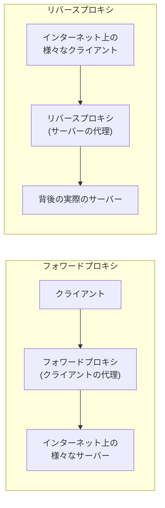

## はじめに

- **この記事で得られること**: [Squidで明示的プロキシを構築するハンズオン](/articles/squid-proxy-handson-guide)や[透過型プロキシを構築するハンズオン](/articles/transparent-proxy-handson-guide)で、このシリーズがこれまで構築してきたプロキシは、すべて「**フォワードプロキシ**」という、片方の種類に限られていたことに気づきます。この記事では、プロキシには、**クライアントの代理として振る舞うフォワードプロキシ**と、**サーバーの代理として振る舞うリバースプロキシ**という、まったく逆方向の、2つの種類が存在するという全体像を体系的に理解します。
- **対象読者**: このシリーズでSquidを使ったプロキシの構築は経験しているものの、「リバースプロキシ」という言葉を聞いたことがあっても、フォワードプロキシとの違いを、正確に説明できない方を想定しています。
- **読むのにかかる想定時間**: 約16分

この記事は[『上位1%』シリーズ 全記事ガイド](/sitemap)の一部、[Webプロキシ/キャッシュ基礎シリーズ](/sitemap#シリーズ一覧)の1.1本目です。

## 前提知識

- [プロキシとファイアウォールの使い分け](/articles/proxy-firewall-guide): プロキシが、通信を中継する存在であるという、基本的な理解が前提になっています。

## 全体像をつかむ

**このシリーズでこれまで扱ってきたプロキシ(Squidによる明示的プロキシ、透過型プロキシ)は、すべて、クライアント側に立ち、クライアントの代理として振る舞う、「フォワードプロキシ」でした。** しかし、プロキシという概念には、もう1つ、まったく逆方向の「**リバースプロキシ**」が存在します。**この2つを分けている軸は、「プロキシが、どちら側の正体を、もう一方から隠しているのか」という、代理の方向そのもの**です。**フォワードプロキシは、サーバー側から見て、個々のクライアントの正体を隠し、クライアントの代理として振る舞います。リバースプロキシは、クライアント側から見て、個々のサーバーの正体を隠し、サーバーの代理として振る舞います。**

## 基礎から徹底解説

### フォワードプロキシ:クライアントの代理人

**フォワードプロキシは、クライアントの近くに配置され、そのクライアントが、インターネット上の様々な、不特定多数のサーバーへアクセスする際の、代理人として振る舞います。** [Squidで構築した明示的プロキシ](/articles/squid-proxy-handson-guide)も、[iptablesで構築した透過型プロキシ](/articles/transparent-proxy-handson-guide)も、この型です。**接続先のサーバーの数は、限定されておらず、クライアント自身が、1つのフォワードプロキシを経由して、あらゆる宛先へアクセスします。** サーバー側からは、本来のクライアントのIPアドレスが見えず、フォワードプロキシ自身のIPアドレスだけが見えます。

### リバースプロキシ:サーバーの代理人

**リバースプロキシは、サーバーの近くに配置され、そのサーバーへアクセスしようとする、インターネット上の不特定多数のクライアントを受け止める、代理人として振る舞います。** クライアント側からは、リバースプロキシが、まるで本来のサーバーそのものであるかのように見え、**その背後に実際のサーバーが存在していることは、意識されません。** **[ロードバランシング基礎シリーズ](/sitemap#シリーズ一覧)で扱ったHAProxyやnginxは、まさにこのリバースプロキシの代表例**であり、複数台の背後のサーバーへトラフィックを振り分けるという機能は、リバースプロキシという役割の、応用的な使い方の1つに過ぎません。

CDNも、リバースプロキシの一種として理解できる

[HTTPSの普及とプロキシキャッシュの終焉](/articles/http-caching-cdn-guide)で扱った**CDN**(Content Delivery Network)も、構造的には**リバースプロキシの、大規模に分散配置されたネットワーク**として理解できます。CDNのエッジサーバーは、クライアントから見ると、まるでコンテンツの提供元そのものであるかのように振る舞いますが、実際には、背後にある本来のオリジンサーバーへのリクエストを代行し、キャッシュした結果を返しているに過ぎません。この構造は、1台のリバースプロキシが行っていることを、世界中の多数の拠点へ分散配置した、拡張版だと考えることができます。

## プロが見ている視点(上位1%の理解)

### 「プロキシ」という1つの言葉が、まったく逆方向の2つの役割を指している

**「プロキシ」という言葉だけを聞くと、フォワードプロキシを思い浮かべる人と、リバースプロキシを思い浮かべる人が、実務では両方存在します。** これは、どちらが正しいという問題ではなく、**「プロキシ」という言葉自体が、「代理」という抽象的な概念を指しているだけであり、代理の方向(クライアント側の代理か、サーバー側の代理か)までは、この言葉単体では決まっていない**ためです。**実務で「プロキシ」という言葉に出会ったら、まず「これはクライアント側の代理(フォワード)か、サーバー側の代理(リバース)か」を、文脈から判断する習慣を持つ**ことが、この分野の会話を正確に理解するための、最初の一歩になります。

## よくある誤解・つまずきポイント

- **誤解1: 「プロキシといえば、このシリーズで扱ったような、クライアント側のものだけを指す」**
  プロキシには、クライアントの代理として振る舞うフォワードプロキシと、サーバーの代理として振る舞うリバースプロキシという、まったく逆方向の2つの種類が存在します。
- **誤解2: 「リバースプロキシは、フォワードプロキシの、単なる発展型・上位版だ」**
  2つは、代理する対象(クライアント側かサーバー側か)がそもそも異なる、別の目的を持つ仕組みです。優劣の関係ではありません。
- **誤解3: 「CDNは、プロキシとはまったく別の、独立した技術だ」**
  CDNは、構造的にはリバースプロキシを、世界中の多数の拠点へ分散配置した、拡張版として理解できます。

## 障害・トラブルシューティングの視点

1. **「プロキシの設定を確認してください」という指示を受けたが、何を確認すればよいか分からない**: まず、そのプロキシがクライアント側(フォワード)かサーバー側(リバース)かを確認し、確認すべき設定ファイルやツールを正しく特定します。
2. **サーバーのアクセスログに、クライアントの本来のIPアドレスが記録されていない**: フォワードプロキシを経由している場合、サーバー側からはプロキシ自身のIPアドレスしか見えません。
3. **クライアントから見えているサーバーのIPアドレスへ直接アクセスしても、期待した応答が得られない**: そのIPアドレスが、リバースプロキシ自身のものであり、背後の実際のサーバーへの、別の到達経路を確認する必要があります。

## まとめ

- フォワードプロキシは、クライアントの近くに配置され、クライアントの代理として、インターネット上の様々なサーバーへのアクセスを中継します。
- リバースプロキシは、サーバーの近くに配置され、サーバーの代理として、インターネット上の様々なクライアントからのアクセスを受け止めます。
- 2つを分けている軸は、「プロキシが、どちら側の正体を、もう一方から隠しているのか」という、代理の方向そのものです。
- HAProxy・nginx・CDNは、リバースプロキシの代表例であり、ロードバランシングやキャッシュ配信は、その応用的な使い方です。

**今日から意識すべきこと**
1. 「プロキシ」という言葉に出会ったら、まずそれがフォワードプロキシかリバースプロキシかを、文脈から判断する習慣をつけましょう。
2. ロードバランサーやCDNに触れる際は、それらがリバースプロキシという、このシリーズで扱ったフォワードプロキシの逆方向の仕組みであることを意識しましょう。

## 参考文献

- [Reverse Proxy vs. Forward Proxy | Cloudflare](https://www.cloudflare.com/learning/cdn/glossary/reverse-proxy/)
- [What Is a Forward Proxy? | Fortinet](https://www.fortinet.com/resources/cyberglossary/forward-proxy)
